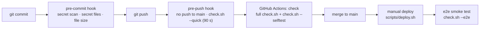

# Contributing to RippleTwin

Thanks for your interest. RippleTwin was built by Team Uncapped at the FEIT Hackathon Festival 2026 (University of Melbourne, 29 Sep – 1 Oct 2026) and is now maintained by [@Zemmeng](https://github.com/Zemmeng) on a best-effort basis. Bug reports, fixes and documentation improvements are welcome; open an issue before starting anything large.

This guide covers local setup, the repository layout, how to run the demo and the tests, the quality gate every change goes through, and the conventions for branches, commits and docs.

## Prerequisites

| Tool | Version | Used for |
|---|---|---|
| git | any recent | everything; `apps/site/build.mjs` needs a git work tree |
| bash | 3.2+ (macOS's bundled bash is fine) | `scripts/*.sh`, the git hooks and every `test.sh` |
| Node.js | 20+ (`apps/sumo` tests need 20.6+) | the engine, the Workers and the JS tests |
| Python | 3.9+ (standard library only) | `scripts/check.sh` helpers, `apps/web/build.py`, the Python tests |
| GitHub CLI (`gh`) | recommended | opening PRs, checking CI, detecting your handle in `setup.sh` |

Wrangler is not installed globally: every Worker module (`api`, `site`, `sumo`, `web`) pins it as a devDependency, so `npm ci` in that module is enough. Docker is only needed to build the SUMO container image in `apps/sumo`, and the offline Python data pipelines (`apps/roads`, `apps/web/tools/sumo`) list their own packages in `requirements.txt`. None of these are needed to run the demo or the tests.

## Setup

```bash
git clone https://github.com/Zemmeng/rippletwin.git
cd rippletwin
bash scripts/setup.sh
```

`setup.sh` is idempotent. It checks the tools above, enables the repository's git hooks (`git config core.hooksPath .githooks`), copies `.env.example` to `.env` if you have none, records your GitHub handle in `git config hack.me`, and finishes with `bash scripts/check.sh --quick`. It never commits, pushes or reads key values.

## Repository layout

```
apps/<module>/   eight self-contained modules, each with README.md (Owner: @handle) and test.sh
docs/            architecture, interfaces, data sources, decisions, pitfalls, and the hackathon archive
scripts/         check.sh (quality gate), secret-scan.sh, setup.sh, deploy.sh
.githooks/       pre-commit and pre-push hooks
.github/         CI workflows, CODEOWNERS, PR and issue templates
hackathon.conf   event metadata read by the scripts and two module tests
```

| Module | What it is | Local port |
|---|---|---|
| `sim` | Swanston St / La Trobe St junction simulation on real traffic volumes (static page) | 4174 |
| `roads` | Data pipeline: Melbourne CBD road network, SCATS flows, signals, GTFS transit, walking network, buildings, equipment (static JSON) | — |
| `web` | The six-step workbench UI; zero-build, `src/` is concatenated into `public/index.html` by `build.py` | 4175 |
| `engine` | Pure-JS traffic engine (browser and Node): route choice driven by sign readings and road-user parameters | — (`node apps/engine/tools/demo.mjs`) |
| `api` | Cloudflare Worker: sign reading (LLM with keyword-rule fallback), plan explanations, worksite register, hire quote and export pack | 8788 |
| `params` | Literature-sourced behaviour parameters with confidence levels (static JSON) | — |
| `site` | Same-origin Worker that serves every module's `public/` and forwards `/api/*` | 8790 |
| `sumo` | Worker and Cloudflare Container that ran Eclipse SUMO on the real network, plus the pre-computed replays in `public/` | 8791 |

Module owners are listed in [`.github/CODEOWNERS`](.github/CODEOWNERS) and in the registry in [`apps/README.md`](apps/README.md). Module interfaces, data formats and the HTTP API are specified in [`docs/reference/interfaces.md`](docs/reference/interfaces.md).

## Running the demo locally

The `site` Worker serves the whole demo from one origin, exactly as in production:

```bash
cd apps/site
npm ci
npm run dev          # node build.mjs && wrangler dev --port 8790
```

Open <http://localhost:8790/web/public/>. The root `/` redirects there, and `/?list` shows the module directory.

- `build.mjs` copies only **git-tracked** files from each `apps/<module>/public/`. After adding a file, `git add` it and restart `npm run dev`.
- To serve `/api/*` locally as well, start the API Worker first in a second terminal: `cd apps/api && npm ci && cp .dev.vars.example .dev.vars && npm run dev` (port 8788). The example keeps `MOCK=1`, so signs are read with keyword rules and no LLM is called. Wrangler's local dev registry connects the `site` service binding to that session.
- `/api/sumo/*` has no local backend unless you run `apps/sumo` (which needs Docker). The page then falls back to the pre-computed SUMO replays in `apps/sumo/public/`, as the live site does.

Individual modules can be previewed on their own ports (see the table above and each module's README), but anything that loads data from other modules needs the `site` origin.

## Tests

Every module has a `test.sh` that needs no `npm install` and no network:

```bash
bash apps/engine/test.sh        # one module
bash scripts/check.sh           # every module, plus the other checks
```

The `test.sh` contract, enforced by checks [4] and [5]:

- it is executable in git (mode `100755`; use `git update-index --chmod=+x apps/<module>/test.sh`);
- its **last line** is exactly `N passed, M failed`;
- it exits non-zero when anything fails;
- it runs offline in its own directory; `check.sh` runs it with `MOCK=1` and a time limit (`CHECK_TEST_TIMEOUT`, 120 s by default).

The counts are assertion counts from small zero-dependency runners (for example `apps/api/tests/mini.mjs`), not test-case counts.

## Quality gate

One script, `scripts/check.sh`, is shared by the pre-push hook, CI and the deploy script, so a change is judged the same way everywhere. It never prints secret values, kills a timed-out test's whole process group, runs on macOS's bash 3.2 and Python 3.9, and is covered by its own self-test.



| Stage | What runs | Blocks on |
|---|---|---|
| `pre-commit` | `secret-scan.sh --staged`; staged secret files (`.env`, `.dev.vars`, `*.pem`, ...); staged files over 1 MB (2 MB for `apps/*/public/*.json`, 10 MB for `docs/hackathon/pitch/*.pdf`) | any hit |
| `pre-push` | refuses pushes to `main` and pushes of anything other than the current HEAD; then `check.sh --quick` (70 s per test, 90 s overall) | any ❌ or a missing summary line; an overall timeout lets the push through with ⚠️ |
| CI (`check.yml`) | full `check.sh --base origin/main` and `check.sh --selftest` on every PR and every push to `main` | any ❌ or a failed self-test scenario |
| `scripts/deploy.sh` | identity (`DEPLOYER` / `BACKUP_LEAD` in `hackathon.conf`), clean tree, `main` or a pushed tag in sync with `origin`, freeze rule, full `check.sh`, then each module's `npm run deploy` and `check.sh --e2e` | any failed preflight check |

Every `check.sh` run ends with a summary block: one line `======== Summary X ❌ Y ⚠️`, followed by every ❌ and ⚠️ line again. The whole output is also written to `logs/last-check.txt`. Exit codes: 0 = no ❌, 1 = at least one ❌, 2 = usage error.

| Mode | Command |
|---|---|
| Full (all files, all tests) | `bash scripts/check.sh` |
| Quick (only files and modules changed since the merge-base with `origin/main`) | `bash scripts/check.sh --quick` |
| Different base | `bash scripts/check.sh --base <ref>` |
| Live smoke test (`GET /` with `data-smoke`, `/api/health` with `"ok":true`, no localhost, ≤ 3 s each) | `bash scripts/check.sh --e2e [URL]` |
| Self-test of the gates in throwaway repos | `bash scripts/check.sh --selftest` |

### The nine checks

| # | Check | ❌ (must fix) | ⚠️ (warning) |
|---|---|---|---|
| [1] | Secret scan | a staged or tracked line matches a key or token pattern (AWS, OpenAI, Anthropic, GitHub, Google, Slack, PEM, JWT, Bearer, generic `key=`/`token=`/`password=` assignments, ...); only `path:line:pattern` is printed | — |
| [2] | Secret files tracked | a tracked `.env`, `.env.*`, `.dev.vars*`, `settings.local.json`, `keys.json`, `credentials*.json`, `*.pem` or `*.key` (`*.example` is allowed) | — |
| [3] | Branch & module boundary | changes committed on `main`; a branch name that does not match the convention below; on a module branch, files outside `apps/<module>/`, or deleted lines in the append-only `docs/decisions.md` / `docs/pitfalls.md` | the same cases when `ALLOW_MAIN=1` / `ALLOW_CROSS=1` is set; a `lead/*` branch used by someone other than `LEAD` / `BACKUP_LEAD` |
| [4] | Module structure | `apps/<module>/` without a `README.md` containing an `Owner:` line, or without an executable `test.sh` | the owner is still a placeholder |
| [5] | Module tests | a `test.sh` fails, times out, exits non-zero or does not end with `N passed, M failed` | leftover background processes had to be killed |
| [6] | Repo hygiene | a tracked file over 1 MB (2 MB for `apps/*/public/*.json`, 10 MB for `docs/hackathon/pitch/*.pdf`) | files over 500 KB; large untracked files; shell scripts with CRLF endings, without the executable bit, or with `$var` directly followed by a non-ASCII character |
| [7] | RULES block | `README.md` does not contain exactly one `<!-- RULES:BEGIN -->` … `<!-- RULES:END -->` pair | — |
| [8] | Handoff notes | — | a note in `handoff/` with a bad file name, a missing heading (`## 1. Facts`, `## 2. Shared files to change`, `## 3. For the lead`, `## 4. Next steps`) or older than 12 h (an event-time practice; the event's notes are archived in `docs/hackathon/handoff/`) |
| [9] | hackathon.conf | the file is missing or malformed, `TZ` or a time is invalid, or `START` is not before `DEADLINE` | duplicate or missing keys; empty `DEADLINE` / `LEAD` / `DEPLOYER`; `DEMO_URL` not linked from `README.md`; a `DEPLOY_MODULES` entry with no `apps/` directory |

### Escape hatches

Each bypass exists for a real situation. Use it only then, and say why in the commit or PR.

| Bypass | Effect | Acceptable when |
|---|---|---|
| `ALLOW_MAIN=1 git push` | lets the pre-push hook push to `main`; check [3] reports changes on `main` as ⚠️ instead of ❌ | a small maintainer fix (a typo, a config value) that does not merit a PR; give the reason in the commit message |
| `ALLOW_CROSS=1 git push`, plus the `cross-module` label on the PR | check [3] reports out-of-module files and non-conforming branch names as ⚠️; CI sets the variable when the label is present | an agreed change that must touch several modules at once, such as an interface change applied to producer and consumer together |
| `git commit --no-verify` / `git push --no-verify` | skips the local hook entirely | the hook itself is broken, or the pre-push run is too slow for an unrelated reason; CI still runs the full check, so explain it in the PR. Never to get a secret past the scanner |

## Branches and pull requests

- Never commit directly to `main`; every change goes through a pull request, which is squash-merged.
- Module work: `<handle>/<module>/T<n>-<slug>`, for example `alice/engine/T42-detour-cap`. `<module>` is one of the eight directory names under `apps/`, `T<n>` is a task or issue number, and the slug is short, lowercase and hyphenated. Check [3] infers the module from the name and keeps the change inside `apps/<module>/`.
- Maintainer work that spans the repository (docs, CI, cross-cutting refactors): `lead/<slug>`. Check [3] allows the whole repository on these branches and warns when the identity (`git config hack.me`, or `GITHUB_ACTOR` in CI) is not `LEAD` or `BACKUP_LEAD` in `hackathon.conf`.
- Keep a branch up to date by merging `main` into it. Do not rebase or force-push a branch that has been pushed.
- Fill in the PR template, including the `======== Summary` line from `bash scripts/check.sh --quick`.

## Commit messages

```
engine: cap detour share at junction capacity

Explain why, not just what. Mention how it was tested and any decision
it relates to (for example D-0929-1435 in docs/decisions.md).
```

- Start the subject with the module name (`sim`, `roads`, `web`, `engine`, `api`, `params`, `site`, `sumo`) or `docs`, `ci`, `scripts`; write it in the imperative mood and keep it under about 72 characters.
- Write new commits in English. The history from the event (26 Sep – 1 Oct 2026) is mostly in Chinese; the team decided not to rewrite it (D-0930-0133), because that would need a force-push.

## Adding a module

1. Create `apps/<name>/` with a lowercase ASCII name matching `^[a-z][a-z0-9-]*$`.
2. Add `README.md` with an `Owner: @handle` line (check [4]).
3. Add an executable `test.sh` that follows the contract above; check [5] discovers it automatically.
4. Register the module in the table in `apps/README.md` (owner, local port) and add `/apps/<name>/ @handle` to `.github/CODEOWNERS`.
5. Put static files in `apps/<name>/public/`; `apps/site` serves the git-tracked ones at `/<name>/public/` with no further configuration.
6. If the module is deployed on its own, give it a wrangler config and an `npm run deploy` script (or a `deploy.sh`), and add it to `DEPLOY_MODULES` in `hackathon.conf`. Order matters: a Worker that others bind to must come first.
7. Document its interface in `docs/reference/interfaces.md`.

## Documentation conventions

- `docs/decisions.md` and `docs/pitfalls.md` are **append-only**. Add a row; never edit or delete an old one. To reverse a decision, append a new row that names the one it supersedes. Both files use git's `union` merge driver (`.gitattributes`), and check [3] rejects deleted lines on module branches.
- Decision IDs use `D-MMDD-HHMM`. A pitfall row records the symptom, the root cause and the fix.
- When a module interface changes, update `docs/reference/interfaces.md` in the same PR as the code on both sides.
- `docs/hackathon/` is the archive of the event. Treat it as a historical record: fix broken links, but do not update its content to match the current code.
- Use ASCII file and directory names, Australian/British spelling and sentence-case headings.
- Use placeholders such as `<YOUR_KEY>`, `your_api_key` or an ALL-CAPS variable name for example credentials in docs; realistic-looking values trip check [1].

## Security

Do not report vulnerabilities in public issues. See [SECURITY.md](SECURITY.md).
