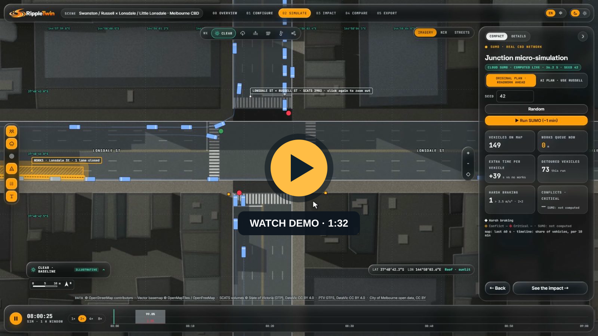

<h1 align="center">
  <picture>
    <source media="(prefers-color-scheme: dark)" srcset="docs/images/logo-dark.png">
    
  </picture>
</h1>

<p align="center"><b>Model the road closure before the barriers go out.</b></p>

<p align="center">
  <a href="#award"></a>
  <a href="https://hackathon-site.zemmmeng.workers.dev/web/public/"></a>
  <a href="https://youtu.be/tb_P3QXtKkw"></a>
  <a href="https://github.com/Zemmeng/rippletwin/actions/workflows/check.yml"></a>
  <a href="LICENSE"></a>
  <a href="NOTICE.md"></a>
</p>

<p align="center">
  <a href="https://hackathon-site.zemmmeng.workers.dev/web/public/">Live demo</a> ·
  <a href="https://youtu.be/tb_P3QXtKkw">Video</a> ·
  <a href="docs/architecture/README.md">Architecture</a> ·
  <a href="docs/README.md">Docs</a> ·
  <a href="docs/hackathon/README.md">Hackathon archive</a>
</p>

<p align="center">
  <a href="https://youtu.be/tb_P3QXtKkw"></a>
</p>

RippleTwin is a digital twin of the Melbourne CBD for temporary traffic management. A planner closes a lane on a real street, places the barriers, signs and variable message signs (VMS) they would actually hire, and sees the queue, the delay, where drivers detour and what it costs tram and bus riders and pedestrians, before any equipment goes out. A language model reads the signs the way four types of road user would, a deterministic engine in the browser computes the impacts from open data, and Eclipse SUMO cross-checks the main scenario on the real street network.

> [!NOTE]
> **Winner of the RPM Hire Prize** at the FEIT Hackathon Festival 2026, Faculty of Engineering and Information Technology, University of Melbourne (Challenge 5, *Future Cities: Digital Tool for Temporary Infrastructure*). Built by Team Uncapped, five people, in about 50 hours from 29 September to 1 October 2026.

## Contents

- [Highlights](#highlights)
- [How it works](#how-it-works)
- [Architecture](#architecture)
- [Example: one lane closed on Lonsdale Street at 8 am](#example-one-lane-closed-on-lonsdale-street-at-8-am)
- [What is real and what is assumed](#what-is-real-and-what-is-assumed)
- [Getting started](#getting-started)
- [Repository layout](#repository-layout)
- [Testing and quality gates](#testing-and-quality-gates)
- [Project status](#project-status)
- [Documentation](#documentation)
- [Team](#team)
- [Award](#award)
- [Acknowledgements](#acknowledgements)
- [Contributing](#contributing)
- [License](#license)
- [Citation](#citation)

## Highlights

- **Deterministic traffic engine in the browser.** Plain JavaScript with no dependencies, running on the real 1,513-link CBD road network. A full evaluation takes a few milliseconds, and the tests assert byte-identical output for identical input. ([engine](docs/architecture/engine.md))
- **The LLM reads signs; it never does arithmetic.** For each road-user type, the model reports whether a sign is noticed, understood and trusted, and which road it points to. The engine turns those readings into route shares, calibrated so that a plain warning diverts about 3% of drivers and a named detour about 20%, the rate seen in a field study. Plan explanations drop any sentence containing a number the engine did not produce, and the call budget fails closed: no budget, no call. ([sign reading](docs/architecture/sign-reading.md))
- **Eclipse SUMO on the real street network.** During the event, SUMO 1.27.1 ran in a Cloudflare Container behind a rate-limited Worker and simulated the full 08:00–09:00 hour around the works. Pre-computed replays, stamped with the SHA-256 of the script that generated them, are the fallback, and the page always says which source it is showing. ([traffic simulation](docs/architecture/traffic-simulation.md))
- **Zero-build front end.** Hand-written HTML, CSS and JavaScript, concatenated into one page by a 42-line Python script: no bundler, no CDN JavaScript and no map tiles at runtime. English by default, with a 中文 toggle. ([front end](docs/architecture/frontend.md))
- **Real open data, labelled assumptions.** OpenStreetMap, eight weeks of SCATS traffic-signal counts, PTV timetables and City of Melbourne pedestrian and building data, all prepared offline. Every assumed value is labelled on screen, with a range where one exists. ([data sources](docs/data/sources.md))
- **One quality gate everywhere.** `scripts/check.sh` runs nine checks, from a secret scan and module boundaries to every module's tests (about 2,770 assertions, nothing to install), in the git hooks, in CI and before every deploy. ([contributing](CONTRIBUTING.md#quality-gate))
- **One origin on Cloudflare Workers.** A site Worker serves every module's static files and routes `/api/*` to the API Worker (KV cache, Durable Objects) through service bindings. There is no CORS, and the LLM key never reaches the browser. ([deployment](docs/architecture/deployment.md))

## How it works

The workbench walks a planner through six steps.

| Step | What happens |
|---|---|
| **00 Overview** | Pick a street on the map or one of the two demo plans, and see the real data behind the map. |
| **01 Configure** | Close one lane or all lanes, choose the hour and the footpath treatment, write the VMS frames and static signs (checked against the sign-text rules as you type) and review the pre-simulation checks. |
| **02 Simulate** | Watch the hour play out: a SUMO micro-simulation on the real street network for the Lonsdale demo plan; elsewhere, an in-browser junction animation with assumed signal timing. |
| **03 Impact** | Queue, delay, detours, trams and buses, pedestrians, nearby works that clash, how each road-user type read the signs, and which inputs are real and which are assumed. |
| **04 Compare** | Read the rule-based advisor's suggestions, then compare three equipment plans (A Minimum, B Standard, C Guided) side by side, with assumed hire costs and an optional plain-language explanation. |
| **05 Export** | Choose a plan, record who decided and why, then print a one-page execution pack (equipment list, hire quote, VMS schedule, set-up checks, who to notify) or copy the response playbook. |

<table>
  <tr>
    <td width="33%" align="center"><br><sub><b>00 Overview</b></sub></td>
    <td width="33%" align="center"><br><sub><b>01 Configure</b></sub></td>
    <td width="33%" align="center"><br><sub><b>02 Simulate</b></sub></td>
  </tr>
  <tr>
    <td width="33%" align="center"><br><sub><b>03 Impact</b></sub></td>
    <td width="33%" align="center"><br><sub><b>04 Compare</b></sub></td>
    <td width="33%" align="center"><br><sub><b>05 Export</b></sub></td>
  </tr>
</table>

## Architecture

<picture>
  <source media="(prefers-color-scheme: dark)" srcset="docs/images/architecture-dark.svg">
  
</picture>

Everything is served from one origin. The browser loads the web app, the engine and the open data as static files and computes every engine number locally. The site Worker forwards `/api/*` to the API Worker (sign reading, plan explanation, worksite register) and, during the event, `/api/sumo/*` to the SUMO container. The code is split into eight modules, each owning one directory under [`apps/`](apps/README.md) with its own README and `test.sh`:

| Module | What it does | Owner |
|---|---|---|
| [`engine`](apps/engine/README.md) | Deterministic traffic-impact engine: detours, route choice per road-user type, queues, tram, bus and pedestrian impacts, clash cost of overlapping works, equipment options and a rule-based advisor | @Zemmeng |
| [`web`](apps/web/README.md) | The six-step workbench: canvas map of the CBD, plan editor, simulation playback, impact, comparison and export | @unicornnnnnny |
| [`api`](apps/api/README.md) | Cloudflare Worker: LLM sign reading with keyword-rule fallback, number-checked plan explanation, worksite register, hire quote and execution pack | @jinmingq |
| [`sumo`](apps/sumo/README.md) | Eclipse SUMO in a Cloudflare Container behind a Worker proxy, the browser client and the pre-computed replays | @Zemmeng |
| [`roads`](apps/roads/README.md) | Offline Python pipeline that turns open data into the CBD network, traffic flows, transit, footpaths, buildings, basemap and equipment inventory | @louisxie316-dotcom |
| [`params`](apps/params/README.md) | Behaviour and valuation parameters, each with a source, a range and a confidence rating | @Unzzip |
| [`site`](apps/site/README.md) | The single public origin: serves every module's `public/` folder and routes `/api/*` through service bindings | @Zemmeng, @unicornnnnnny |
| [`sim`](apps/sim/README.md) | The team's first prototype: a micro-simulation of the Swanston St × La Trobe St junction on real counts | @Zemmeng |

The [architecture overview](docs/architecture/README.md) follows one plan from page load to export and records the key design decisions.

## Example: one lane closed on Lonsdale Street at 8 am

The main demo plan closes the right-hand lane of Lonsdale St westbound, near Swanston St, on a weekday from 08:00 to 09:00. About 1,140 vehicles an hour were counted on that link; with one lane closed, it is assumed to pass 810 an hour (1,800 veh/h × ½ × 0.9). The barriers, arrow board and static sign stay the same in every variant. Only the words on the VMS change.

| Standard sign: `ROADWORK AHEAD` | One more frame: `USE RUSSELL ST` |
|---|---|
|  |  |

**Engine** (whole CBD network, one hour, sign readings from the pre-computed DeepSeek answers that ship with the site):

| | `ROADWORK AHEAD` | `ROADWORK AHEAD` ▸ `USE RUSSELL ST` |
|---|---|---|
| Drivers who detour | 14% | 35% |
| Queue behind the works at 09:00 | 918 m | 538 m |
| Extra time per affected vehicle | 8.5 min | 4.0 min |
| Extra delay across the network | 10,493 vehicle-minutes | 5,629 vehicle-minutes (−46%) |
| Extra delay for tram and bus riders (15 routes, about 1,900 riders an hour at assumed loads) | 18,693 rider-minutes | 10,991 rider-minutes (−41%) |

**SUMO** (micro-simulation on the real street network around the works, seed 42, assumed signal timing; read from [`apps/sumo/public/real/index.json`](apps/sumo/public/real/index.json)). It compares the original sign with the advisor's wording `USE RUSSELL / SAVE 9 MIN`, labelled "AI plan" on the page. The share of drivers who detour is an input to SUMO, taken from the engine's result for each wording when the run was made:

| | Original plan: `ROADWORK AHEAD` (14% detour) | AI plan: `USE RUSSELL / SAVE 9 MIN` (53% detour) |
|---|---|---|
| Vehicles that detoured | 73 | 287 |
| Vehicles held up by the works at 09:00 | 278 | 87 |
| Physical queue on Lonsdale St at 09:00 | 246 m | 260 m |
| Vehicles past the works in the hour | 805 | 788 |
| Extra time per vehicle bound for the works | +533 s | +396 s |
| Extra time per vehicle, all traffic in the area | +38.6 s | +39.8 s |

How to read these numbers:

- The stronger wording sends more drivers around the works, so fewer are held up and those bound for the works lose less time. The physical queue on Lonsdale St is about the same, because the open lane passes cars at its capacity either way, and the network-wide average barely moves: diversion moves delay onto Russell, Little Bourke and Swanston streets rather than removing it.
- SUMO is a cross-check between two models, not a validation. Counted the engine's way, SUMO's queue for the original sign is 973 m against the engine's 918 m, but both rely on the same assumed 810 veh/h capacity, so the agreement is partly by construction. It is one seed, with assumed signal timing and turn shares.
- On this plan the workbench shows SUMO's numbers. The engine figures are what it shows for every other street, and what the engine computes behind the scenes. The full SUMO metrics and their definitions are in [traffic simulation](docs/architecture/traffic-simulation.md#seed-42-results), and the engine's calculation is in the [worked example](docs/architecture/engine.md#worked-example).

## What is real and what is assumed

The page labels which is which, everywhere. No RippleTwin output has been validated against the observed outcome of real roadworks, so every queue, delay and detour figure is a model estimate.

- **Real, open data:** 1,513 directed road links and 805 nodes from OpenStreetMap; hourly SCATS detector counts for eight weeks (1 August to 27 September 2026); PTV timetables for 22 tram and 25 bus routes; City of Melbourne pedestrian counts; 2,508 buildings. Everything was downloaded ahead of time by the scripts in [`apps/roads/tools/`](apps/roads/tools/), and no data API is called at runtime.
- **Assumed, and labelled:** 1,127 of the 1,513 link flows (74%) are interpolated from nearby detectors; 29 of the 37 behaviour parameters have low or no confidence and are shown with a range; equipment quantities and day rates are the team's own, because RPM Hire publishes no prices; riders per tram and bus trip; signal timing and turn shares in SUMO and in the in-browser simulation; and the weather layer, which is illustrative only.
- **Calibrated, not taken from the model:** a named detour diverts about one driver in five, as observed at two motorway sites outside Oslo (Erke, Sagberg & Hagman, 2007). A model's reading is treated like a stated intention, which overstates real behaviour: in London, only one-fifth as many drivers diverted as a survey predicted (Chatterjee et al., 2002).
- **Back-tested:** the engine ignores weather, and a back-test against eight weeks of real hourly weather found that rain barely changes CBD car volumes (wet-hour ratio 0.998, 95% CI 0.985–1.015).

Details, the parameter confidence table and the full reference list (11 sources, each checked on 30 September 2026) are in [assumptions and validation](docs/data/assumptions-and-validation.md). Licences and attribution lines for every dataset are in [data sources](docs/data/sources.md).

## Getting started

**Prerequisites:** Node.js 20 or later, Python 3.9 or later and git. Docker is needed only to build the SUMO container image. The tests need no installs at all, and the demo's only dependency, Wrangler, comes in through `npm ci`.

```bash
git clone https://github.com/Zemmeng/rippletwin.git
cd rippletwin
bash scripts/setup.sh        # checks the tools, enables the git hooks, creates .env, then runs a quick check
```

**Run the whole demo locally.** The site Worker serves the page, the engine, the data, the pre-computed sign readings and the SUMO replays from one origin, exactly as in production:

```bash
cd apps/site && npm ci && npm run dev    # → http://localhost:8790/web/public/
```

Sign wordings outside the pre-computed set are read by keyword rules in the browser. To serve `/api/*` as well, start the API Worker in a second terminal: `cd apps/api && npm ci && cp .dev.vars.example .dev.vars && npm run dev`. The example keeps `MOCK=1`, so no LLM is called.

**Run the tests:**

```bash
bash scripts/check.sh --quick    # files and modules changed since origin/main; look for "======== Summary 0 ❌"
bash scripts/check.sh            # full: all nine checks and every module's tests
bash apps/engine/test.sh         # a single module
```

**Optional: a real LLM.** In `apps/api/.dev.vars` (copied from [`.dev.vars.example`](apps/api/.dev.vars.example)), set `MOCK=0` and `LLM_API_KEY` to a key for DeepSeek or any OpenAI-compatible provider (`LLM_BASE_URL`, `LLM_MODEL`). The file is git-ignored. See [re-enabling the LLM](apps/api/README.md#status-and-re-enabling-the-llm).

## Repository layout

```text
.
├── apps/                 eight self-contained modules, each with README.md and test.sh
│   ├── engine/           traffic-impact engine (plain JavaScript, browser and Node)
│   ├── web/              six-step workbench UI (src/ → build.py → public/index.html)
│   ├── api/              Worker: sign reading, plan explanation, worksite register, execution pack
│   ├── sumo/             SUMO container service, browser client and pre-computed replays
│   ├── roads/            offline open-data pipeline → public/cbd/*.json
│   ├── params/           sourced behaviour parameters (public/params.json)
│   ├── site/             same-origin gateway Worker
│   └── sim/              first prototype: single-junction micro-simulation
├── docs/
│   ├── architecture/     overview, engine, sign reading, traffic simulation, front end, deployment
│   ├── reference/        module interfaces, data formats and HTTP API
│   ├── data/             data sources, assumptions and validation
│   ├── hackathon/        archive of the event: brief, plan, task board, specs, pitch, handoff notes
│   ├── images/           logos, screenshots, diagrams, award certificate
│   ├── decisions.md      decision log with rejected alternatives
│   └── pitfalls.md       problems hit during the build and how they were fixed
├── scripts/              setup.sh, check.sh (quality gate), secret-scan.sh, deploy.sh
├── .githooks/            pre-commit and pre-push hooks
├── .github/              CI workflows, CODEOWNERS, issue and pull request templates
├── hackathon.conf        event metadata read by the scripts
└── CONTRIBUTING.md  SECURITY.md  NOTICE.md  CITATION.cff  LICENSE
```

## Testing and quality gates

Every module has a `test.sh` that needs no `npm install` and no network, and ends with the line `N passed, M failed`. Together they run about 2,770 assertions on small zero-dependency runners built on Node and the Python standard library. One script, `scripts/check.sh`, is the gate for every change: a secret scan, tracked secret files, branch and module boundaries, module structure, module tests, repository hygiene, the rules block in this README, handoff notes and `hackathon.conf`. The pre-push hook runs it in quick mode, GitHub Actions runs it in full on every pull request and push to `main` (with a self-test that proves each gate turns red when it should), and the deploy script runs it before every deploy. See [the quality gate](CONTRIBUTING.md#quality-gate) for each check and its escape hatches.

## Project status

The hackathon is over. The project is complete as a demo and is maintained on a best-effort basis.

- **Live:** the [live demo](https://hackathon-site.zemmmeng.workers.dev/web/public/) still runs on the `hackathon-site` and `hackathon-api` Workers, with the build deployed on 1 October 2026. Later commits translate code comments, documentation and developer-facing messages into English without changing behaviour, so some API error messages on the live site are still in Chinese.
- **Retired after the event:** the SUMO Cloudflare Container and the `hackathon-sumo` Worker (`/api/sumo/*` now returns `502 sumo_down`), and the DeepSeek API key (`/api/health` reports `llm.mode: "rules"`).
- **Fallbacks in use:** steps 02 and 03 replay the pre-computed seed-42 SUMO run, labelled "pre-computed (cloud unavailable)". Step 04's per-plan SUMO cells show "—", because the per-plan comparison has no pre-computed fallback. The 92 pre-computed DeepSeek sign readings still ship with the site, and any new wording is read by keyword rules.
- **History:** commit messages and pull request titles from the event are in Chinese; the team agreed not to rewrite public history. The untranslated tree at the end of the event is kept in the tag [`hackathon-final`](https://github.com/Zemmeng/rippletwin/tree/hackathon-final).

How to bring SUMO back is in [`apps/sumo/README.md`](apps/sumo/README.md#redeploying), and the full deployment picture is in [deployment](docs/architecture/deployment.md#post-event-status).

## Documentation

| Topic | Where |
|---|---|
| Documentation index | [docs/README.md](docs/README.md) |
| Architecture | [Overview](docs/architecture/README.md) · [Traffic engine](docs/architecture/engine.md) · [Sign reading](docs/architecture/sign-reading.md) · [Traffic simulation](docs/architecture/traffic-simulation.md) · [Front end](docs/architecture/frontend.md) · [Deployment](docs/architecture/deployment.md) |
| Reference | [Module interfaces, data formats and HTTP API](docs/reference/interfaces.md) |
| Data | [Data sources](docs/data/sources.md) · [Assumptions and validation](docs/data/assumptions-and-validation.md) |
| Decisions and lessons | [Decision log](docs/decisions.md) · [Pitfalls](docs/pitfalls.md) |
| The event | [Hackathon archive](docs/hackathon/README.md) · [Submission notes](docs/hackathon/submission.md) |
| Modules | [apps/README.md](apps/README.md) and each module's README |
| Contributing and security | [CONTRIBUTING.md](CONTRIBUTING.md) · [SECURITY.md](SECURITY.md) |

## Team

Team **Uncapped**. Module ownership is recorded in [`.github/CODEOWNERS`](.github/CODEOWNERS).

| Member | Role | Main work |
|---|---|---|
| [@Zemmeng](https://github.com/Zemmeng) | Team lead, architect and integrator | Traffic engine, SUMO cloud service, same-origin site Worker, first junction prototype, wiring between the UI and the engine, LLM integration, CI and tooling |
| [@unicornnnnnny](https://github.com/unicornnnnnny) | Front end and UI; designated deployer | The web workbench: CBD map, liquid-glass UI, full-CBD layer, six-step workflow, logo |
| [@jinmingq](https://github.com/jinmingq) | API and LLM module; pitch | Sign reader, API Worker, worksite register, plan explanation, hire quote and execution pack; comparison and export UI; 4×4 in-browser junction simulation; first native SUMO back end |
| [@louisxie316-dotcom](https://github.com/louisxie316-dotcom) | Data engineering | Road network, SCATS flows, signals, PTV transit, walking network and pedestrian counts, buildings, equipment inventory; weather back-test |
| [@Unzzip](https://github.com/Unzzip) | Research | Behaviour parameters from the literature with confidence ratings; OpenStreetMap vector basemap; first English README and repository clean-up |

The team wrote the specs and made every product decision. AI coding assistants (Claude Code, OpenAI Codex) wrote much of the code, tests and documentation from those specs; how they were used is disclosed in the [submission notes](docs/hackathon/submission.md#2-ai-tools-used).

## Award

<p align="center">
  
</p>

Team Uncapped won the RPM Hire Prize ($1,000) at the 2026 FEIT Hackathon Festival. RPM Hire sponsored Challenge 5, the challenge RippleTwin was built for.

## Acknowledgements

- The Faculty of Engineering and Information Technology at the University of Melbourne, for running the FEIT Hackathon Festival 2026.
- RPM Hire, for sponsoring Challenge 5 and the prize.
- The data providers: OpenStreetMap contributors; the Department of Transport and Planning, Victoria, and Public Transport Victoria, through DataVic; City of Melbourne Open Data; OpenMapTiles and OpenFreeMap; and Open-Meteo.
- The Eclipse SUMO project and its contributors.
- Deepika Rao, author of [liquid-glass.js](https://github.com/sven1577/liquid-glass) (MIT), from which the refraction effect on the glass panels is adapted.

Full attributions and licences are in [NOTICE.md](NOTICE.md).

## Contributing

Bug reports, fixes and documentation improvements are welcome; open an issue before starting anything large. Three ground rules apply to every change:

<!-- RULES:BEGIN -->
1. **One task = one branch = one pull request.** Never commit directly to `main`.
2. **Write only inside your own module.** Shared files are append-only; a change that has to span modules goes through an agreed cross-module pull request.
3. **Secrets live only in `.env` files or Wrangler secrets.** Never in git, chat, issues or handoff notes; documentation names the variable, never the value.
<!-- RULES:END -->

They are enforced by the pre-push hook, by check [3] with [`.github/CODEOWNERS`](.github/CODEOWNERS), and by the pre-commit secret scan and CI. Setup, branch naming, commit format and the full checklist are in [CONTRIBUTING.md](CONTRIBUTING.md); to report a vulnerability, see [SECURITY.md](SECURITY.md).

## License

The code is released under the [MIT License](LICENSE), copyright 2026 Team Uncapped.

The data files derived from OpenStreetMap, [`apps/roads/public/cbd/network.json`](apps/roads/public/cbd/network.json), `walk.json`, `buildings.json` and `vectormap.json`, are distributed under the [Open Database License (ODbL) 1.0](https://opendatacommons.org/licenses/odbl/1-0/), not MIT: © OpenStreetMap contributors. Other datasets carry their own licences and attribution lines; see [NOTICE.md](NOTICE.md).

## Citation

If you use RippleTwin in your work, please cite it using the metadata in [CITATION.cff](CITATION.cff); GitHub's "Cite this repository" button generates APA and BibTeX entries from it.
