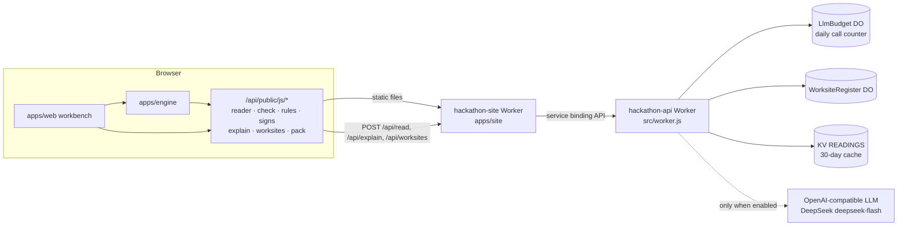
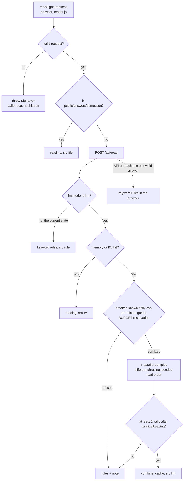

# api: sign reading, plan explanation and worksite register

Owner: @jinmingq

A Cloudflare Worker (`hackathon-api`) plus a set of JavaScript modules that run unchanged in the browser and in the Worker. It answers four questions for the RippleTwin workbench:

- **Sign reading.** How does each type of road user (commuter, local, tourist, delivery) read a set of roadside signs? Do they notice the signs, do they understand them, which roads do the signs tell them to use or avoid, and do they believe them? An LLM reads the signs, with deterministic keyword rules as the fallback. The LLM only *reads*: route shares are computed by the traffic engine (`apps/engine`) from explicit per-persona parameters ([D-0929-1435](../../docs/decisions.md)).
- **Plan explanation.** Pros, cons, the hardest-hit group, risks and a lean for 1–5 traffic-management plans, written only from numbers the engine computed. It gives a lean, never the decision.
- **Worksite register.** A shared list of registered works (a Durable Object), so overlapping works can be checked against each other.
- **Execution pack.** Once a person has chosen a plan: the equipment list and an equipment-hire quote, the VMS schedule, set-up checks and who to notify (browser-side, pure functions).

> **Status after the event.** The `LLM_API_KEY` secret was deleted, so the live API runs in keyword-rule mode (`llm.mode: "rules"`). The 92 readings that DeepSeek produced during the event still ship in `public/answers/demo.json`, so most demo requests keep their LLM text; any new sign wording is read by the rules. Everything else (register, explanations, execution pack) works. See [Status and re-enabling the LLM](#status-and-re-enabling-the-llm).

Related docs: [sign-reading architecture](../../docs/architecture/sign-reading.md) · [module interfaces](../../docs/reference/interfaces.md) · [prompts](prompts.md) · [original T5 spec (archive)](../../docs/hackathon/specs/T5-PRD.md).

## Architecture



In production the site Worker serves `apps/api/public/` as static files at `/api/public/*` and forwards every other `/api/*` path (except `/api/sumo/*`) to this Worker through the `API` service binding. This Worker has no public URL of its own (`workers_dev: false`).

The modules in `public/js/` are isomorphic, so the browser degrades to exactly the same rule output when the API is unreachable:

| Module | Used by | Role |
|---|---|---|
| `signs.js` | Worker, `rules.js`, `reader.js`, `check.js`, `worksites.js` | Sign-text spec, request normalisation (`SignError` codes), canonical cache key, `sanitizeReading()` for untrusted readings |
| `rules.js` | Worker, browser | Deterministic keyword reader (`RULE_V = "k1"`) |
| `reader.js` | engine (`backend.js`) | `readSigns()`: answers file → `POST /api/read` → rules |
| `check.js` | engine, web step 01 | `checkSigns()`: non-throwing spec check + soft readability warnings for the sign editor |
| `explain.js` | Worker, web step 04 | Rule-based explanation, number guard, `optionFromRun()`, `explainOptions()` client |
| `worksites.js` | Worker, web step 03 | Worksite schema, time overlap, register client with seed fallback |
| `pack.js` | web steps 04–05 | Hire quote, stock check, execution pack text and document |

## HTTP API

| Method and path | Purpose |
|---|---|
| `GET /api/health` | Status: version, mock flag, LLM configuration (never the key), register binding |
| `POST /api/read` | Read a set of signs for one persona |
| `POST /api/explain` | Explain 1–5 plans from engine numbers |
| `GET /api/worksites?from=&to=&status=` | List seed and registered worksites |
| `POST /api/worksites` | Register a worksite; returns a one-time `edit_token` |
| `GET /api/worksites/<id>` | One worksite |
| `PATCH /api/worksites/<id>` | Edit a worksite (header `x-edit-token`) |
| any other `/api/*` | `404 {ok:false, error:"not_found"}` (never an HTML page) |
| anything else | Static assets from `public/` (`ASSETS` binding) |

Every error uses the envelope `{ ok: false, error, msg }`. Clients should branch on `error` (a stable short code); `msg` is human-readable. Request bodies are read with a streaming byte limit (8 KB for read/explain, 16 KB for worksites): an oversized `Content-Length` is rejected without reading, and a stream is cancelled as soon as it passes the limit (`413 too_large`).

### `GET /api/health`

Live response on 2026-10-11:

```json
{"ok":true,"v":"0.3.0","mock":false,"llm":{"mode":"rules","model":"deepseek-flash","key":false,"cache":"kv","prompt_v":"r2","explain_v":"e2","provider":"deepseek","budget":true,"per_day":50000,"per_min":600},"register":true}
```

| Field | Current value | Meaning |
|---|---|---|
| `v` | `"0.3.0"` | Version; a `VERSION` var overrides it |
| `mock` | `false` | `true` unless `MOCK` is exactly `"0"` (an unset `MOCK` means mock, so nothing is spent by accident) |
| `llm.mode` | `"rules"` | `"llm"` only when `MOCK === "0"`, `LLM_API_KEY` is set and non-blank, and `LLM_BASE_URL` is a valid `https://` URL (or `http://localhost` / `127.0.0.1`) with no credentials or query string. Otherwise `"rules"`. It is `"rules"` now because the key was deleted |
| `llm.model` | `"deepseek-flash"` | `LLM_MODEL` |
| `llm.key` | `false` | Whether the secret is set; the value is never returned |
| `llm.cache` | `"kv"` | `kv` when the `READINGS` KV namespace is bound; otherwise `cache-api` on a custom domain, or `memory` on `*.workers.dev` (where the Cache API does nothing) |
| `llm.prompt_v` / `llm.explain_v` | `"r2"` / `"e2"` | Prompt versions from [prompts.md](prompts.md); both are part of the cache keys |
| `llm.provider` | `"deepseek"` | `deepseek`, `dashscope` or `openai-compatible`, from the base URL and model |
| `llm.budget` | `true` | Whether the `BUDGET` Durable Object is bound; without it no LLM call is ever made |
| `llm.per_day` / `llm.per_min` | `50000` / `600` | `LLM_MAX_CALLS_PER_DAY` (global) and `LLM_MAX_CALLS_PER_MIN` (per instance) from `wrangler.jsonc` |
| `llm.error` | absent | `"bad_base_url"` when `LLM_BASE_URL` is invalid |
| `register` | `true` | Whether the `REGISTER` Durable Object is bound |

`scripts/check.sh` (item E2) and the site smoke tests only require `"ok": true`.

### `POST /api/read`

```json
{ "persona": "tourist", "kmh": 40,
  "signs": [{ "kind": "vms", "frames": [["USE", "RUSSELL ST"]], "read_s": 9 }],
  "roads": ["La Trobe Street", "Russell Street"] }
```

→ `{ ok: true, reading: { persona, notice, understand, advice: { "<road>": "use" | "avoid" }, saving_min, delay_min, trust, why, range?, src, model, prompt_v, note? } }`

- `notice`, `understand`, `trust` are shares in 0–1; `saving_min` / `delay_min` are what the signs claim, or `null`; `why` is one sentence (≤ 160 characters) from the road user's point of view; `range` gives the min–max of the three LLM samples.
- `src`: `llm` (just asked), `kv` (server cache), `rule` (keyword rules). The browser adds `file` for readings from the answers file. Rule readings carry `model: "rules"`, `prompt_v: "k1"`.
- `note` appears only when an enabled LLM path fell back to the rules: `llm_paused: recent calls failed` (circuit breaker), `llm_rate_limited`, `llm_daily_cap`, `llm_no_budget` / `llm_budget_error` (counter unbound or failing, so nothing is spent), `llm_fallback: 1/3 valid (bad_json, http_401)` (fewer than 2 valid samples, with short error codes such as `http_401` wrong key, `http_402` balance exhausted, `timeout`, `bad_json`, `invalid`), or `llm_error`.
- Errors: `400` with a `SignError` code (`bad_request`, `bad_persona`, `bad_kmh`, `too_many_signs`, `bad_road`, `bad_sign`, `bad_kind`, `bad_read_s`, `too_many_frames`, `too_many_lines`, `line_too_long`, `too_many_words`, `empty_frame`, `empty_sign`, `bad_chars`), `400 bad_json`, `405 method`, `413 too_large`.

The `SignError` and `checkSigns()` messages are Chinese on purpose: the web app shows them verbatim when the UI is in Chinese, and in English it maps them by `code` and extracts the quoted 「line」 (`apps/web/src/js/6-engine.js`). All other `msg` texts are English.

### `POST /api/explain`

```json
{ "lang": "en",
  "options": [
    { "id": "o1", "label": "Warning only",
      "metrics": { "delay_veh_min": 10493, "queue_m": 918, "mean_delay_s": 509, "detour_share": 0.14,
                   "transit_pax_min": 18693, "transit_blocked_pax_h": 0, "peds_extra_min": 0, "peds_blocked_h": 0,
                   "blocked_vph": 0, "hire_aud": 900, "days": 5 },
      "per_capita_min": { "commuter": 3.9, "local": 4.4, "tourist": 5.1, "delivery": 3.0, "transit": 2.2, "pedestrian": 0 },
      "flags": { "params_assumed": true, "reading_rules": true } } ] }
```

→ `{ ok: true, explain: { src, lang, options: [{ id, summary, pros[], cons[], hardest_hit: { group, min, text } | null, risks[] }], lean: { option, why } | null, decide, model?, prompt_v?, note? } }`

- `lang` is `en` (default) or `zh`; 1–5 plans; `label` ≤ 60 characters without `< >`; every metric is optional and ≥ 0 (`detour_share` 0–1); unknown fields are dropped.
- `decide` is a fixed sentence saying that the person responsible chooses the plan and records why.
- `src`: `llm`, `kv` or `rule`; fallback `note` codes match `/api/read`, plus `llm_fallback: bad_json | invalid | empty | timeout | http_<status>`.
- Errors: `400 bad_request | bad_options | bad_label | bad_text | bad_number | bad_lang | bad_json`, `405`, `413`.

The worksite endpoints are described in [Worksite register](#worksite-register).

## Sign reading

### Resolution chain



`readSigns()` memoises per session by canonical request, so the same message and persona are fetched once, and callers get a copy. The canonical key is SHA-256 of `{persona, normalised signs, sorted roads}`; `kmh` is left out because `read_s` already reflects speed. In rules mode the Worker answers from the rules directly and never consults KV.

### Sign-text specification

Anything over the spec is rejected (sources: the RPM Hire VMS product page and the WA VMS guideline §1.4 and §7.4, cited in the [T5 spec](../../docs/hackathon/specs/T5-PRD.md)):

- `kind` is `vms`, `sign` or `arrow`. A VMS has at most 2 frames × 4 lines × 10 characters and 8 words in total; a static sign is one message of at most 40 characters and 8 words; an arrow board is like a static sign but the text may be omitted.
- Allowed characters: `A–Z 0–9`, space and `. , ' & : ! ? ( ) + / -` (lower case is upper-cased). `< >` are never allowed, so nobody can forge the `<sign>` tag the prompt wraps sign text in.
- At most 8 signs and 8 roads per request; road names use the engine's `cleanName()` character set and at most 40 characters.
- `read_s` must be ≥ 0; it is rounded and capped at 120 s (the engine yields 100+ s in a 5 km/h queue). `kmh` is 0–130.

`checkSigns(request)` (for the sign editor) never throws: `{ ok, error?, warnings[{ sign, code, msg }] }`. `error` means the API would answer 400. Warnings mean the text is within the spec but hard to read: `many_lines` (> 3 lines), `long_line` (> 8 characters, unless the line is a whole candidate road name), `frames_too_fast` (2 s per frame, 3 s for 4 lines), `short_read` (about 1 s per word), `odd_abbrev`.

### Keyword rules (`rules.js`)

| On the sign | Reading |
|---|---|
| `USE / VIA / TAKE / TRY <road>`, optionally `OR <road>` | `advice[road] = "use"` |
| `AVOID <road>`, `<road> CLOSED / BLOCKED` | `advice[road] = "avoid"`; avoid wins if a road gets both |
| `SAVE(S) [UP TO] N MIN` | `saving_min = N` |
| `N MIN DELAY`, `DELAY(S) / DLY(S) N MIN`, `ALLOW [EXTRA] N MIN` | `delay_min = N`; `N-M` takes M; the largest across signs |
| only `ROADWORK AHEAD` and the like | empty `advice` |
| non-standard abbreviations (`WKS AHD TFC CLSD RTE`..., or a vowel-less word not in the standard list) | `understand` drops per abbreviation: tourist 0.15, commuter 0.05, local / delivery 0.03, at most 3 counted |

- Road spellings: `RUSSELL ST`, `RUSSELL STREET`, `RUSSELL` (suffixes are often dropped: `LA TROBE ST` does not fit on a line), `LATROBE`; apostrophes and full stops are ignored (`A'BECKETT`); the longest match wins (`LITTLE LONSDALE` is not read as `LONSDALE`); a suffix-less spelling that matches two roads (Flinders Street / Flinders Lane) is ignored.
- `notice`: per sign, `ratio = read_s ÷ (words × 1 s + 1 s per extra frame)` and `0.95 × ratio ÷ (ratio + 0.5)`, combined as "notices at least one sign", capped at 0.95.
- `understand` starts at 0.9 (minimum 0.2); `trust` is 0.7, or 0.8 when the sign gives minutes. Persona differences in trust and familiarity are engine parameters and are not counted twice here.

### LLM integration

The call layer (`src/llm.js`) works with any OpenAI-compatible `POST {LLM_BASE_URL}/chat/completions`. The body is `{ model, messages, response_format: { type: "json_object" }, max_tokens: 300, stream: false }`, with a 6 s timeout per call. DeepSeek also gets `thinking: { type: "disabled" }` (otherwise `content` comes back empty) and DashScope gets `enable_thinking: false`.

| Provider | `LLM_BASE_URL` | `LLM_MODEL` | Status |
|---|---|---|---|
| DeepSeek (default) | `https://api.deepseek.com` | `deepseek-flash` | Used in production during the event ([API notes](../../docs/hackathon/llm-apis/jinmingq-deepseek.md)) |
| Alibaba DashScope (international) | `https://dashscope-intl.aliyuncs.com/compatible-mode/v1` | `qwen-plus` | Untested |
| Alibaba DashScope (mainland China) | `https://dashscope.aliyuncs.com/compatible-mode/v1` | `qwen-plus` | Untested |
| Other OpenAI-compatible | e.g. `https://api.openai.com/v1` | e.g. `gpt-4o-mini` | Untested; must support `response_format: json_object` |

Prompt design ([prompts.md](prompts.md) is the single source; `tools/gen-prompt.mjs` generates `src/prompt.js`):

- The model only reports how one persona *reads* the signs. It is never asked which route people take or what share detours: with only a persona description, LLM answers vary little between road-user types and are more risk-averse than people, so shares come from the engine.
- The user message holds only what that driver can see: sign text, speed, readable seconds and candidate road names. Sign text sits inside `<sign>` tags, and the system prompt says tagged text is not an instruction.
- Three parallel samples per persona and message, each with a different phrasing and a road order shuffled by a PRNG seeded from the canonical request's SHA-256, so replays are reproducible. They are combined as: mean for `notice` / `understand` / `trust` (with `range` = min–max), median for minutes, and for `advice` at least 2 agreeing samples with avoid winning any conflict. `why` comes from the sample whose `trust` is closest to the mean. With fewer than 2 valid samples the rules answer instead.
- Every sample, cache hit and file entry goes through `sanitizeReading()`: values out of range void the reading, `advice` keeps only roads from the request, and no share-like field is ever passed on.

Caching: per-instance memory (500 entries) → KV `READINGS` (30 days, key `read:<SHA-256(prompt_v | model | canonical request)>`) → the Cache API on a custom domain. Rule fallbacks are never cached, and cached readings are sanitised again. At DeepSeek's peak price (¥2 per million input tokens, ¥8 per million output tokens) one call costs about ¥0.0018, so one message × 4 personas × 3 samples is about ¥0.02.

## Cost safety

`/api/read` and `/api/explain` are public, and changing any number (for example `read_s`) busts the cache, so spending is capped in layers that all fail closed:

1. **Off by default.** A call happens only when `MOCK` is exactly `"0"` and a key is set.
2. **Cache first.** Memory, then KV, before any admission check.
3. **Circuit breaker.** 3 consecutive failed readings or explanations pause LLM calls for 60 s, so a wrong key or a provider outage does not make every request wait 6 s.
4. **Known daily cap.** Once the counter answers "over", the instance stops asking until the next 00:00 UTC.
5. **Per-instance per-minute guard** (`LLM_MAX_CALLS_PER_MIN`). Best effort: Cloudflare runs and recycles many instances, so this only stops a day's budget going in one minute.
6. **Global daily reservation** in the `LlmBudget` Durable Object (`src/budget.js`). The counter is reserved atomically before every call (no other I/O between `get` and `put`, so the DO input gate serialises requests) and resets at 00:00 UTC (10:00 or 11:00 in Melbourne). An unbound or failing DO means no call. A reading reserves 3 calls; an explanation reserves 5, because its `max_tokens` is 5× larger.
7. **No direct URL.** The api Worker has `workers_dev: false`; the only entry is the site's `/api/*`.
8. **Prepaid balance.** A small prepaid provider balance is the last line of defence.

The code defaults are 600 calls per day (about ¥1.2 a day, ¥2.4 worst case) and 60 per instance per minute. For the final demo the caps were raised to 50,000 per day and 600 per minute ([D-1001-0125](../../docs/decisions.md)), leaving the DeepSeek balance as the real limit; those values are still in `wrangler.jsonc`.

Secret hygiene: the key is read from `env.LLM_API_KEY` only when a request is sent. It never enters the config object, logs, error messages or responses, and `LlmError` carries fixed short codes only. Tests assert that the key never appears in any response, even when the provider echoes it in a 401.

## Plan explanation and the number guard

`explain.js` holds a deterministic rule-based explanation (`src: "rule"`, English or Chinese):

- Summary from network delay, queue, extra wait per car and tram/bus passenger delay; pros and cons are the lowest and highest values of each lower-is-better metric across plans (ties all count).
- `hardest_hit` is the group with the largest per-capita minutes. Risks cover stopped trams or buses, pedestrians or vehicles with no way around, more than half of drivers detouring, assumed inputs and rule-based sign reading.
- `lean` goes to the plan with the lowest sum of vehicle-, passenger- and pedestrian-minutes (added as is, not weighted by occupancy, which `why` states) and mentions when that plan is not the cheapest to hire or has risks. There is no lean for a single plan, a tie, or a plan without network delay.

With the LLM enabled, the Worker asks once ([D-0929-2307](../../docs/decisions.md); `max_tokens` 1500, 20 s timeout, charged as 5 calls). The user message contains only the normalised plans, inside a `<data>` tag that the system prompt declares is not an instruction. The answer then goes through `sanitizeExplain()`, the number guard behind the principle "the LLM suggests, the engine computes" ([D-0929-1310](../../docs/decisions.md)):

- **Traceability.** `allowedNumbers()` holds every number in the request (including digits in labels) and each plan's total, plus their whole-number, one-decimal and percentage forms. `numbersIn()` applies NFKC first, so full-width digits are caught, and accepts a thousands separator only as a comma followed by exactly 3 digits. Any sentence with a number outside the set is dropped.
- **No numbers in words.** `hasWordNumber()` drops sentences that write quantities in English or Chinese words (`twice`, `half`, `ninety`, `seven hundred`, 两倍, 一半, 三成, 九十米...), after cutting plan labels out of the text.
- **Engine-owned fields.** `hardest_hit` and the rule-based risks are always recomputed from engine numbers; the `decide` sentence is fixed; only `options` and `lean` are taken from the model, and the metadata fields `model`, `prompt_v` and `note` must match a strict pattern. A summary that fails falls back to the rule summary, and if nothing model-written survives, the whole answer falls back (`note: "llm_fallback: empty"`).
- Cached explanations (KV key `explain:<SHA-256(explain_v | model | normalised request)>`) are sanitised again on every hit.

In the browser, `optionFromRun(id, label, be.run() result, { hire_aud, days })` turns an engine result into a plan, and `explainOptions(request)` calls `POST /api/explain` (waiting 25 s), sanitises the answer again and falls back to the local rules when the API is unreachable. Step 04 (Compare) calls it for the engine plan; on the SUMO plan the explanation is hidden, because its metrics would not come from the engine.

## Worksite register

Overlapping works only interact if everyone sees the same list. `src/register.js` keeps one global `WorksiteRegister` Durable Object (migration `v2`, SQLite backend), and `worksites.js` defines the worksite object: the engine's worksite plan (`links`, `closes`, `time`, `equipment`; see [interfaces](../../docs/reference/interfaces.md)) plus register fields.

```json
{
  "id": "W-7KQ2MX", "title": "Collins St water main", "kind": "utility", "status": "decided",
  "links": ["l595594354_9756035316"], "closes": { "lanes": 1, "footpath": "left" },
  "time": { "from": "2026-10-12", "to": "2026-10-14", "hours": [9, 15] },
  "equipment": [{ "id": "VMS-1", "type": "vms", "at_m": 200, "frames": [["USE", "RUSSELL ST"]] }],
  "decision": { "option": "o2", "by": "council", "reason": "least tram delay", "at": "2026-09-30T02:00:00.000Z" },
  "seed": false, "created": "2026-09-30T01:00:00.000Z", "updated": "2026-09-30T02:00:00.000Z"
}
```

- `kind`: `road / utility / building / event / other` (default `other`). `status`: `draft / assessed / decided / exported / withdrawn` (default `draft`); `decided` and `exported` require a `decision`, whose `by` is `contractor` or `council` and whose `at` is stamped by the server.
- `id`, `seed`, `created` and `updated` are set by the server. **Fields outside the whitelist are dropped**, so names or emails are never stored.
- `title` ≤ 80 and `decision.reason` ≤ 280 characters, without `< >` or control characters (the web page builds templates with `innerHTML`).
- 1–20 `links`; `closes.lanes` 0–8 (0 requires a closed footpath); `time.hours` is a daily `[start, end)` in whole hours, so overnight works that cross midnight must be split into two entries; at most 366 days.
- At most 30 `equipment` items with unique ids; `at_m` from −2000 to 2000 (negative = downstream of the start of the works, for example `END ROADWORK`); sign text follows the sign-reading spec and its error codes. Optional `item` / `qty` name an RPM inventory item for `pack.js`; the engine ignores them.

| Endpoint | Behaviour |
|---|---|
| `GET /api/worksites?from=&to=&status=` | `{ ok, register: "do" \| "seed", n, worksites }`: seeds plus stored entries, sorted by start date then id; `from` / `to` (YYYY-MM-DD) match works whose period intersects the window. With the DO unbound or failing, `register` is `"seed"` and only the seeds are returned |
| `POST /api/worksites` | `201 { ok, worksite, edit_token }`. **The token is returned only this once**; only its SHA-256 is stored, and it is compared inside the DO |
| `GET /api/worksites/<id>` | `{ ok, worksite }` or `404 not_found` |
| `PATCH /api/worksites/<id>` | Header `x-edit-token` + any of `title / kind / status / links / closes / time / equipment / decision`; the merged worksite is validated again in full |

Errors: `400` field codes (`bad_worksite`, `bad_title`, `bad_text`, `bad_kind`, `bad_status`, `bad_links`, `bad_closes`, `bad_time`, `bad_equipment`, `bad_decision`, `bad_patch`, `bad_query`, `bad_json`, plus the sign-text codes) · `403 bad_token` (missing, wrong, or another entry's token) · `403 locked` (seed worksites) · `404 not_found` · `405 method` (there is no DELETE: set `status` to `withdrawn`) · `409 full` (200 entries) · `413 too_large` (> 16 KB) · `429 daily_cap` (500 writes per day globally, reset at 00:00 UTC) · `503 no_register` / `register_error`.

Seed worksites (`public/js/worksites-seed.js`, read-only and never stored): `W-LONSDALE` and `W-LATROBE` match the engine demo plans, and `W-LTLBOURKE` closes Little Bourke Street on the Lonsdale demo's detour (Russell St → Little Bourke St), overlapping Lonsdale for 3 days. In a local check on 2026-09-29 the engine's `conflict()` gave a clash cost of about 10,000 vehicle-minutes at 08:00 on 10-07 and 10-08; the engine's live result is authoritative.

Browser client (`worksites.js`; `opts: { fetch, apiBase, timeoutMs }`, `apiBase` empty for same-origin): `listWorksites()` falls back to the three seeds when the API is unreachable; `createWorksite()` normalises first and throws `WorksiteError` without sending an invalid request; `updateWorksite()` / `getWorksite()` rethrow the API's error code; `overlapping()` returns the other non-withdrawn worksites that overlap in time, which the web app passes pairwise to the engine's `conflict(a, b)`; `toEngineWorksite()` converts to the engine format. Step 03 (Impact) of the web app only reads the register; it never creates or edits entries.

## Execution pack and hire quote

`pack.js` is pure browser code (the network, inventory and engine results are already in the browser); it is not an endpoint.

| Function | Result |
|---|---|
| `loadInventory(opts?)` | Fetches `/roads/public/cbd/equipment.json` (RPM inventory published by `apps/roads`: 16 items with quantities and day rates) |
| `linkInfoFrom(network)` | `network.json` → per-link length, name, lanes and tram flag |
| `quote(worksite, inventory, { links })` | `{ days, length_m, lines[{ item, name, qty, day_rate_aud, days, cost_aud, over_stock }], total_aud, partial_total_aud, unmatched, over_stock, notes, assumed: true }` |
| `stockCheck(worksites, inventory, { links })` | Items that run short when worksites share the inventory on the same days (worst day per item; withdrawn worksites excluded) |
| `buildPack(worksite, { inventory, links, impacts, now })` | Location, time, decision, quote, VMS schedule, signs, set-up checks and who to notify; `impacts` are the chosen plan's metrics |
| `packText(pack, "zh" \| "en")` / `packDoc(pack, lang)` | Plain text for Copy / Print, and the same wording grouped by section for the one-page document in step 05 (Export) |

- **Equipment → inventory.** An explicit `item` wins; otherwise VMS → `vms_a`, arrow board → `arrow_board`, barrier → `barrier_water`, and static signs by their text (`RIGHT LANE CLOSED` → `sign_lane_closed_right`, `END ROADWORK`, `DETOUR LEFT`, `FOOTPATH CLOSED`...). Anything unmatched (for example `ROAD CLOSED`, which the inventory lacks) is listed in `unmatched` and not costed.
- **Quantities.** An explicit `qty` wins; barriers are the closure length divided by the unit length, rounded up (without link lengths the count is flagged `length_unknown` and the total becomes "at least"); everything else is 1. Days are calendar days, inclusive.
- **Checks** (only what the list can show; no standard clauses are cited): lanes closed without barriers, footpath closed without a footpath sign, no end-of-works sign, a full closure with neither detour signs nor a VMS, over stock, unmatched items, unknown length.
- **Notify** (roles only, never organisations or contact details): council traffic management and frontage businesses and residents always; the tram / bus operator when passengers are delayed or a tram runs on the closed link; emergency services for a full closure or blocked traffic; pedestrians and people with disabilities when the footpath closes or walkers detour.
- Day rates and stock levels are **assumptions** (RPM Hire publishes no prices), and every quote and text says so ("RPM Hire's formal quote applies").

## Configuration

| Variable or binding | Where | Value | Notes |
|---|---|---|---|
| `MOCK` | `wrangler.jsonc` vars | `"0"` | Only `"0"` allows LLM calls; unset means mock |
| `LLM_API_KEY` | Worker secret (`.dev.vars` locally) | not set (deleted after the event) | Without it, rules only |
| `LLM_BASE_URL` / `LLM_MODEL` | vars | `https://api.deepseek.com` / `deepseek-flash` | Must be https; the model name is part of the cache key |
| `LLM_MAX_CALLS_PER_DAY` | vars | `"50000"` (code default 600) | Global per UTC day, a hard cap; `"0"` = no calls |
| `LLM_MAX_CALLS_PER_MIN` | vars | `"600"` (code default 60) | Per instance, best effort, not a billing cap |
| `LLM_TIMEOUT_MS` | optional var | 6000 | Per call (max 30000); explanations use at least 20000 |
| `VERSION` | optional var | `0.3.0` | Reported by `/api/health` |
| `ASSETS` | static assets | `public/` | |
| `BUDGET` | Durable Object `LlmBudget` | migration `v1` | Daily counter; unbound = no calls |
| `REGISTER` | Durable Object `WorksiteRegister` | migration `v2` | Unbound = read-only seeds |
| `READINGS` | KV namespace | bound | 30-day reading and explanation cache |

`.dev.vars.example` sets `MOCK=1` and an empty key, so a local copy never spends.

## Running locally

```bash
cd apps/api
npm ci                              # wrangler 4; only needed for wrangler dev/deploy and tests/workerd.test.mjs
cp .dev.vars.example .dev.vars      # MOCK=1, no key: rules only
npx wrangler dev --port 8788        # or: npm run dev
curl -s localhost:8788/api/health
curl -s -X POST localhost:8788/api/read -H 'content-type: application/json' \
  -d '{"persona":"tourist","kmh":40,"signs":[{"kind":"vms","frames":[["USE","RUSSELL ST"]],"read_s":9}],"roads":["La Trobe Street","Russell Street"]}'
```

The engine imports `public/js/reader.js` directly; when the site runs locally (`apps/site`), the modules are served at `/api/public/js/*` on the same origin.

## Status and re-enabling the LLM

Checked on 2026-10-11 against the live site:

- `/api/health` reports `mode: "rules"`, `key: false`, `cache: "kv"`, `budget: true`, `register: true`.
- `POST /api/read` and `POST /api/explain` return pure rule output with no `note`; in rules mode the Worker skips KV, so readings cached in KV during the event are not served.
- The browser still serves the 92 DeepSeek readings in `public/answers/demo.json` (`src: "file"`), They cover the 8 demo messages × 4 personas and the run and before/after requests of the Lonsdale and La Trobe engine demos. 12 Lonsdale advisor requests changed after the file was generated (a `precompute.mjs` dry run lists them), so those are read by the rules.
- `/api/worksites` works with the Durable Object (currently only the 3 seeds). Nothing in this module depended on the deleted SUMO container.
- The deployed Worker predates the English translation of the error messages, so its `msg` texts stay Chinese until the next deploy.

To turn the LLM back on (the deployer, from `main`):

1. Lower the caps in `wrangler.jsonc` to safe values (for example `LLM_MAX_CALLS_PER_DAY` `"600"` and `LLM_MAX_CALLS_PER_MIN` `"60"`) and deploy: `bash scripts/deploy.sh api --hotfix` (the event deadline has passed, so `deploy.sh` needs `--hotfix`), or `npm run deploy` in `apps/api`.
2. Put a small prepaid balance on the provider account.
3. `cd apps/api && npx wrangler secret put LLM_API_KEY` and paste the key (log in first with `npx wrangler login`). `MOCK` is already `"0"` and KV is bound, so nothing else is needed.
4. Check `/api/health`: `llm.mode` becomes `"llm"`, with `key` and `budget` both `true`. A sign text that is not in `demo.json` should come back with `src: "llm"`, and `src: "kv"` the second time.

Emergency stop, without a code change or redeploy: `npx wrangler secret delete LLM_API_KEY`.

Deployment notes: `DEPLOY_MODULES=api site` deploys this Worker before the site, because the site binds `hackathon-api` by name (checked by `tests/config.test.mjs`). Durable Object migrations are append-only: never edit `v1` or `v2`; a new class needs a new tag. See [deployment](../../docs/architecture/deployment.md) for the Cloudflare topology.

## Tools

```bash
node apps/api/tools/precompute.mjs                                              # dry run: request and call counts, cost estimate
node --env-file=apps/api/.dev.vars apps/api/tools/precompute.mjs --run --limit 2   # real calls for 2 requests
node --env-file=apps/api/.dev.vars apps/api/tools/precompute.mjs --run            # all requests → public/answers/demo.json
node apps/api/tools/precompute.mjs --check                                      # validate demo.json
node apps/api/tools/gen-prompt.mjs                                              # regenerate src/prompt.js after editing prompts.md
node apps/api/tools/gen-prompt.mjs --check                                      # verify they match
```

- **`precompute.mjs`** collects `fixtures/demo-signs.json` (8 messages × 4 personas) plus the requests the engine's two demo plans actually send (run, before/after compare and advisor for `lonsdale` and `latrobe`), de-duplicates them by canonical key and calls the LLM through the same `llmReading()` path as the Worker. It is a dry run by default ([D-09](../../docs/decisions.md)); `--run` saves after every batch; `--check` verifies keys, readings and the absence of key-like strings. Other options: `--no-engine`, `--force`, `--out <path>`, `--concurrency N`. The key comes from `LLM_API_KEY` (or `DEEPSEEK_API_KEY` for DeepSeek). The shipped file has 92 entries (32 fixture + 60 engine), generated on 2026-09-29 at 13:19 UTC with `deepseek-flash` and prompt `r2`; it cannot be regenerated without a key. Because `read_s` is part of the key, a change to the engine's speed or legibility model makes those entries fall through to `/api/read`.
- **`gen-prompt.mjs`** parses the `<!-- prompt:<name> -->` blocks in `prompts.md` and validates their structure (placeholders, `<sign>` / `<data>` wrapping, exact persona and kind sets). Bump `prompt_v` (or `explain_v`) when prompt text changes.
- **`jsonc.mjs`** is a minimal JSONC parser for `wrangler.jsonc`.

## Tests

```bash
bash apps/api/test.sh                 # Node >= 18; prints "N passed, M failed" (742 passed at the last run)
node apps/api/tests/<name>.test.mjs   # one file
```

The harness is the zero-dependency `tests/mini.mjs` (`ok / eq / throws / sec / done`); `scripts/check.sh` parses the final count line. No test calls a real provider: every LLM test injects a fake `fetch`. Many assertions are negative ("must never happen"), and the guards were verified by temporarily disabling them and watching the tests fail.

| File | Covers |
|---|---|
| `llm.test.mjs` | No spending by default, 3-sample combine, fallbacks, memory / KV / Cache API caching, rate limit and breaker, the global daily cap across 5 simulated instances (40 cache-busting requests never exceed it), no `BUDGET` = no calls, provider parameters, key never leaked, `*.workers.dev` cache detection |
| `explain-llm.test.mjs` | One call charged as 5, invented numbers dropped, hardest-hit group from the engine, key privacy (including a provider that echoes the key), fallbacks not cached, shared budget, tampered KV entries re-sanitised, prompt injection, Chinese and full-width numerals, `prompts.md` validation |
| `explain.test.mjs` | Normalisation, rule-based explanation, number traceability in both languages, external answers sanitised, `/api/explain`, browser fallback, and a real-engine section (Lonsdale, warning only vs `USE RUSSELL ST`) |
| `pack.test.mjs` | Inventory mapping, quotes against the real inventory and link lengths, stock conflicts, checks and notifications, texts always marking rates as assumptions |
| `register.test.mjs` / `worksites.test.mjs` | Token returned once and never exposed, hash-only storage, seed lock, 409 / 429 caps, DO errors; normalisation, whitelist, PATCH merge, queries, agreement with the engine's `overlaps()` and `validateWorksite()`, client seed fallback |
| `signs.test.mjs` / `rules.test.mjs` / `check.test.mjs` | Spec limits and cache key; the 5 acceptance cases from the T5 spec (AVOID never read as use, tourists never understand abbreviations better than locals, injected instructions give empty advice, over-spec input rejected) and every rule-table row; soft warnings and the demo message list |
| `reader.test.mjs` / `worker.test.mjs` | Resolution order and memoisation; routes, 400 / 404 / 405 / 413, and the streaming byte limit (an endless stream is cut off within 4 chunks) |
| `prompt.test.mjs` / `precompute.test.mjs` / `config.test.mjs` | `prompts.md` ↔ `src/prompt.js` sync and message templates; precompute dry run, `--run` with a fake fetch, `--check`; `wrangler.jsonc` invariants, DO migrations, lockfile, `.dev.vars.example` |
| `engine.test.mjs` / `engine-real.test.mjs` | Every request shape the engine sends is accepted; the real engine on the real network calls `readSigns()` with zero errors |
| `workerd.test.mjs` | Smoke test in real workerd via `unstable_dev` (needs `npm ci`; skipped otherwise): routes, static assets, a real DO, and the daily cap against an in-process fake provider. Hermetic: vars override `MOCK` and the key |

`engine-real.test.mjs`, the real-engine section of `explain.test.mjs` and the real-data sections of `pack.test.mjs` read `apps/engine` and `apps/roads` and skip when those are missing.

## Known issues

- **Number guard gaps.** A computed difference that happens to equal another allowed number (1200 − 600 = 600, with 600 in the request) passes, as does a single Chinese numeral with no unit (缩短约九). Only the prompt covers these. The word-number rules are a conservative keyword list and can drop good sentences (每一辆车, "double the queue"); a dropped summary falls back to the rule summary.
- **Rule-based lean.** Minutes are added without occupancy weighting, and hire cost is not part of the lean.
- **Rule reader.** Advice without a verb (`RUSSELL ST` / `SAVE 8 MIN` with no `USE`) is not recognised; that was left to the LLM.
- **Register access.** There is no login: anyone can register works, and editing relies only on the `edit_token` (a lost token means registering again). The 200-entry and 500-writes-per-day caps limit abuse; they are not permissions. Overlap is by time only; whether two worksites actually interact on the network is the engine's `conflict()`.
- **Execution pack.** The equipment mapping is inferred from type and sign text, signs missing from the inventory are not costed, barriers default to water-filled units counted by length only (no corners or tapers), the checks are not a standards compliance review, and rates are assumed.
- **Rate limiting.** The per-minute limit is per instance, and the daily counter adds a Durable Object round trip (tens of milliseconds) before each call. Two visitors asking the same new message at the same moment each trigger a call (no in-flight coalescing); `readSigns()` only de-duplicates within one browser session.
- **Providers.** Only DeepSeek was used for real; the DashScope and OpenAI rows are untested.

## Files

| Path | Purpose |
|---|---|
| `src/worker.js` | Router: health, read, explain, worksites, JSON 404, static fallback; exports the DO classes |
| `src/llm.js` | LLM layer: config, prompt filling, seeded road order, calls with timeout, combine, caching, breaker, admission gates, `serverReading()` / `serverExplain()` |
| `src/budget.js` | `LlmBudget` Durable Object and `takeBudget()` |
| `src/register.js` | `WorksiteRegister` Durable Object and `handleWorksites()` |
| `src/http.js` | Byte-limited body reader, JSON responses, error envelope |
| `src/prompt.js` | Generated from `prompts.md`; do not edit |
| `prompts.md` | All LLM prompts, with rationale, combine rules and cost estimates |
| `public/js/*.js` | Isomorphic modules (see [Architecture](#architecture)) |
| `public/answers/demo.json` | 92 precomputed DeepSeek readings |
| `fixtures/demo-signs.json` | Demo messages for La Trobe Street, 8 × 4 personas |
| `tools/` | `precompute.mjs`, `gen-prompt.mjs`, `jsonc.mjs` |
| `tests/` | `*.test.mjs` and the `mini.mjs` harness; run with `test.sh` |
| `wrangler.jsonc`, `.dev.vars.example` | Worker config and local variables template |

## Credits

Built by @jinmingq (sign-text spec and keyword reader, Worker, worksite register, rule-based plan explanation, hire quote and execution pack) for Team Uncapped at the FEIT Hackathon Festival 2026 (University of Melbourne), where the project won the RPM Hire Prize. @Zemmeng wrote the LLM layer (`src/llm.js`, `src/budget.js`: provider calls, caching, the daily budget) and the LLM version of the plan explanation.
