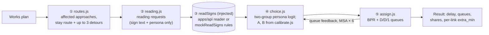

# engine — traffic-impact engine
Owner: @Zemmeng

Given a works plan (closed lanes and footpaths, signs and VMS text, dates and hours) and each road-user type's reading of the signs, the engine works out how many drivers take each route, where queues form, how long the delay is, the knock-on effect on trams, buses and pedestrians, and the extra cost when two worksites overlap. It also builds three inventory-constrained equipment kits and re-scores the rule-based advisor's suggestions.

Following [`docs/hackathon/specs/ai-flow.md`](../../docs/hackathon/specs/ai-flow.md) and decision D-0929-1435 in [`docs/decisions.md`](../../docs/decisions.md): the LLM only *reads* the sign text; every share, minute and queue length is computed here.

Plain ES modules with no dependencies and no DOM access, imported directly in the browser and in Node. Deterministic: the same input always gives the same output. A single `evaluate` on the real 1,513-link CBD network takes about 1–5 ms on a laptop (first call ≈ 4 ms, warm median ≈ 1 ms); the automated gate in `tests/e2e.test.mjs` is < 100 ms.

## Role in RippleTwin

- **The LLM reads the signs; the engine does the arithmetic** (D-0929-1435). The reader returns only noticed / understood / trust / which road to use or avoid / quoted minutes. Route shares come from an explicit per-persona logit, calibrated at two points.
- **On the plan SUMO covers** (the Lonsdale St westbound demo works with one lane closed, link `l595594354_9756035316`), the web page shows SUMO's numbers, not the engine's (D-1001-0045). There the engine only supplies the AI sign reading and the detour share *p* = 1 − stay share, which is SUMO's input (`apps/web/src/js/6e-sumo3.js`, `5-app.js`, `8-compare.js`). On every other street or closure the page shows the engine's numbers.
- **After the event** the SUMO container and the LLM key were retired. The engine itself is unaffected: it is static JavaScript served by the `hackathon-site` Worker at `/engine/public/js/*`, so every engine number is still computed live. Sign reading falls back to the 92 precomputed readings in `apps/api/public/answers/demo.json` or to keyword rules, and every reading records its true source.

## How to run

- Demo of the three acts: `node apps/engine/tools/demo.mjs` (toy Hoddle Grid network). Add `--real` to also run act 1 on the real CBD network (Bourke Street eastbound) and print the time per `evaluate`; add `--params apps/params/public/params.json` to use the parameter file.
- In the browser (serve over http, since ES modules do not load from `file://`; the page, engine and data must share an origin): `cd apps/site && npm ci && npm run dev`, then open <http://localhost:8790/web/public/>. The wiring layer is what the page uses:

```js
const be = await (await import('/engine/public/js/backend.js')).connect();
const s = await be.run(be.demo('lonsdale'));   // s.queue_m, s.mean_delay_s, s.routes, s.by_type, s.transit, s.peds, s.flags …
```

- The core on its own:

```js
import { createEngine, mockReadSigns, loadParams } from '/engine/public/js/index.js';
const [network, flows] = await Promise.all(['network', 'flows'].map(f => fetch(`/roads/public/cbd/${f}.json`).then(r => r.json())));
const params = await loadParams();                   // /params/public/params.json; falls back to assumed values, never throws
const engine = createEngine({ network, flows, readSigns: mockReadSigns, params });   // or readSigns from /api/public/js/reader.js
const plan = { when: { date: '2026-10-06', hour: 17 }, worksites: [/* worksite */] };
await engine.prepare(plan);
const result = engine.evaluate(plan);
```

- In Node without a server, import `connect` from `public/js/backend.js` and pass `{ fetch, importer }` backed by local files, as the tests do (`tests/backend.test.mjs`).

## How to test

`bash apps/engine/test.sh` (Node ≥ 18, no `npm install`). Each `tests/*.test.mjs` runs on its own with a 90 s limit and prints `N passed, M failed`; the script prints the total on its last line, which `scripts/check.sh` parses. Any single file also runs standalone, e.g. `node apps/engine/tests/engine.test.mjs`. There are 11 test files and 419 assertions, all passing. The harness is the tiny `tests/_t.mjs` (`ok` / `t` / `done`), with no framework.

The tests read real data from other modules: `apps/roads/public/cbd/*.json`, `apps/params/public/params.json`, and `apps/api/public/js/{reader,check,worksites-seed}.js`. They fail loudly if `network.json` is missing. No network access or API key is needed: fetches and dynamic imports are injected.

| File | What it checks |
|---|---|
| `tests/engine.test.mjs` | Network, shortest paths, BPR, works hours, detours, reading requests, choice model, two-point calibration (exactly 3% / 20%), `evaluate` (determinism, missing readings, full closure with no detour leaves vehicles stuck, two worksites on one link are not double counted, `readSigns` failing entirely does not crash), clash cost, advisor pieces, reading cache |
| `tests/e2e.test.mjs` | The three demo acts with mock readings (08:00 and 17:00); sign position (a sign after the turn has no effect); advisor suggestions re-run. Real network: loads, a single `evaluate` < 100 ms, act 1 goes the right way, detours avoid laneways |
| `tests/backend.test.mjs` | Wiring layer: fallbacks (numbers still come out when the reader or params fail to load; a missing network throws); the real `apps/api` reader and rule check; summary definitions (seconds per vehicle count only affected vehicles); invalid sign text reported; 7 confirmed review findings (a full closure reroutes every vehicle on the closed link, `why` and queue come from the same approach, before / after compares the same stretch, inactive hours flagged, the advisor compares one hour for undated works, the advisor reports reading failures, no `crypto.subtle` falls back to rules). Negative tests: reader errors and full closures with no detour must show in `flags` |
| `tests/params.test.mjs` | Parameter entry: valid values used, missing ones fall back item by item, invalid groups fall back with an error, `sign_trust` conversion, unreadable file never throws, calibration targets follow `params.json`. Negative tests: no fifth persona can be injected, `__proto__` does not pollute, defaults are never modified |
| `tests/peds.test.mjs` | Footpath closures: the main demo (Lonsdale westbound, 08:00, left side) → pedestrians per hour, extra metres per person, extra person-minutes, road crossings; left / right (finding the opposite carriageway on a dual carriageway by parallel overlap) / both; `closes.footpath` validation (`bad_plan`); `blocked` when there is no way round and `dead_end` for dead ends / small islands (small graphs); crossings counted per street (La Trobe = 4); counters must be on the same side; straight streets are not split. Negative tests: no closure / outside hours gives all zeros, the detour neither uses nor runs alongside the closure, missing or late walk / peds data gives `src = null` rather than a pretend 0, no footpath found gives `unmatched`, `connect` does not wait for pedestrian data, footpath closures do not change vehicle numbers |
| `tests/transit.test.mjs` | Trams and buses on the real `transit.json`: Lonsdale at 08:00 delays 15 bus routes, with the extra seconds per trip ≈ those of cars staying on Lonsdale (within 25%); trips / riders / rider-minute definitions; a La Trobe full closure stops tram route 30; a Lonsdale full closure sends buses on the nearest detour (main roads only); junction gaps filled; weekend / off-peak; before / after delta; a missing `transit.json` or a failing transit calculation still gives vehicle numbers. Negative tests: all zeros outside works hours, delay is versus no works rather than free flow, a partial lane closure lists no trams; every bus link fully closed in turn on real data checks detour times, no negative delay and the network-edge rule |
| `tests/ailog.test.mjs` | AI call log (fake reader: file / llm / kv / plain error → rule fallback): entries = calls, all fields present, `src` recorded truthfully, re-running a plan adds no entries; `readingsOf` returns the main approach, signs in driving order, the same `why` as the summary, and copies; ring-buffer limit, subscribe / unsubscribe, callback errors do not affect readings. Negative tests: no extra requests, a rule fallback never passes as the LLM, `SignError` is logged as `error` |
| `tests/options.test.mjs` | Three inventory-constrained kits (real network + real `equipment.json`): tier shapes (Minimum: no VMS; Standard: arrow board + two VMS reporting delay; Guided: one VMS naming the fastest detour), barrier count = ⌈closed length ÷ section length⌉, hire = quantity × day rate × days, quote lines match the kit, single worksite / `when` / `n` / `worksite` inputs, full closure, both footpaths, hire order Minimum < Guided < Standard and detour share Minimum < Standard < Guided with the `apps/api` reader. Negative tests: never over stock (even with very little stock; shortfalls go into `stock.short`), hire always marked `assumed`, VMS text passes `apps/api` `checkSigns`, byte-identical output for the same input, the input is not modified, a missing inventory throws `no_inventory`. Each kit's queue and delay are recorded, not asserted |
| `tests/clash.test.mjs` | `be.clash()` / `be.stagger()` on the Lonsdale demo + the register's Little Bourke St full closure: overlap window (3 days × peak hours 8 and 17), clash cost = D(A+B) − D(A) − D(B) and equal to `engine.conflict()`, stagger stops at the first zero, `back: true` order. Negative tests: Flinders St (baseline over capacity) gives `negative_delay` and `reliable = false` with display fields never negative; same-corridor substitutes give `substitutes` and stay reliable; unreliable stagger attempts never count as best; reader failures make the result unreliable; invalid input throws; deterministic |
| `tests/conflict.test.mjs` | Regression: a single full closure never makes network delay negative — Little Bourke St at 08:00 and 17:00, every "Little … St" / Flinders Lane link with traffic at 08:00 closed in turn, and the components of `conflict(lonsdale, Little Bourke)` |
| `tests/extra.test.mjs` | `links[].extra_min` is versus the same hour with no works: positive on the works links, near zero on Flinders / King St links that queue at the morning peak anyway, negative values kept, and `hot` agrees with `links` |

## Pipeline

A longer write-up of the model is in [`docs/architecture/engine.md`](../../docs/architecture/engine.md).



- **① Routes** (`routes.js`): the works links are chained along the street; the approach runs about 400 m upstream (`UP_M`) and 300 m downstream (`DOWN_M`). Detours turn off at each junction before the works and take the shortest path to the downstream end; they are named after the street they turn into, avoid laneways (`NO_DETOUR`), are dropped if more than 3× slower than usual (`MAX_RATIO`), and at most 3 are kept (`MAX_ALTS`).
- **② Reading requests** (`reading.js`): per persona, one *full* request with every sign on the approach (at most the 6 nearest the works, `at_m ≥ 0`) and one *prefix* request per detour with only the signs before its turn — a sign only names a road if the driver sees it before the turn. Requests carry only text and persona, never positions or queues, so `prepare()` asks each wording once and caches it (`canon.js`); `evaluate()` is then synchronous.
- **③ Sign reading**: injected `readSigns(request)` → `{ notice, understand, trust, advice: { road: use | avoid }, saving_min, delay_min, why, src, model }`.
- **④ Choice** (`choice.js`): each persona splits into a persuaded share *I* = notice × understand × trust (× persona trust) and the rest. Utility = −β × hurry × minutes, plus the visible queue on the stay route; detours carry inertia −A and ln(familiarity); a road the sign names gets +B plus the minutes it says you save. `calibrate.js` solves A, then B, by bisection so the La Trobe reference scene diverts 3% under ROADWORK AHEAD and 20% under USE RUSSELL ST.
- **⑤ Assignment** (`assign.js`): diverted vehicles move from the stay links to the detour links; link time = BPR (α 0.15, β 4) + deterministic D/D/1 queueing; queue length = (v − c) × 7 m ÷ lanes at the end of the hour. Six iterations of the method of successive averages feed the queue drivers see (half the end-of-hour queue) back into route choice.
- **Output**: network delay in vehicle-minutes versus the same hour with no works (a `credit` term stops a closure from ever showing a time saving), per-persona delay, per-link `extra_min`, the 5 hottest links, and missing / blocked flags. `engine.window()` sums delay over sampled hours; `engine.conflict()` returns D(A+B) − D(A) − D(B) (step ⑥). Step ⑦, the advisor, re-runs each suggestion through ⑤.

## Interfaces (→ [`docs/reference/interfaces.md`](../../docs/reference/interfaces.md): Worksite plan, Engine API, Sign reading)

| Export | Use |
|---|---|
| `createEngine({ network, flows, readSigns, params? })` | → `{ prepare(plan), evaluate(plan, { seed }), window(worksites, whens), conflict(a, b, opts), calib, params }`; `engine.params` reports, item by item, whether each parameter came from `params.json` or an assumed value |
| `connect()` in `backend.js` (**the web page's main entry**, D-0929-1540) | Loads network + flows + transit + params + the `apps/api` reader and rule check in one go and builds the engine → `{ run(plan), compare(before, after), advise(plan), options(…), clash(a, b), stagger(a, b), check(plan), validate(plan), demo(name), status(), pedsReady(), aiLog(), onAiLog(fn), readingsOf(summary), lastReadings() }`. Pedestrian data loads in the background and `pedsReady()` resolves when it is done. `run` returns a display-ready summary (`queue_m mean_delay_s routes by_type hot transit peds flags` …, raw result in `.raw`). Reader and params failures fall back and are reported in `status()` / `flags`. Usage and fields: [`docs/hackathon/specs/T13-web-wiring-PRD.md`](../../docs/hackathon/specs/T13-web-wiring-PRD.md) |
| `be.aiLog()` · `be.onAiLog(fn)` · `be.readingsOf(summary)` · `be.lastReadings()` | AI call log: one record per reader call `{ seq, t, persona, signs, roads, kmh, read_s, src, model, ms, reading, fallback?, error? }` (`src` is the true source `file / kv / llm / rule`; rule fallbacks carry `fallback`; `SignError` is logged as `error`), kept in memory as a 200-entry ring buffer (`AI_LOG_MAX`, configurable with `connect({ aiLogMax })`). `readingsOf(s)` = the signs each persona read on that `run()`'s main approach (in driving order) and their readings, without sending any request. Used by `apps/web/src/js/9-ai.js` |
| `transitImpact(net, flows, transit, plan, result)` | Tram and bus impact → `summary.transit`: per affected route the trips, extra seconds per trip, rider-minutes, detour / stoppage; `PAX_PER_TRIP` riders per trip (assumed); `routePaths(net, transit)` gives each route's gap-filled link sequence (used by tests to check whole-trip detours) |
| `pedImpact(walk, peds, plan, { net? })` | Footpath closure (`closes.footpath` ∈ `left / right / both`) → `{ src, footpath, active, day, hour, closed, closed_m, ped_h, detour_m, extra_min, crossings, blocked, blocked_ped_h, dead_end, unmatched, unmatched_sides, note, note_zh, step_free: null, measured, method, sensor, detour, stretches, assumed }` (`footpathActive(plan)` = is a footpath closed this hour). `backend.run` puts it in `summary.peds`. `validatePlan(plan)` / `validateWorksite(worksite)` → list of errors |
| `loadParams({ url?, fetch? })` / `applyParams(json)` | Read `params.json` → `{ mix, personas, anchors, used }`; anything unreadable or invalid falls back item by item to assumed values, never throws |
| `advise(engine, plan, { askAdvisor })` | Step ⑦: get up to 3 suggestions (reword · move equipment · stagger), re-run each and mark it `better` |
| `be.clash(a, b, { hours?, when? })` · `be.stagger(a, b, { maxDays = 7, back? })` | Overlapping works: over the days both are active × peak hours, `engine.conflict()` gives D(A), D(B), D(A+B) and the clash cost (veh·min). Display fields are never negative: a negative D (Flinders St, where the baseline exceeds capacity) → `flags.negative_delay`, `reliable = false`; only the clash cost < 0 (substitutes on one corridor) → `flags.substitutes`, shown as 0, still reliable; reader failures → `reliable = false`. `stagger` shifts b one day at a time until the clash cost is 0 (`best` prefers reliable attempts), and reports network delay before / after over the same period |
| `be.options(worksite \| plan, { n = 3, when?, worksite? })` | Builds Minimum / Standard / Guided traffic-management kits from the RPM Hire inventory, runs each for the same hour, with hire cost (assumed) and a stock check → `{ worksite, when, days, site, inventory, options: [{ id, label, label_zh, plan, hire, stock, result, flags, vs, guide? \| delay? }] }`; see "Inventory-constrained options" below |
| `options.js`: `TIERS` `tierNeeds` `resolveNeeds` `hireOf` `stockOf` `vmsTextOk` `guidedFrames` `delayFrames` `vms2At` `daysOf` `siteOf` `timeErrors` `whenErrors` | The pure building blocks behind `be.options()`: what to place, checking stock (never over), hire cost, VMS text rules |
| `mockReadSigns` / `mockAdvise` | Keyword-rule reader and rule-based advisor (`src: 'rule'`). `mockReadSigns` is the fallback when the `apps/api` reader is unavailable, and a test double. `mockAdvise` is the advisor in use: no LLM advisor was built |
| `makeGrid()` | 5 × 9 toy network for tests and the demo (Hoddle Grid street names, assumed flows) |
| `PERSONAS` `MIX` `chooseShares` `calibrate` … | Choice-model and calibration building blocks (see `index.js`) |

## Parameters (`apps/params/public/params.json`, from @Unzzip)

Format per [`docs/hackathon/specs/T12-params-PRD.md`](../../docs/hackathon/specs/T12-params-PRD.md) §4: each value is `{ value, range, source, confidence }` (a bare number is accepted too); `value: null` = not found → assumed value, not an error. **This table defines the fields the engine accepts.**

| Field | How the engine uses it | If invalid |
|---|---|---|
| `mix.commuter / local / tourist / delivery` | Share of traffic for each of the 4 personas, summing to 1 ± 0.02 (normalised) | Whole group uses the assumed 50 / 25 / 10 / 15 |
| `anchors.generic_warning_divert` | Low calibration point: diversion of all vehicles when the sign says only ROADWORK / AHEAD | Both must be valid (0–1, low < high), otherwise both use 3% / 20% |
| `anchors.named_route_divert` | High calibration point: diversion when the sign says USE / RUSSELL ST | As above |
| `persona.<type>.hurry` | Time pressure, multiplies the per-minute utility (average ≈ 1, 0.05–5) | This item uses the assumed value |
| `persona.<type>.familiar` (alias `route_familiarity`, the name in an early draft of the T12 parameter spec) | Familiarity: the share who know of / would think of this detour (0.02–1, goes into `ln()`; lower bound `FAMILIAR_MIN` in `choice.js`); `familiar` wins if both are given | As above |
| `persona.<type>.trust` | Trust in signs: a **relative multiplier** on the reading's `trust` (average driver = 1, 0–3) | As above |
| `persona.<type>.sign_trust` | Share who follow what the sign says (0–1). For personas without `trust` it converts to `sign_trust ÷ the mix-weighted mean over personas that have a value`; needs at least 2 personas with a value; values above 3 are clipped to 3 | Only 1 persona with a value: one error, `trust` uses the assumed value |
| `persona.<type>.queue_averse` | Queue aversion: multiplies the visible queue (0–5) | This item uses the assumed value |
| `persona.<type>.truck_only` | Restricted to truck routes (boolean) | This item uses the assumed value |

- Values written as strings or booleans (`"0.05"`, `"3%"`) → reported as "is not a number" and the assumed value is used; `value: null` = not found, no error.
- **Accepted but unused** (listed in `engine.params.ignored` with the full path, nested ones too, e.g. `anchors.stated_to_actual`, `persona.commuter.xxx`): `anchors.stated_to_actual` (since D-0929-1435 the LLM no longer returns shares, so the stated → actual conversion is not needed), `value_of_time`, `vms`. To feed one into the model, add a row to this table first, then change the code.
- The absolute level of trust is absorbed by calibration strength B, so only the **relative differences between personas** in `trust` / `sign_trust` change the results.
- Current file: `mix`, both anchors and `familiar` for all four personas come from `params.json`. `named_route_divert` = 0.2 is cited to Erke, Sagberg & Hagman (2007) with high confidence; `generic_warning_divert` = 0.03 is a working assumption with low confidence. The other persona fields are null and use the defaults in `choice.js`.

## External services and data

The engine core makes no network calls and needs no key: readings come from the injected `readSigns`. The wiring layer (`backend.js`) fetches everything from the same origin:

- Road network, flows and transit from `apps/roads`: `/roads/public/cbd/network.json`, `flows.json`, `transit.json` (PTV GTFS, CC BY 4.0). Pedestrian data `walk.json` and `peds.json` (1.7 MB + 1.8 MB) load in the background; `connect()` does **not** wait for them, and `run()` waits (at most 8 s) only when a footpath is closed that hour; failure never throws. `equipment.json` is fetched on the first `be.options()` call.
- Parameters from `/params/public/params.json`.
- The sign reader `/api/public/js/reader.js` and rule check `/api/public/js/check.js`, imported dynamically. The reader looks up precomputed answers in `apps/api/public/answers/demo.json` first and otherwise POSTs to `/api/read` on the `hackathon-api` Worker (which had an LLM behind it during the event and now answers with rules), falling back to its own keyword rules.

## Trams and buses (`public/js/transit.js`)

After the vehicle numbers, `run()` in `backend.js` calls `transitImpact()`; the result is `summary.transit` (fields in [`docs/reference/interfaces.md`](../../docs/reference/interfaces.md), "Trams and buses: `s.transit`"). Model and assumptions:

| What | How | Source |
|---|---|---|
| Which routes are listed | A link the route uses in this direction is fully closed, or the whole trip is > 0.1 s slower than with no works (routes whose trip is not slower overall, because other links got faster, are not listed); and the route has trips this hour | Engine |
| Trips | `trips[wd/we][hour]`, weekday / weekend from the engine's `dayType` | GTFS (apps/roads) |
| Extra seconds per bus trip | Sum over the route's links of (`linkTime` under the plan − `linkTime` in the same hour with no works); `links[].delay_s` cannot be summed directly (it is versus free flow) | Engine |
| Bus meets a full closure | Nearest detour within 400 m before / after the closure (shortest path by travel time under the plan; trunk / primary / secondary / tertiary first, side streets only if needed, laneways never). The turn-off and rejoin points are chosen by the fastest whole trip "route to the turn-off + detour + route after rejoining"; extra seconds = detoured trip − usual trip, never below 0 (skipping a loop of the route does not make the bus faster: an early timetabled bus waits); no detour = `blocked` | Engineering assumption |
| Full closure at the network edge | `transit.json` routes are cut to the CBD network: a full closure within 400 m of where the route enters / leaves the network with no detour inside it → the bus reroutes outside the network, `edge: true`, minutes `null`, not a cancellation (counted in `edge_routes`). Closing each of the 233 bus links at 08:00 in turn, all 56 cases previously judged "cancelled" were of this kind | Engineering assumption |
| Trams | CBD trams run in their own lanes: a partial lane closure does not delay them (not listed); a full closure = `blocked`, reporting only the lost trips and riders, minutes `null` | Engineering assumption |
| Riders per trip | Weekdays 7–9 and 16–18: tram 60, bus 25; otherwise tram 30, bus 12 (ranges in `PAX_RANGE`) | **Assumed**: no per-route PTV loading data |
| Gaps in route links | `transit.json` was matched by 10 m sampling, so short links inside junctions are often missing: where two consecutive links do not connect, the shortest path within 60 m fills the gap (trams only on tracked links) | Engineering assumption |

Measured on the current code and data (engine rule reader, `params.json`): the Lonsdale demo at 08:00 with one lane closed delays 15 bus routes by about 356 s per trip (cars staying on Lonsdale lose about 360 s), 77 trips and 1,925 riders per hour, about 11,400 rider-minutes. With the same link fully closed, buses turn off at Exhibition St and return via Victoria St → Elizabeth St, about 76 s extra per trip. A full closure of the La Trobe demo link stops tram route 30: 6 trips and 360 riders per hour. `transitImpact` takes about 3–5 ms for a full closure and under 1 ms for a one-lane closure on a laptop; no test gates its speed.

## Pedestrians (`public/js/peds.js`)

| Step | How | Assumption |
|---|---|---|
| Which footpaths close | Footpaths in `walk.json` with `road_link` = a works link, matching `side`, and `kind` ∈ `sidewalk / other / path`. For the right side, also the opposite carriageway (same name, opposite direction, ≤ 40 m away) and its `left` footpaths, taking only those that run alongside the works link (angle < 45°, ≤ 65 m laterally) for ≥ min(5 m, half their own length) | Crossings and malls never close; 5 m [assumed] |
| Stretches | Worksite × side × a chain of end-to-end works links whose headings differ by < 60° (a straight street crossing a 45° bearing is not split in two, so pedestrians are not counted twice) | — |
| Origin, destination | The two farthest-apart nodes of the closed footpaths that can still reach ≥ min(60, half the node count) nodes avoiding the closure; fewer than 2 such nodes = dead end (`dead_end`, no detour, not `blocked`) | 60 nodes [assumed: a CBD block perimeter has about 20–40] |
| Extra metres | Shortest path on the (undirected) footpath network avoiding every closure − usual shortest path | Pedestrians take the shortest path |
| Pedestrians | The busiest closed footpath in the stretch this hour (`peds.json`); both sides closed = the two added | Everyone counted walks the full stretch (upper bound) |
| Extra minutes | `ped_h × detour_m ÷ (1.3 m/s × 60)` | Walking speed 1.3 m/s [assumed]; waiting at signals not included |
| No way round | `blocked = true`, pedestrians go into `blocked_ped_h`, not `extra_min` (a scan of the whole network found only 3 such cases, all with both sides of the St Kilda Rd bridge closed) | — |
| Crossings | Consecutive crossing segments on the detour count once (refuge islands split crossings); different street names count separately | — |
| Nearest counter | A counter on a closed footpath first; otherwise ≤ 40 m away and on the same side of the works link centreline | A counter across the road counts different people |
| No footpath found | `unmatched = true` + `note` (about 1/3 of links across the network, for one-side closures: `walk.json` has no footpath mapped on that side) | Not the same as "footpath open as usual" |
| Accessibility | `step_free` is always `null` | `walk.json` has no step / kerb-ramp data |

Measured on the current code and data: Lonsdale westbound at 08:00, left side closed (47 m) → 185 pedestrians per hour, 176 m extra each, 2 road crossings, 417 person-minutes; right side closed (the opposite carriageway's north footpath, 102 m) → 185 per hour, 67 m extra, 158 person-minutes; both sides → 370 per hour, 1,125 person-minutes. La Trobe westbound at 17:00, left / right closed → 818 per hour, 4 crossings, about 1,020 / 1,070 person-minutes.

## Inventory-constrained options (`public/js/options.js` + `be.options()`)

Decision D-0929-2011 item 3: three kits for one worksite, with **every number computed by the engine** (each kit is a `run()` for the same hour). `options()` itself never calls the LLM; each kit's readings go through the same reader chain as `run()` (answers file → `/api/read` → rules), so identical readings give byte-identical output. Before a live demo, the sign texts it generates should be precomputed into the answers file.

| Tier | What it places | Why |
|---|---|---|
| `o1` Minimum | Barriers (water-filled `barrier_water`, count = ⌈closed length ÷ 2 m⌉) + ROADWORK AHEAD + LEFT/RIGHT LANE CLOSED (DETOUR AHEAD for a full closure) + END ROADWORK (at the end of the works, negative `at_m`; `signsOn()` only takes signs with `at_m ≥ 0`, so it is not in the reading request and does not use one of the reader's 6 sign slots) | Minimum compliant set |
| `o2` Standard | o1 + arrow board + **two** VMS reporting delay without naming a road (`delayFrames()`: EXPECT / DELAYS ▸ N MIN, N = whole extra minutes per vehicle on o1's stay route, ≥ 1; under 1 minute → ROADWORK / AHEAD and `flags.no_delay_min`) | Common practice; the most expensive tier |
| `o3` Guided | o1 + arrow board + **one** VMS naming the fastest detour and the minutes saved (the `mockAdvise` wording, e.g. USE / RUSSELL ▸ SAVE / 9 MIN) | One VMS fewer than Standard; relies on the wording alone |

- VMS position: run o1 first, take the fastest detour from the rule-based advisor, and place the VMS 100 m upstream of its turn (rounded to 50); Standard's VMS-1 and Guided's VMS share that position. Standard's VMS-2 goes further upstream (`vms2At()`: at most 500 m; if the modelled upstream stretch is shorter, inside its start, rounded to 50; on Lonsdale 400 m, before the Exhibition St turn). No faster detour → Guided shows ROADWORK / AHEAD and sets `flags.no_faster_detour`. With both footpaths closed, Standard has 7 upstream signs and VMS-2 is pushed out by the reader's 6-sign limit → `flags.vms_read = false`.
- Footpath closures (`closes.footpath`): per side, a row of footpath-capable barriers + one FOOTPATH CLOSED.
- Stock: for each need, the first item in order of preference with enough stock left (water-filled → plastic → steel barriers; VMS type A → type C); if none has enough, only what is left is placed and the shortfall goes into `stock.short`. **No item quantity in a kit ever exceeds stock.** Equipment already held by time-overlapping worksites in the same plan (`equipment[].item / qty`) is subtracted first (`stock.shared_with`). Needs with fewer candidate items are served first (footpaths can only use water-filled barriers), so lane barriers do not cause false shortfalls.
- Input checks (all throw `bad_plan`): links not in the network, a non-existent date or `from` after `to` in `time`, `hours` not `[start, end)`, an invalid `when`. Works inactive at `when` → `flags.inactive`, `flags.ok = false`; a VMS left out of the reading request → `flags.vms_read = false`.
- Hire = quantity × `day_rate_aud` × days (calendar days from `time.from` to `time.to`, inclusive). **Stock quantities and day rates are assumed values** (RPM Hire publishes no prices): `hire.assumed = true`, `flags.assumed`, and the UI labels them as assumptions (D-0929-1536).
- Every equipment entry carries `item` (the `equipment.json` id) and `qty`, matching `equipment[].item / qty` in the interface spec, so `apps/api` `pack.js` can quote the same plan.
- Measured on the current code and data, Lonsdale westbound at 08:00 (queue / network delay / detour share 1 − stay share / hire):

| Reader | o1 Minimum | o2 Standard | o3 Guided |
|---|---|---|---|
| `apps/api` reader (answers file, else its keyword rules) | 918 m / 10,493 veh·min / 0.14 / A$515 | 286 m / 2,927 veh·min / 0.492 / A$2,515 | 82 m / 966 veh·min / 0.605 / A$1,765 |
| Engine's own rules (`mockReadSigns`) | 918 m / 10,493 veh·min / 0.14 / A$515 | 918 m / 10,493 veh·min / 0.14 / A$2,515 | 276 m / 2,800 veh·min / 0.497 / A$1,765 |

The engine's own rules cannot read the minutes in "EXPECT DELAYS / 10 MIN", so with them o2 equals o1. On the La Trobe demo at 17:00 none of the three kits queues, and o3 finds no faster detour.

## Determinism and performance

- No randomness and no clock in the numerics (wall-clock time appears only in AI-log metadata). Adjacency lists are sorted by id, the Dijkstra heap breaks ties first-in first-out, cache keys are canonical JSON, and sorts break ties by name. Tests assert byte-identical JSON for `evaluate`, `options()`, `clash()` / `stagger()`, `transitImpact` and `pedImpact`.
- Measured on a laptop for the Lonsdale demo on the 1,513-link network: `evaluate` first call ≈ 4 ms, warm median ≈ 1 ms; `backend.run()` warm median ≈ 3 ms including transit and the sign check; `options()` for three kits ≈ 7–10 ms. The only automated gate is < 100 ms per `evaluate` (`tests/e2e.test.mjs`). Costs are kept down by the memoised route structure, a cached no-works baseline per day type and hour, and WeakMap-cached transit, footpath and laneway indexes.

## Structure

| File | Role |
|---|---|
| `public/js/index.js` | Every export of the engine core |
| `public/js/backend.js` | Wiring layer: the web page's one-stop entry (dynamically imports `apps/api` `reader.js` / `check.js` by URL; everything else comes from `index.js`) |
| `public/js/pipeline.js` | `createEngine`: prepare / evaluate / window / conflict, successive averages for queue feedback |
| `public/js/choice.js` | Step ④ choice model: per-persona parameters (hurry · familiarity · trust in signs · queue aversion · truck-only) + persuaded share → route shares |
| `public/js/calibrate.js` | Two-point calibration: solves detour inertia A and recommendation strength B on the reference scene |
| `public/js/params.js` | Reads `params.json`, validating and falling back item by item, and reports the source of each item |
| `public/js/reading.js` | Step ② reading requests (all signs + the signs before each detour's turn) and the mock rule reader |
| `public/js/routes.js` | Step ①: affected vehicles, stay route, up to 3 detours (about 400 m upstream, 300 m downstream) |
| `public/js/assign.js` | Step ⑤: assignment, BPR + D/D/1 queues, network total travel time |
| `public/js/options.js` | Inventory-constrained kits: tier needs, stock resolution (never over stock), hire cost, VMS text rules, delay / guidance frames |
| `public/js/net.js` · `worksite.js` · `cards.js` · `canon.js` | Network index and shortest paths · works hours and capacity · sign read time and road-name cleaning · canonical JSON |
| `public/js/advisor.js` | The engine half of step ⑦ + the rule-based advisor |
| `public/js/transit.js` | Trams and buses: route → link sequence (gaps filled), bus delay and detours, tram stoppages, rider-minutes |
| `public/js/peds.js` | Footpath closure → pedestrian detour (shortest path on the footpath network, pedestrians per hour, road crossings) |
| `public/js/grid.js` | Toy grid network |
| `tools/demo.mjs` · `tests/` · `test.sh` | Demo · tests · test runner |

## Conventions

- The engine core never imports the api module: `readSigns` / `askAdvisor` are injected by the caller; only the wiring layer `backend.js` loads `apps/api` files by URL.
- The LLM only supplies readings; every number comes from the engine. When queues grow, the engine re-runs route choice itself without asking the LLM again.
- `evaluate` is synchronous and deterministic: `prepare` the readings it needs first; missing ones count as "nobody persuaded" and are reported in `missing`.
- A reading request holds only text + persona (no position, travel time or queue), so each wording is asked once per persona; the engine decides from `turn_m` whether a sign comes before a turn.
- After changing choice-model parameters, re-run `node tools/demo.mjs` to check that the three acts still go the right way.

## Known issues

- `BETA` and "a 1 km visible queue feels like about 4 extra minutes" are engineering assumptions not in `params.json`; most persona fields in `params.json` are still null and use the defaults in `choice.js`, and the 3% low anchor is a working assumption (low confidence).
- Some flows in the network data already exceed capacity (e.g. Flinders Street 2,526 / 1,800 veh/h): the engine only counts the difference from no works, but the absolute numbers come out high. `be.clash()` flags this case as `negative_delay`.
- Detours never use CBD laneways (OSM `living_street` / `service` etc., see `NO_DETOUR` in `routes.js`): the network data gives laneways such as Heffernan Lane a capacity of 1,620 veh/h, higher than a single main-road lane, so without the exclusion a sign could name a laneway.
- BPR + deterministic point queues: no spillback into upstream junctions; routes are fixed at free-flow times rather than re-found under congestion; only vehicles on the first works link are rerouted.
- The core models car drivers only (1 person per vehicle). Tram and bus riders are computed separately in the wiring layer (`summary.transit`; riders per trip are assumed, buses do not reroute around queues, trams only respond to full closures). Cycling is not modelled.
- Pedestrians cover only "footpath closed → detour" (`summary.peds`): no interaction between pedestrian and vehicle flows, and no wheelchair-accessibility judgement. `walk` is treated as read-only data (its index is cached per object, so pass a new object after changing it). `peds.json` is mostly estimated (67 of 6,802 links measured); `measured` / `sensor` report this.
- The advisor (`advise`) and the clash cost (`conflict`) compare vehicle delay only, not trams, buses or pedestrians. The advisor is rule-based.
- Clash and advisor windows cover at most 31 days, sampling only 1–2 hours per day.
- The network data has no `truck` field, so truck restrictions currently have no effect.
