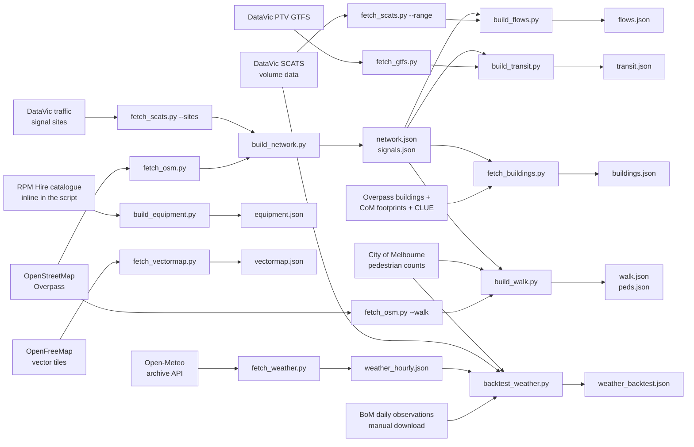

# roads: Melbourne CBD open-data pipeline

Owner: @louisxie316-dotcom

An offline, re-runnable Python pipeline that turns open datasets for a CBD bounding box into 11 static, schema-checked JSON files under `public/cbd/` (about 5.9 MB in total, each under 2 MB). They are served at `/roads/public/cbd/<file>` and read by the engine, the web app, the API and the SUMO service. Nothing in this module runs at request time, and no API keys are needed to rebuild it.

- The area is a parameter, not hard-coded: `fetch_osm.py`, `fetch_scats.py`, `build_network.py`, `build_transit.py`, `fetch_buildings.py` and `fetch_vectormap.py` take `--bbox S,W,N,E` (default `-37.8235,144.9480,-37.8060,144.9760`), and the later steps take `--area <name>` and read the bbox from that area's `network.json`, so another district is a re-run, not a code change (only the weather grid point is fixed in `fetch_weather.py`).
- Ids are derived from OSM ids and output is written in a fixed, sorted order, so re-runs diff cleanly and the UI can store the link ids a user picks.
- Every imputed number carries a `method` label saying how it was produced, and every assumption is written into the file's `assumptions`.

Wider context: [module interfaces](../../docs/reference/interfaces.md) (road data files section), [data sources and licences](../../docs/data/sources.md), [assumptions and validation](../../docs/data/assumptions-and-validation.md).

## Data lineage



Downloads land in `raw/` (gitignored) and outputs in `public/cbd/`; `fetch_buildings.py`, `fetch_vectormap.py` and `fetch_weather.py` do both steps. Consumers:

- `apps/engine` (`backend.js` `connect()`): network, flows, transit, walk, peds (walk and peds load in the background), equipment
- `apps/web`: buildings, vectormap, walk geometry; the network through the engine
- `apps/api` (`pack.js` `quote()` / `stockCheck()`): equipment
- `apps/web/tools/sumo/build_real.py` and the SUMO container image (`apps/sumo/Dockerfile`): network, signals, flows

## Outputs

| File | Contents | Size | Built by | Read by |
|---|---|---|---|---|
| `network.json` | Directed road graph: 805 nodes, 1,513 junction-to-junction links with lanes, speed, capacity, free-flow time, tram and bike-lane flags | 499 KB | `build_network.py` | engine, SUMO |
| `signals.json` | 151 SCATS signal sites in the bbox, 124 snapped to a network node | 19 KB | `build_network.py` | SUMO, web tests |
| `flows.json` | Weekday and weekend 24-hour profiles (veh/h) for every link, with a `method` per link | 409 KB | `build_flows.py` | engine, SUMO |
| `transit.json` | PTV trams (22 routes) and buses (25 routes) map-matched onto directed links, hourly trips, 182 stops | 123 KB | `build_transit.py` | engine |
| `walk.json` | Undirected walking network: 5,198 nodes, 6,802 links, each sidewalk attached to a road link and side | 1.7 MB | `build_walk.py` | engine, web |
| `peds.json` | Hourly pedestrian volumes per walking link from 71 sensors, with a `method` per link | 1.8 MB | `build_walk.py` | engine |
| `buildings.json` | 2,508 building footprints with height, height source, use and frontage links | 911 KB | `fetch_buildings.py` | web |
| `equipment.json` | 16 works equipment items (barriers, static signs, VMS, arrow board, portable pedestrian signals) with specifications; quantities and day rates assumed | 8 KB | `build_equipment.py` | engine, API |
| `vectormap.json` | Basemap layers in lat/lon: 336 polygons (water, green space, land use) and 328 lines (rail, tram, waterways) | 158 KB | `fetch_vectormap.py` | web |
| `weather_hourly.json` | 1,392 hours of Open-Meteo weather, 1 Aug to 27 Sep 2026 | 71 KB | `fetch_weather.py` | none (evidence only) |
| `weather_backtest.json` | Weather back-test results, placebo, case studies and audit trail | 40 KB | `backtest_weather.py` | none (evidence only) |

The two weather files are an offline study. No app code reads them and the page never shows them.

## Data sources and licences

| Source | Used for | Licence |
|---|---|---|
| OpenStreetMap via Overpass / OSMnx | Road and walking networks, tram tracks, building outlines | ODbL 1.0, "© OpenStreetMap contributors" |
| DataVic [Traffic Signal Volume Data](https://discover.data.vic.gov.au/dataset/traffic-signal-volume-data) (SCATS) | Hourly vehicle flows, bike counts for the back-test | CC BY 4.0, Department of Transport and Planning Victoria |
| DataVic [Victorian traffic signals](https://discover.data.vic.gov.au/dataset/victorian-traffic-signals) | Signal site list | CC BY 4.0 |
| DataVic [Traffic signal configuration data sheets](https://discover.data.vic.gov.au/dataset/traffic-signal-configuration-data-sheets) | Detector layout for site 2921 (read by HTTP Range) | CC BY 4.0 |
| DataVic [GTFS Schedule](https://discover.data.vic.gov.au/dataset/gtfs-schedule) (PTV, 26 Sep 2026 release, sub-feeds 3 and 4) | Tram and bus routes, stops, trips | CC BY 4.0 |
| City of Melbourne Pedestrian Counting System (hourly counts and sensor locations) | Pedestrian volumes | Not stated on the dataset page; companion City of Melbourne datasets are CC BY |
| City of Melbourne 2018 Building Footprints | Measured building heights | CC BY |
| City of Melbourne CLUE building information, census 2024 | Building use and floor counts | CC BY |
| OpenMapTiles vector tiles via the OpenFreeMap public instance | Vector basemap | Schema CC BY 4.0, data ODbL |
| Open-Meteo Historical Weather API, model `ecmwf_ifs` | Hourly weather | CC BY 4.0, "Weather data by Open-Meteo.com" |
| Bureau of Meteorology daily observations IDCJDW3033 (Melbourne Olympic Park) | Checking model rain against measured rainfall | © Commonwealth of Australia; downloaded by hand, not redistributed |
| RPM Hire product pages, TfNSW sign register (T1-1, T2-16) | Equipment specifications and sign codes | Reference only; no images or text copied |

**Licence of the data files.** `network.json`, `walk.json`, `buildings.json` and `vectormap.json` are derived from OpenStreetMap and are distributed under the **ODbL 1.0 (share-alike), not the MIT licence** that covers the code. `vectormap.json` also follows the OpenMapTiles schema. Credit "© OpenStreetMap contributors", and for the basemap also "© OpenMapTiles / OpenFreeMap". Anyone redistributing these files must pass the licence on with them. The other files carry the attributions listed above; see the repository root for the code licence and the full notice.

## Rebuilding

The committed JSON is the frozen dataset from the event (29–30 Sep 2026). `raw/` is not committed, and the upstream data has moved since then (OSM edits, new GTFS releases, weekly OpenFreeMap snapshots), so a re-run will not reproduce the files byte for byte and link ids may shift. Only `equipment.json` regenerates exactly, because its catalogue lives in the script. To change a metadata string in another file, edit it in place and update the generating script to match.

One-time setup for the OSMnx steps (Python 3.9 or later):

```bash
python3 -m venv apps/roads/.venv && apps/roads/.venv/bin/pip install -r apps/roads/requirements.txt   # osmnx, networkx, geopandas, shapely
```

`fetch_scats.py`, `fetch_gtfs.py`, `build_flows.py`, `build_equipment.py`, `fetch_vectormap.py`, `fetch_weather.py` and `backtest_weather.py` use the standard library only and run with plain `python3`. Every script exits with code 1 when an input is missing and says which one.

```bash
PY=apps/roads/.venv/bin/python
B=https://data.melbourne.vic.gov.au/api/explore/v2.1/catalog/datasets

# Road network and signals -> network.json, signals.json
python3 apps/roads/tools/fetch_scats.py --sites                  # raw/victorian_traffic_signals.csv
$PY apps/roads/tools/fetch_osm.py                                # raw/osm_drive.graphml, raw/osm_tram.geojson (about 30 s)
$PY apps/roads/tools/build_network.py                            # about 2 s

# Vehicle flows -> flows.json
python3 apps/roads/tools/fetch_scats.py --range 2026-08-01..2026-09-27   # raw/cbd_VSDATA_*.csv: about 270 MB, 30 min; days already fetched are skipped
python3 apps/roads/tools/build_flows.py

# Equipment and transit -> equipment.json, transit.json
python3 apps/roads/tools/build_equipment.py                      # catalogue is inline in the script
python3 apps/roads/tools/fetch_gtfs.py                           # raw/gtfs/3.zip (tram), 4.zip (metro bus): about 105 MB
$PY apps/roads/tools/build_transit.py                            # about 20 s

# Walking -> walk.json, peds.json
$PY apps/roads/tools/fetch_osm.py --walk                         # raw/osm_walk.graphml; add --overpass <mirror> if the main server refuses
curl -sS -G "$B/pedestrian-counting-system-monthly-counts-per-hour/exports/csv" --data-urlencode "where=sensing_date>=date'2026-08-01' and sensing_date<=date'2026-09-27'" -o apps/roads/raw/peds.csv
curl -sS "$B/pedestrian-counting-system-sensor-locations/exports/csv" -o apps/roads/raw/ped_sensors.csv
$PY apps/roads/tools/build_walk.py                               # about 5 s

# Buildings -> buildings.json
curl -sS -G "$B/2018-building-footprints/exports/geojson" --data-urlencode "where=in_bbox(geo_point_2d, -37.8235, 144.9480, -37.8060, 144.9760)" -o apps/roads/raw/com_footprints_2018.geojson
curl -sS -G "$B/buildings-with-name-age-size-accessibility-and-bicycle-facilities/exports/csv" --data-urlencode "where=year(census_year)=2024 and latitude>=-37.8235 and latitude<=-37.8060 and longitude>=144.9480 and longitude<=144.9760" --data-urlencode "select=census_year,building_name,predominant_space_use,number_of_floors_above_ground,latitude,longitude" -o apps/roads/raw/com_buildings_clue.csv
$PY -u apps/roads/tools/fetch_buildings.py                       # first run downloads OSM buildings (prints each server it tries); --refresh downloads again

# Vector basemap -> vectormap.json
python3 apps/roads/tools/fetch_vectormap.py                      # 6 z14 tiles, about 10 s

# Weather back-test -> weather_hourly.json, weather_backtest.json
#   First download the BoM files by hand into raw/: IDCJDW3033.202608.csv and IDCJDW3033.202609.csv from
#   https://www.bom.gov.au/climate/dwo/2026MM/text/IDCJDW3033.2026MM.csv (BoM does not allow automated downloads).
#   Also needs the SCATS range and raw/peds.csv from above.
python3 apps/roads/tools/fetch_weather.py                        # date window defaults to the traffic data in raw/
python3 apps/roads/tools/backtest_weather.py                     # about 20 s
```

Handy for exploring: `fetch_scats.py --day 2026-09-22` pulls one day of CBD SCATS rows (about 4.6 MB) out of the statewide monthly archive, and `fetch_scats.py --sheet 2921` extracts one junction's detector configuration sheet.

**Another district.** Pass the same `--bbox S,W,N,E` to `fetch_scats.py`, `fetch_osm.py`, `build_network.py`, `build_transit.py`, `fetch_buildings.py` and `fetch_vectormap.py`, and the same `--area <name>` to every script that writes `public/<area>/` (`build_flows.py` and `build_walk.py` take only `--area`). Check the output sizes first: walk and peds are already close to the 2 MB budget.

## Methods

### Road network (`build_network.py`)

- Lanes, speed and bike lanes are computed per segment on the **unsimplified** OSMnx graph, because OSM tags are per way and turn into lists after simplification. Lanes per direction come from `lanes` on one-way roads, otherwise `lanes:forward` / `lanes:backward`, otherwise half the total rounded up, otherwise a road-class default (2 for primary and above, 1 otherwise). Missing `maxspeed` defaults to 40 km/h.
- Bike lanes are read by side under left-hand traffic: forward traffic looks at `cycleway:left`, reverse traffic at `cycleway:right`; one-way roads count both.
- The graph is then simplified to junction-to-junction links: lanes take the minimum along the link (the bottleneck), free-flow times are summed, and a link has a bike lane when more than half its length does. `speed_kmh` is therefore the time-weighted equivalent speed `len_m / t0_s` and need not be an integer.
- Only the largest strongly connected component is kept, so the engine always finds a detour: the default bbox has 904 nodes after simplification and 99 are dropped (dead ends at the bbox edge).
- Each SCATS site snaps to the nearest node within 30 m. Capacity is `cap_vph = lanes × 1800 × g`, where `g = 0.5` when the end node has a signal within 30 m (SCATS `INT` / `POS`, or OSM `traffic_signals`) and 0.9 otherwise. Flashing-amber crossings (`FLASH PX`) do not count as signals.
- A link is tagged `tram` when at least 50% of its length lies within 12 m of OSM tram track.

### Vehicle flows (`build_flows.py`)

Eight weeks of 15-minute SCATS counts (1 Aug to 27 Sep 2026; 31 Aug is missing upstream and the 25 Sep public holiday is excluded; 38 weekdays and 18 weekend days used) are averaged into weekday and weekend hourly profiles. Negative counts mean a fault, and any hour with a faulty slot is dropped. Each link gets the best method available:

| `method` | How the flow is produced | Links |
|---|---|---|
| `detector_map` | The site and approach heading are in `DETECTOR_MAP`: the sum of those detectors, from the configuration sheet. Most accurate; site 2921 only | 2 |
| `site_split` | The link ends at a junction with SCATS data: lanes × the mean hourly flow of that junction's lane detectors | 384 |
| `street_interp` | Mean per-lane flow of adjacent upstream and downstream links on the same named street × lanes, propagated along the street | 679 |
| `class_default` | Median per-lane flow of measured links of the same road class × lanes. Coarsest; mostly minor unsignalised streets and unnamed turning slips | 448 |

**Which detectors count as lanes.** SCATS detectors cannot be told apart by flow alone. At site 2921, detector 1 is the Swanston St bike counter and logs about 5,500 a day, as many as a traffic lane. Splitting the junction total by lanes would count bikes and trams as cars and overestimate by 2–3 times, while averaging every detector would pull per-lane flow down to about 40% of measured, because tram and push-button detectors carry little. A detector therefore counts as a lane only if its weekday daily count is at least 50% of the junction's busiest detector and at least 300.

Checks on 29 Sep: the 2921 eastbound approach (`detector_map`, detector 7) carries 400–453 veh/h between 16:00 and 18:00 on weekdays, against about 450 in `apps/sim`. Median per-lane weekday flow at 17:00 is 431 (`detector_map`), 277 (`site_split`), 296 (`street_interp`) and 282 (`class_default`). Weekday peak v/c has a median of 0.25 and a 95th percentile of 0.57; 5 links exceed capacity.

### Transit (`build_transit.py`)

- Service days are a normal weekday (Tue 29 Sep 2026) and a Saturday (3 Oct 2026), computed from `calendar.txt` and `calendar_dates.txt`. Only trips that stop inside the bbox are kept, grouped by mode, route number and direction.
- For each group the most common shape is clipped to the bbox and sampled every 10 m. Each sample matches a directed link within 15 m whose bearing differs by at most 45°, and a link needs at least 2 hits, which avoids false matches at junctions. Unmatched length is reported as `offnet_m`.
- Trips per hour use the departure time at the first stop inside the bbox. Each stop attaches to the nearest link within 30 m, otherwise `road_link: null`.
- Result: 90.6% of route length matched. 98% of the 285 links used by tram routes were already tagged `tram` in `network.json`, an independent check of the tram tagging. Route 96 has 1.3–1.6 km off the road network, which is the tram-only Bourke St Mall. Routes 30, 35 and 86 run on La Trobe St; route 19 runs 13 trips an hour and route 96 runs 10 in the weekday peak. 12 stops have no road link within 30 m, mostly on tram-only sections.

### Walking network and pedestrian volumes (`build_walk.py`)

- OSM was chosen over the City of Melbourne Pedestrian Network because CBD sidewalks are mapped as separate ways: 77 km of `footway=sidewalk`, against 3 km recorded only as `sidewalk=*` tags on roads (checked 29 Sep).
- Indoor corridors, parking aisles and driveways (about 700 links) are dropped: roadworks do not affect them, and dropping them keeps `peds.json` under 2 MB. The graph is made undirected, simplified where `kind` changes, and cut to its largest connected component.
- `kind`: sidewalk 1,948, crossing 988, path 1,808, other (walking along a roadway) 1,844, mall 214. Crossings are `signal`, `zebra` or `uncontrolled`.
- Each sidewalk attaches to a parallel road link within 25 m. Under the Australian keep-left rule a sidewalk belongs to the direction of travel it lies to the left of (`side: "left"`, found by cross product); a one-way road with no reverse link can give `right`. Crossings attach to the link they cross. 92% of sidewalks attach to a roadway, and 82% of those are on the left of that direction.
- Pedestrian volumes come from 71 sensors in the bbox (70 attached to a walking link), 1 Aug to 27 Sep 2026, 39 weekdays and 18 weekend days:

| `method` | How the volume is produced | Links |
|---|---|---|
| `sensor` | The walking link a sensor is attached to (within 40 m): 8-week hourly mean | 67 |
| `street_interp` | The nearest sensor on the same named street, within 800 m | 1,825 |
| `class_default` | Median of the sensors beside the same road class; links not beside a roadway take the 25th percentile of all sensors | 4,910 |

Checks: Swanston St sensor `Swa148_T` averages 1,938 people at 17:00 on weekdays (the phase-2 spec quotes 1,626 for Saturday 27 Sep at 17:00); the busiest is Collins St `Col620_T` with 3,299 at 17:00.

### Buildings (`fetch_buildings.py`)

- Outlines, names and uses come from OSM `building=*`, fetched directly from Overpass with a hard timeout per server and failover across four servers. Heights come from the City of Melbourne 2018 Building Footprints (5,923 parts), and use and floor counts from the CLUE census 2024.
- **Height priority: measured municipal height, then OSM `height`, then OSM `building:levels` × 3.2 m, then a 12 m default.** For CBD towers the `height` on the OSM outer outline is often only the podium, with the tower drawn as a separate `building:part`: Eureka Tower is 20 m in OSM and 298 m in the City of Melbourne data (actual about 297 m); Rialto Towers is 20 m in OSM and 249 m (actual about 251 m). Across the 297 buildings with both heights the median relative difference is 14%, and the 24 that differ by more than 2.5 times are mostly this podium-and-tower case. The municipal height is the highest `footprint_max_elevation` of the parts inside the OSM outline minus `structure_min_elevation`; buildings built after 2018 fall back to OSM or the default.
- Height sources: municipal 2,108, OSM height 30, OSM levels 32, default 338 (87% not default).
- Use: OSM tags win where they are specific (`amenity`, `shop`, a specific `building` value). For buildings OSM leaves as `other` (for example `building=yes`), the census records inside the outline give the most common `predominant_space_use`, mapped by keyword in `CLUE_USE`: student accommodation counts as residential and commercial accommodation as hotel; vacant, under construction, storage, plant rooms, wholesale and manufacturing stay `other`. Census floor counts fill missing OSM levels.
- Result: 2,508 buildings. Uses: other 901 (36%; 1,898 or 76% with OSM alone), residential 491, office 404, public 297, retail 194, education 94, hotel 93, parking 34. 2,065 buildings have a frontage link within 30 m (at most 4 recorded each).
- Buildings that cross the bbox edge are dropped (every point must be inside the bbox), only outer rings are kept, and outlines are simplified to about 0.5 m.

### Equipment (`build_equipment.py`)

16 items: barriers 3, static signs 9, VMS 2, arrow board 1, portable pedestrian signals 1. Specifications are copied from RPM Hire product pages (each item's `url`, checked 29 Sep 2026). **`qty` and `day_rate_aud` are all assumptions**, because RPM Hire publishes no prices; each item lists them in `assumed`. Sign codes are filled in only where verified (T1-1 Roadwork Ahead, T2-16 End Roadwork) and are `null` otherwise. RPM Hire has no product page for static signs, so their `url` is `null`.

VMS lines hold **10** characters (`chars_per_line`), matching the sign-reading limit in `apps/api` `readSigns()` / `/api/read` (longer lines get a 400). The RPM Hire page contradicts itself: its FAQ says "12-13 characters per line up to 4 lines", while its message guide says "Up to 10 characters per line (including any spaces)", ideally 3 lines of 8 characters, 2 seconds per screen (3 when flashing). The guide's 10 is used, and its recommendations are kept in `lines_recommended`, `chars_recommended` and `seconds_per_screen`.

### Vector basemap (`fetch_vectormap.py`)

OpenMapTiles vector tiles (`.pbf`) from the OpenFreeMap public instance (no key, no request cap) are downloaded at build time and decoded to lat/lon by a minimal protobuf / Mapbox Vector Tile decoder written for this script (varint, zigzag, cursor geometry). At run time the page fetches only this one same-origin file and contacts no tile server. The snapshot used is recorded in `tile_source`. Output order is fixed so re-runs diff cleanly.

At z14 (checked 30 Sep) the file holds 336 polygons (water 25, grass 208, sport 21, civic 23, urban 38, wood 14, park 5, aeroway 1, sand 1) and 328 lines (tram 146, rail 175, waterway 7). The largest Yarra River polygon is 171,000 m² and lies in the south of the bbox; total rail length is 54 km, because each track in the Flinders St yards is a separate line.

### Weather back-test (`fetch_weather.py`, `backtest_weather.py`)

The web app's illustrative micro-simulation uses invented weather multipliers (`WXP` in `apps/web/src/js/4-sim.js`). This study measured what rain actually did to CBD traffic between 1 Aug and 27 Sep 2026, excluding the school-holiday week of 21–27 Sep. Spec: [docs/hackathon/specs/T31-weather-backtest-PRD.md](../../docs/hackathon/specs/T31-weather-backtest-PRD.md).

**Design.** A wet hour (model precipitation ≥ 0.1 mm/h, confirmed by BoM) is compared with the median of dry hours for the same sensor, day of week and hour. Each day contributes the baseline-weighted median log ratio, days are averaged, and 95% intervals come from resampling days (2,000 draws). Cells with fewer than 3 days get no number. A placebo test treats randomly chosen dry days as fake wet days, each left out of its own baseline, and repeats the draw 25 times.

**Results** (daytime 07:00–19:00, ratio to the dry baseline):

| Mode | Wet (≥ 0.1 mm/h, 13 days) | Rain (≥ 1 mm/h, 4 days) |
|---|---|---|
| Cars, 540 CBD lane detectors | 0.997 [0.989, 1.005] | 0.998 [0.985, 1.015] |
| Bikes, 4 detectors at site 2921 | 0.924 [0.861, 0.986] | 0.965 [0.838, 1.079] |
| Pedestrians, 5 City of Melbourne counters | 0.875 [0.813, 0.933] | 0.681 [0.50, 0.911] |

- Car volumes do not change measurably in rain. The capacity proxy (busiest 15-minute flow in the weekday morning peak at the top 10% of CBD lane detectors) is 0.979 [0.971, 0.986], an upper bound on the effect.
- The bike placebo averages 0.966, so the method reads bikes about 3% low; the real bike effect is about −5%.
- Pedestrians fall by about 12% in any rain and by about a third in heavier rain. On Monday 10 Aug (24.4 mm at BoM) the morning peak saw pedestrians at 0.44, bikes at 0.78 and cars at 1.00.
- Against `WXP`: the storm `rate` of 0.9 is too strong for cars (measured 0.998); for bikes and pedestrians 0.9 lies inside the wide rain intervals, so one shared `rate` cannot express the difference between modes. The storm capacity factor `T` of 1.4 (capacity × 0.71) is far stronger than the measured × 0.98. In model-only fog, car volumes are 3% higher, because fog falls on calm, clear, cold mornings; this is not causal. There was no flood, heat or high-wind sample in these 8 weeks.

**Caveats.**

- Open-Meteo's grid point is about 3 km north-west of the CBD (-37.786, 144.940), and model rain timing is unreliable. The 33 hours where the model reports rain but BoM has under 0.2 mm for that 24 h period count as false alarms (for example the morning of 19 Aug) and are not used as wet hours.
- Traffic hour h is matched to Open-Meteo time T = h + 1, because precipitation at T is the previous hour's total. Checking with the bike rain effect, T = h, h + 1 and h + 2 all fall within each other's intervals, so the data cannot say which alignment is best.
- Baselines are split by day of week. With a weekday / weekend split only, the placebo read 4–11% low, because fully dry days included more Sundays and Mondays run about 6% below Tuesday to Thursday.
- SCATS has counts only, no speed or occupancy, so the speed, deceleration and wobble parts of `WXP` cannot be tested, and the capacity proxy mixes "fewer cars" with "slower cars".
- `car` uses all 540 CBD lane detectors chosen by the flow heuristic, not checked lane by lane. `car_2921` uses the 3 detectors checked against the configuration sheet and agrees.

## Schema notes

Formats for `network.json`, `flows.json`, `signals.json`, `transit.json`, `walk.json` and `peds.json` are specified in [module interfaces](../../docs/reference/interfaces.md) and in the original specs ([`PRD.md`](PRD.md) section 5, [`PRD-2.md`](PRD-2.md) section 3). The tests in `tests/` are the executable contract for all 11 files. Fields may be added at any time; renaming or removing a field, or changing a unit, needs a `version` bump and a matching change in every consumer.

- **Ids.** Nodes `n<osm node id>`; links `l<from osm id>_<to osm id>[_<key>]`; walking nodes `w<osm id>` and links `wl<a>_<b>[_<key>]`; stops `st_<gtfs id>` (tram) or `sb_<gtfs id>` (bus); routes `tram_<number>` / `bus_<number>`; buildings `w<osm way id>` or `r<osm relation id>`.
- **Profiles.** Every 24-value array is indexed by hour (0 = 00:00–01:00) under `days.wd` / `days.we` (or `trips.wd` / `trips.we`), with non-negative numbers.
- **`buildings.json`.** `buildings[]` = `{id, name, use, height_m, levels, height_src, footprint[[lat, lon]], frontage[{link, dist_m}]}`. `use` ∈ `retail / office / residential / education / public / parking / hotel / other`; `height_src` ∈ `com / osm_height / osm_levels / default`. The format began as the draft in issue #21 section 5. No other fields are allowed (a test guards against personal data).
- **`equipment.json`.** `items[]` = `{id, category, name, effect, applies_to, …specifications, qty, day_rate_aud, assumed[], url}`. `category` ∈ `barrier / sign / vms / arrow_board / ped_signal`; `effect` ∈ `close / route_vehicles / route_peds / warn / message / control_crossing`. Barriers have `unit_len_m`; VMS have `lines` and `chars_per_line` (must stay 10).
- **`vectormap.json`.** Top-level keys are exactly `version, area, bbox, generated, zoom, tile_source, sources, assumptions, polygons, lines`. `polygons[]` = `{kind, polys: [[ring of [lat, lon]], …]}` (first ring outer, the rest holes, not closed); `lines[]` = `{kind, pts: [[[lat, lon], …], …]}`. Polygon kinds and line kinds (`waterway, rail, transit`) are written in a fixed order.
- **Weather files.** `weather_hourly.json` keeps the Open-Meteo `hourly` arrays plus `grid`, `units`, `notes` and the traffic-data coverage it was built against. `weather_backtest.json` holds `results`, `capacity_proxy`, `placebo`, `cases`, `wxp_compare` and an `audit` block listing every baseline, wet, rain, fog and false-alarm hour, so the tests can recompute the classification independently.

## Testing

```bash
bash apps/roads/test.sh     # Python 3.9+, standard library only; 104 assertions on the committed files
```

The four test files validate the committed JSON rather than re-running the pipeline:

- **Contract and referential integrity**: unique ids, every `from` / `to`, `road_link`, `walk_link`, route and stop reference exists, 24 non-negative values per profile, `coverage` totals add up, file sizes under 2 MB (`scripts/check.sh` also enforces this for every JSON file under `public/`).
- **Connectivity**: the largest strongly connected component holds at least 90% of road nodes (iterative Kosaraju), and the walking network is at least 90% connected (union-find).
- **Calibration and domain sanity**: `site_split` and `detector_map` per-lane medians within 2 times of each other; at most 5% of links above 1.2 times capacity; La Trobe St flows of 100–2,000 veh/h at 17:00; at least 80% of tram-route links tagged `tram`; a pedestrian peak of 500–10,000 per hour; Eureka Tower and Rialto Towers at least 200 m; the Yarra in the south of the bbox; plausible rail lengths; VMS 10 characters per line.
- **Reverse assertions**: no keys or tokens, no personal-data fields, no external URL in `vectormap.json` other than the tile source; the weather test recomputes dry baseline hours from `weather_hourly.json` and checks that excluded days never leak into any result.

When a file is absent the matching checks are skipped and only the skeleton is checked. `test.sh` gives each file 90 s and always ends with `N passed, M failed`, which `scripts/check.sh` parses.

## Known limitations

- `detector_map` covers only site 2921. `site_split` reads about a third below measured per-lane flow; mapping more junctions from their configuration sheets would fix that.
- 193 links have no street name (mostly turning slips), so they cannot use `street_interp`.
- 27 of the 151 signal sites have no node within 30 m (17 pedestrian signals `POS`, 5 flashing crossings `FLASH PX`, 5 junctions `INT`) and have `node: null`.
- Dual carriageways with a central median (for example La Trobe St, with trams in the middle) are two one-way roads in OSM, so one junction is 2–4 nodes. They all carry the same site number; the short connectors between them are not approaches and are interpolated.
- Detector 3 at site 2921 (Swanston St southbound left turn) cannot be matched: the OSM drive network has no link entering the junction southbound on Swanston St.
- `walk.json` and `peds.json` are close to the 2 MB budget (1.7 and 1.8 MB). For a larger area, `peds.json` could store a table of distinct curves plus a reference per link (there are only 77 distinct curves).
- The PTV GTFS bundle stores each sub-feed compressed, so a sub-feed cannot be read by Range and must be downloaded whole (tram 14 MB, bus 87 MB). Sub-feed 3 is tram and 4 is metropolitan bus, confirmed by `route_type` in `routes.txt`.

## Implementation notes

- OSMnx 2.x takes the bbox as `(west, south, east, north)`; this repo's `--bbox` is `south,west,north,east`, and the scripts convert.
- OSMnx writes its Overpass cache to `cache/` in the current directory by default, which would land outside the module when run from the repo root. `fetch_osm.py` pins it to `raw/osm_cache/`.
- The main Overpass server sometimes refuses connections and mirrors time out at 180 s. `fetch_osm.py` raises the timeout to 300 s and takes `--overpass <url>`; `fetch_buildings.py` tries each server once with a hard timeout.
- `fetch_scats.py` reads remote ZIP members through a seekable HTTP Range wrapper. The buffer must be large (4 MB): every read is one HTTPS request, and at 64 KB one day took about 2 minutes instead of a few seconds. `fetch_gtfs.py` reuses the same reader. Both write to `.part` first and rename, so an interrupted run never leaves half a file.
- Do not name a directory `data/`: the repository `.gitignore` ignores every `data/`.

## Module layout

| Path | Purpose |
|---|---|
| `README.md` | This file |
| `PRD.md` | Original phase-1 spec from the hackathon (network, flows, signals); historical record |
| `PRD-2.md` | Original phase-2 spec by @jinmingq (equipment, transit, walking, pedestrians); historical record |
| `requirements.txt` | `osmnx>=2.0,<3` (brings networkx, geopandas, shapely, requests) |
| `test.sh` | Runs `tests/test_*.py` with a 90 s limit each |
| `tools/fetch_scats.py` | SCATS days or ranges, the signal site list, or one junction's configuration sheet, read remotely by HTTP Range |
| `tools/fetch_osm.py` | OSM drive network (unsimplified) and tram tracks, or the walking network with `--walk` |
| `tools/build_network.py` | `network.json` + `signals.json` |
| `tools/build_flows.py` | `flows.json` (standard library only) |
| `tools/fetch_gtfs.py` | Extracts the tram and metropolitan bus sub-feeds from the PTV GTFS bundle |
| `tools/build_transit.py` | `transit.json`: routes map-matched to directed links, hourly trips, stops |
| `tools/build_walk.py` | `walk.json` + `peds.json`: sidewalk-to-road attachment and side, sensor attachment, imputation |
| `tools/fetch_buildings.py` | `buildings.json`: OSM outlines, municipal heights, census use, frontage links |
| `tools/build_equipment.py` | `equipment.json` from the inline catalogue |
| `tools/fetch_vectormap.py` | `vectormap.json`: OpenFreeMap tiles decoded by a built-in MVT decoder |
| `tools/fetch_weather.py` | `weather_hourly.json` from Open-Meteo (standard library only) |
| `tools/backtest_weather.py` | `weather_backtest.json` (standard library only) |
| `tests/test_roads.py` | Network, flows, signals, equipment, transit, walk and peds |
| `tests/test_buildings.py` | `buildings.json`, including landmark and personal-data checks |
| `tests/test_vectormap.py` | `vectormap.json`: schema, kind order, geometry validity, external-URL check |
| `tests/test_weather.py` | Both weather files, with independent recomputation of the dry baseline |
| `public/cbd/` | The 11 generated JSON files (plus an empty `.gitkeep`) |
| `raw/` | Raw downloads (gitignored, not committed) |

## History

Built during the FEIT Hackathon Festival, 29–30 Sep 2026: the road network and 8 weeks of SCATS flows (PR #9), the phase-2 spec (#12, @jinmingq), equipment, transit and walking data (#14), buildings (#33, #40), the weather back-test (#92) and the vector basemap (#111, @Unzzip). `PRD.md` and `PRD-2.md` are kept as the original planning documents.
