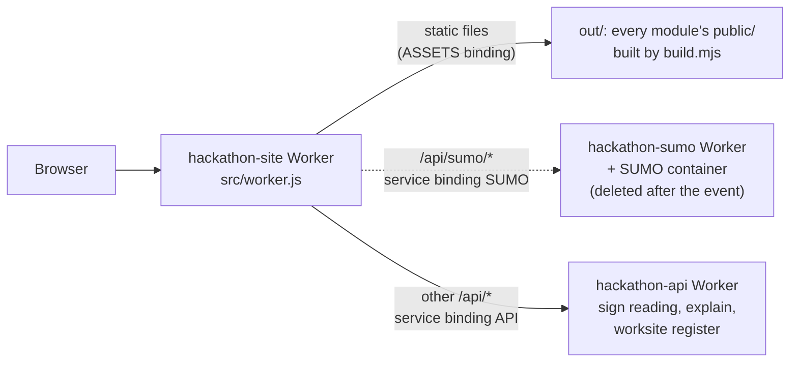

# site: same-origin gateway and static host (`hackathon-site`)
Owner: @unicornnnnnny (designated deployer) · @Zemmeng (code)

One Cloudflare Worker serves the whole RippleTwin demo from a single origin: <https://hackathon-site.zemmmeng.workers.dev>.

- At build time, `build.mjs` copies the **git-tracked** files in each `apps/<module>/public/` to `/<module>/public/`, unchanged. The web app, the engine's JavaScript, the road network data and the SUMO replays therefore share one origin, so they can `fetch` and `import` each other without CORS.
- At run time, `src/worker.js` forwards `/api/sumo/*` to the SUMO Worker and every other `/api/*` request to the API Worker through Cloudflare service bindings. Neither backend has a public URL of its own.

> **Status after the hackathon.** `hackathon-site` and `hackathon-api` are still online. The SUMO Worker and its container were deleted, so `/api/sumo/*` now returns `502 sumo_down` and the page falls back to the pre-computed SUMO run. The `SUMO` binding is still declared in `wrangler.jsonc` and **must be removed before the next site deploy**. Details: [Status after the hackathon](#status-after-the-hackathon).

## Architecture



Release path: `git ls-files` → `build.mjs` → `out/` → `wrangler deploy` (gated by `scripts/deploy.sh`) → `scripts/check.sh --e2e` against the live URL.

## Routing

`wrangler.jsonc` sets `run_worker_first: ["/api/*", "!/api/public/*"]`, so a request for an existing static file is served by Workers Static Assets without running Worker code. Requests that do reach `src/worker.js` are matched in this order:

| # | Path | Handled by | Errors |
|---|---|---|---|
| 1 | `/api/sumo`, `/api/sumo/*` (not lookalikes such as `/api/sumoX`) | Forwarded unchanged to the `SUMO` binding (`hackathon-sumo`): method, query, body and headers kept, prefix not stripped. The allowlist, header stripping and rate limiting happen in `apps/sumo` | no binding → `503 sumo_off`; the binding throws → `502 sumo_down` |
| 2 | `/api`, `/api/*` except `/api/public/*` | Forwarded unchanged to the `API` binding (`hackathon-api`) | the binding throws → `502 api_unreachable`; no binding → `/api/health` answers `{"ok":true,"v":"site-0.1","mock":true,"api":false}` and every other path `503 api_not_deployed` |
| 3 | everything else, including `/api/public/*` | The `ASSETS` binding (`out/`) | no binding → `500 no_assets` |

What the static side serves:

| Path | Content |
|---|---|
| `/` | Generated landing page with `data-smoke="site"` and a build stamp (`<meta name="build">`, commit and UTC time). If `apps/web/public/index.html` exists, it redirects to `/web/public/` in JavaScript (with a `<noscript>` meta-refresh fallback) |
| `/?list` | The same page without the redirect: a list of every module with its file count |
| `/<module>/public/*` | Git-tracked files from `apps/<module>/public/`. A new module is served automatically once it has a `public/` directory; no change to `site` is needed |
| `/api/public/*` | Static files from `apps/api/public/` (`reader.js`, `answers/demo.json`, ...). This exclusion lives in two places, `run_worker_first` and the `isApi` check in `worker.js`; change both together |

Observed behaviour (local workerd on 2026-09-29 and the live site on 2026-10-11): `/index.html` returns `307` to `/`, `/sim/public` returns `307` to `/sim/public/`, and an unknown static path returns `404` with an empty body.

### Error envelope

Every error is `{ "ok": false, "error": "<code>", "msg": "<explanation>" }` with `content-type: application/json` and `cache-control: no-store` (see [`docs/reference/interfaces.md`](../../docs/reference/interfaces.md), error format). Responses carry no CORS headers, because everything is same-origin, and never include internal error text or stack traces.

| Code | Status | When | Client behaviour |
|---|---|---|---|
| `sumo_off` | 503 | no `SUMO` binding | `sumo-client.js` falls back to the pre-computed results in `/sumo/public/real/` |
| `sumo_down` | 502 | the `SUMO` binding throws (the live behaviour today) | same fallback |
| `api_unreachable` | 502 | the `API` binding throws | sign reading falls back to keyword rules |
| `api_not_deployed` | 503 | no `API` binding | same as above |
| `no_assets` | 500 | the `assets` block is missing from `wrangler.jsonc` | — |

Clients must branch on `error`, never on `msg`.

## Build (`build.mjs`)

`node build.mjs [--out <dir>]` (default `apps/site/out`, gitignored) wipes the output directory, copies each module's `public/`, and writes `out/index.html`. It uses Node built-ins only and runs automatically before `npm run dev`, `dry-run` and `deploy`. Safety properties, each covered by `tests/build.test.mjs`:

- **Only git-tracked files ship.** It copies exactly what `git ls-files` lists. Gitignored files on the deployer's laptop (`keys.json`, `*.pem`, `raw/`, `node_modules/`) and files never `git add`ed are never published, even though `deploy.sh`'s clean-tree check cannot see ignored files. Without git, or outside a git work tree, it refuses to build and leaves the previous output untouched.
- **No path tricks.** It skips dotfiles and `..` segments, symlinks, submodules and paths behind a symlinked parent directory. A module directory or `public/` that is a symlink, or whose real path is outside `apps/`, skips the whole module with a log line. It strips inherited `GIT_DIR` / `GIT_INDEX_FILE` so a git hook cannot point it at another index.
- **Safe wipe.** The output directory must be `apps/site/out` or lie outside `apps/`, and a non-empty directory is wiped only if it holds the build's own `data-smoke="site"` page.
- **Cloudflare limits checked at build time.** It aborts on any file over 25 MiB or more than 20,000 files in total.
- **Traceable output.** The landing page carries the commit and build time, so the deployed version is visible. The live site shows `68f549e 2026-09-30 18:04 UTC`.

At HEAD the build copies 7 modules (`api`, `engine`, `params`, `roads`, `sim`, `sumo`, `web`): about 210 files and 57 MB, most of it the pre-computed SUMO frames in `sumo/public/`. Untracked files are counted in the log, never copied.

## Configuration (`wrangler.jsonc`)

| Key | Value |
|---|---|
| `name` | `hackathon-site` (also the `workers.dev` URL prefix) |
| `main` / `compatibility_date` | `src/worker.js` / `2026-09-01` |
| `workers_dev` / `preview_urls` | `true` / `false` (no per-version preview URLs) |
| `observability` | enabled (Workers Logs, or `npx wrangler tail`) |
| `assets` | directory `out`, binding `ASSETS`, `run_worker_first: ["/api/*", "!/api/public/*"]` |
| `services` | `API` → `hackathon-api`, `SUMO` → `hackathon-sumo`. Each service must equal the `name` in `apps/api/wrangler.jsonc` / `apps/sumo/wrangler.jsonc`; `tests/config.test.mjs` checks both |

There are no `vars` and no secrets. The LLM key lived on the API Worker as a wrangler secret.

## Run locally

Needs Node 18+, npm and git.

```bash
cd apps/site
npm ci          # installs only wrangler, pinned to 4.143.0 in package-lock.json
npm run dev     # node build.mjs && wrangler dev --port 8790
```

Open <http://localhost:8790>: it redirects to `/web/public/`, and `/?list` shows the module list.

- `npm run dev` builds once. After changing another module's `public/`, restart it. **New files must be `git add`ed first**, or they are not copied (the build log reports how many were left out).
- For a working `/api/*`, start `apps/api` first (`npm run dev`, port 8788), then `site`. Wrangler's local dev registry should connect the `API` binding to that session; this two-Worker setup was not verified during the event.
- Without a local `apps/sumo` (which needs Docker), `/api/sumo/*` fails and the page uses the pre-computed SUMO results, as on the live site.
- To preview one module's own page, its own static server is quicker (ports in [`apps/README.md`](../README.md)). Use `site` to check that paths still work once everything is mounted under one origin.
- `npm run build` only builds; `npm run dry-run` bundles without uploading and lists the bindings (`env.API`, `env.SUMO`). Prefix `WRANGLER_SEND_METRICS=false` to turn off wrangler's telemetry.

## Tests

```bash
bash apps/site/test.sh     # 89 passed, 0 failed
```

No `npm ci` and no network needed. `test.sh` runs each file with a 60 s limit and ends with the `N passed, M failed` line that `scripts/check.sh` reads.

| File | Assertions | Covers |
|---|---|---|
| `tests/build.test.mjs` | 35 | throwaway git repos in a temp dir: only tracked files are copied, planted gitignored placeholders never reach `out/`, symlinked modules are skipped, refusal without git or outside a repository, the landing page (`data-smoke`, redirect, `?list`, no `localhost`, commit stamp), safe wipe; then a build of the real repository and the CLI |
| `tests/config.test.mjs` | 15 | `wrangler.jsonc` fields, exactly the `API` and `SUMO` bindings cross-checked against the target Workers' names, `DEPLOY_MODULES` order (`api` before `site`), no `vars`, pinned wrangler matching the lockfile, exact `dev` / `deploy` scripts |
| `tests/worker.test.mjs` | 39 | fake `ASSETS` / `API` / `SUMO` bindings: default export only, route precedence, `/api/sumoX` lookalikes, forwarding of the original request, every error code, no leaked error detail, no CORS headers |

Live smoke test: `bash scripts/check.sh --e2e https://hackathon-site.zemmmeng.workers.dev` checks that `GET /` returns 200 with `data-smoke`, that `/api/health` contains `"ok":true`, that the landing page has no `localhost`, and that each request returns within 3 s.

## Deploy

| Worker | Role | Public URL | How it was deployed |
|---|---|---|---|
| `hackathon-site` | this module | `hackathon-site.zemmmeng.workers.dev` | `scripts/deploy.sh` |
| `hackathon-api` | `apps/api` | none (`workers_dev: false`), reachable only through the `API` binding | `scripts/deploy.sh` |
| `hackathon-sumo` | `apps/sumo`, Worker + Cloudflare Container | none, reachable only through the `SUMO` binding | by hand from a machine with Docker (`cd apps/sumo && npx wrangler deploy`); **deleted after the event** |

A binding's target Worker must exist before `site` is deployed, so `DEPLOY_MODULES=api site` in `hackathon.conf` deploys `api` first (`tests/config.test.mjs` checks the order). `sumo` is deliberately not in `DEPLOY_MODULES`.

Deploy only through the gate, never with a bare `npm run deploy`:

```bash
bash scripts/deploy.sh all            # api, then site
```

`deploy.sh` runs six preflight checks: identity (`git config hack.me` equals `DEPLOYER` or `BACKUP_LEAD` in `hackathon.conf`), a clean work tree, `main` or a pushed tag in sync with `origin`, the freeze rule (after the deadline only a `demo-*` tag deploys, unless `--hotfix` is given), and a green full `scripts/check.sh`. Then it runs `npm run deploy` (`node build.mjs && wrangler deploy`) per module, runs `check.sh --e2e` against `DEMO_URL`, and on failure prints a rollback command based on the previous `demo-*` tag. `wrangler login` (or `CLOUDFLARE_ACCOUNT_ID` when several accounts are logged in) must be done first in `apps/site`.

During the event @Zemmeng ran the production deploys as `BACKUP_LEAD`. The backup GitHub Actions workflow (`.github/workflows/deploy.yml`) never completed a run: its `CLOUDFLARE_API_TOKEN` / `CLOUDFLARE_ACCOUNT_ID` secrets were never set, and it calls `wrangler deploy` without running `node build.mjs`, so a `site` deploy from it would fail on the missing `out/` directory.

## Status after the hackathon

Checked with read-only requests on 2026-10-11:

- **Online.** `hackathon-site` serves build `68f549e` (the last code commit). `/api/health` is answered by `hackathon-api` with `"mock":false` and `"llm":{"mode":"rules",...}`: the LLM key was deleted, so new sign wording is read by keyword rules, while the 92 pre-computed readings in `/api/public/answers/demo.json` still ship.
- **SUMO deleted.** The `hackathon-sumo` Worker and its container are gone, but the deployed site still has the `SUMO` binding, so `env.SUMO.fetch` throws and `/api/sumo/*` returns `502 sumo_down`. The live body still carries the original Chinese `msg`, because the site has not been redeployed since; the current source returns English. Step 02 and step 03 replay the pre-computed real-network run in `/sumo/public/real/` (seed 42), labelled "SUMO · pre-computed (cloud unavailable)". Step 04's per-plan SUMO cells show "—", because the options run has no pre-computed fallback.
- **Before the next site deploy**, in one commit:
  1. remove `{ "binding": "SUMO", "service": "hackathon-sumo" }` from `services` in `wrangler.jsonc`; otherwise `wrangler deploy` is expected to fail with "Could not resolve service binding" (not tried);
  2. relax `tests/config.test.mjs` (it requires exactly the `API` and `SUMO` bindings and checks the SUMO service name);
  3. relax `apps/sumo/tests/config.test.mjs` (it checks the site's `SUMO` binding name).

  `worker.js` then answers `503 sumo_off`, which `sumo-client.js` treats like `sumo_down`. The deadline has passed, so `deploy.sh` also needs a `demo-*` tag or `--hotfix`.
- **Hosting plan.** Containers needed Workers Paid. `site` and `api` use only static assets, service bindings, SQLite Durable Objects and one KV namespace, so they should run on the Free plan within its limits; this has not been verified.
- An early standalone Worker, `rippletwin` (from `apps/web/wrangler.jsonc`), is still online with an outdated prototype of the web page. It is not part of this deployment.

## Design notes

- `src/worker.js` exports only `default`. workerd treats every named export as an entrypoint, and exporting a string stops the Worker from starting (`Incorrect type for map entry`, seen in local workerd). `tests/worker.test.mjs` checks this first.
- The `/api/sumo` check must come before the general `/api/*` check; moved after it, the API would swallow every SUMO request (`tests/worker.test.mjs` checks the precedence).
- `out/` is build output: not in git, never edited by hand, regenerated before `dev` and `deploy`.
- Static asset requests are free on Cloudflare; only requests that run Worker code (`/api/*`) count against the daily request quota.
- The landing page must never mention `localhost` (`check.sh --e2e` checks it).

## Files

| File | Purpose |
|---|---|
| `build.mjs` | copies each module's `public/` to `out/<module>/public/` and writes `out/index.html`; wipes `out/` first |
| `src/worker.js` | routes `/api/sumo/*` to `SUMO`, other `/api/*` to `API` (or the placeholder answers), everything else to `ASSETS` |
| `wrangler.jsonc` | Worker name, assets directory, `run_worker_first`, service bindings |
| `package.json` / `package-lock.json` | wrangler only (pinned 4.143.0); scripts `build`, `dev`, `dry-run`, `deploy`, `test` |
| `test.sh`, `tests/*.test.mjs` | see [Tests](#tests) |
| `out/` | build output, gitignored |
