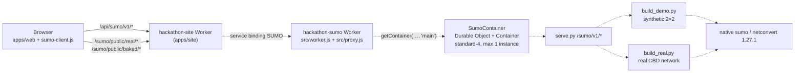

# sumo: cloud SUMO service
Owner: @Zemmeng

Runs native [Eclipse SUMO](https://eclipse.dev/sumo/) 1.27.1 for the RippleTwin workbench. A Cloudflare Worker (`hackathon-sumo`) sits in front of a Cloudflare Container that runs `apps/web/tools/sumo/serve.py`. The module also ships the browser client (`public/js/sumo-client.js`) and the pre-computed SUMO replays the page falls back to whenever a live cloud run is unavailable.

SUMO is a **model cross-check** of the traffic engine on the real CBD street network, with assumed signal timing and turn shares. It does not validate or prove the engine's numbers.

> **Status: decommissioned after the hackathon.** The `hackathon-sumo` Worker and its container were deleted after FEIT Hackathon Festival 2026. On the live site, `/api/sumo/v1/*` returns `502 sumo_down`, and the page replays the pre-computed real-network run in `public/real/`. The code, image definition and tests are kept so the service can be redeployed; see [Redeploying](#redeploying).

## Post-event status

| Part | State |
|---|---|
| Worker `hackathon-sumo` + container `SumoContainer` | deleted |
| `GET /api/sumo/v1/health` on the live site | `502 {"ok":false,"error":"sumo_down","msg":…}`, answered by the site Worker's catch branch because its `SUMO` binding now points at a missing Worker |
| `/sumo/public/js/sumo-client.js`, `/sumo/public/real/*`, `/sumo/public/baked/*` | served as static assets by the site Worker (HTTP 200) |
| `bash apps/sumo/test.sh` | runs offline (no Docker, no npm install, no network): 396 passed |

What the workbench does now:

- **Step 02 (Simulate).** `runReal()` gets `502 sumo_down` from the health check, so it returns `{source:'baked', reason:'health_down', detail:'sumo_down'}` with the seed-42 replay from `public/real/`. The pill reads "SUMO · pre-computed (cloud unavailable) · seed 42" with the reason "Cloud SUMO is unreachable". Choosing another seed still shows the seed-42 replay, labelled seed 42.
- **Step 03 (Impact).** Shows the same run, labelled pre-computed.
- **Step 04 (Compare).** `runOptions()` has **no pre-computed fallback**, so it returns `source:'none'`; the per-plan SUMO cells show "—" with the reason. The background prefetch of the options run only follows a live step 02 run, so it never fires.
- The synthetic 2×2 replays in `public/baked/` are not used by the current UI; only the legacy `run()` / `bakedFor()` API reads them.

The live `502` body still carries the original Chinese `msg` text, because the site Worker has not been redeployed since the event. Clients should rely on `error`, never on `msg`.

> **Redeploy hazard.** `apps/site/wrangler.jsonc` still binds `SUMO` → `hackathon-sumo`. Redeploying the site while that Worker does not exist is expected to fail with "Could not resolve service binding". Either redeploy `hackathon-sumo` first, or remove the binding and, in the same commit, relax `apps/site/tests/config.test.mjs` (which requires exactly the `API` and `SUMO` bindings) and `apps/sumo/tests/config.test.mjs` (which checks the binding name). Without the binding the site answers `503 sumo_off`, which the client treats like `sumo_down`.

## Architecture



Dashed links: deleted after the event. The static replays are served by the site Worker, which copies `apps/sumo/public/` to `/sumo/public/` at build time (`apps/site/build.mjs`).

- **Same origin only.** The Worker has no `workers.dev` URL (`workers_dev: false`, `preview_urls: false`); the only way in is the site's service binding, so no CORS is needed.
- **One instance.** serve.py keeps job state in memory and on the container's ephemeral disk, so the Worker always addresses `getContainer(env.SUMO_CONTAINER, 'main')` and `wrangler.jsonc` pins `max_instances: 1`.
- **Container.** `standard-4` (4 vCPU / 12 GiB / 20 GB disk, the largest Cloudflare instance type at the time) with `sleepAfter = '12h'`; `/data` is ephemeral and wiped on sleep, restart or redeploy. The instance type was raised to 4 vCPU so the scenarios of the full one-hour run can execute in parallel (`SUMO_REAL_JOBS=4`).
- **Edge logic in `proxy.js`.** It imports no Cloudflare module, so Node tests it directly. `worker.js` is a short shell that may export only `default` and the Durable Object class, because workerd treats every named export as an entrypoint.

A run, as the client drives it:

```mermaid
sequenceDiagram
  participant Page as Page (sumo-client.js)
  participant W as hackathon-sumo (proxy.js)
  participant C as serve.py (container)
  Page->>W: GET /health
  W->>C: GET /sumo/v1/health
  C-->>Page: 200 {status:"ready", active_jobs, networks}
  Page->>W: POST /runs {network:"real", seed, p_original, p_ai}
  Note over W: body ≤ 2 KB → 3 POST/min/IP → busy gate (active_jobs below 2)
  W->>C: POST /sumo/v1/runs
  C-->>Page: 202 {id, status:"queued"}
  loop every 1 s
    Page->>W: GET /runs/{id}
    W-->>Page: queued | running | complete | failed
  end
  Page->>W: GET /runs/{id}/index.json, {scenario}/manifest.json, frames-NNN.json
  W-->>Page: 200, cached for a day; chunk SHA-256 checked in the browser
  Note over Page: any failure → fallback with a reason code (baked replay, or source 'none')
```

The site Worker sits between the page and `hackathon-sumo` and forwards `/api/sumo` and `/api/sumo/*` unchanged.

## Simulation modes

Model details, assumptions and measured results are in [`apps/web/tools/sumo/README.md`](../web/tools/sumo/README.md); the method is summarised in [`docs/architecture/traffic-simulation.md`](../../docs/architecture/traffic-simulation.md).

**Synthetic 2×2 grid** (default; `network` absent or `"synthetic"`). Four junctions with assumed geometry, not Melbourne. Scenarios `baseline` / `closure` / `guided` / `footpath` (`baseline` is always added). Parameters: `seed` (integer 0–2147483647, default 42), `scenarios`, `demand_duration_s` (10–600, default 600), `clearance_s` (600–2400, default 1200), `demand_scale` (0.1–1.2, default 1.0), `diversion_share` (0–1, default 0.45).

**Real CBD network** (`"network":"real"`, contract v2). OSM `network.json`, SCATS `signals.json` and weekday 08:00–09:00 `flows.json` from `apps/roads/public/cbd/`, with demand fitted by SUMO's routeSampler; cars only. The network starts empty at 07:57 (warm-up, not shown); from 08:00 the right lane of Lonsdale St westbound (link `l595594354_9756035316`) is closed; 08:00–09:00 is shown and measured. Scenarios:

| id | Diversion share | Meaning |
|---|---|---|
| `baseline` | 0 | no works (metrics only, no frames) |
| `original` | `p_original`, default 0.14 | the engine's reading of the sign "ROADWORK AHEAD" |
| `ai` | `p_ai`, default 0.53 | the engine's reading of "USE RUSSELL / SAVE 9 MIN" |

**Options mode** (`"network":"real"` + `options`). Same network and works; each plan changes only the diversion share. `options` is 1–5 items `{id, p}` with a unique `id` in A–E and `p` in 0–1; `frames` defaults to `false` (metrics only); it cannot be combined with `p_original`, `p_ai` or `scenarios` (400 `bad_config`). A job runs `baseline` + `opt-<id>`; options with equal `p` run once and are copied with `reused_from`. Step 04 of the workbench sends plans A (no VMS), B (two VMS showing the delay) and C (one VMS naming the detour), with `p` taken from the engine's reading of each plan's signs.

### Seeds and reproducibility

- Seed range 0–2147483647, default 42. Pre-computed copies exist only for seed 42.
- Departures are Poisson arrivals drawn from the seed, and the diversion draw uses a second seeded generator shared across scenarios (common random numbers), so `baseline`, `original` and `ai` simulate the same vehicles and differences come from the treatment. Candidate routes and routeSampler use a fixed seed (7) inside the cached demand.
- Results depend on the platform: routeSampler picks different demand on macOS and Linux, so replays are baked in the linux/amd64 image. Every output records `generator_sha256`, the SHA-256 of the generator script (see [Provenance](#provenance)).

## HTTP API (`/api/sumo/v1`)

The full contract (fields of `index.json`, manifests and frame chunks, formats v1 / v2) is in [`docs/reference/interfaces.md`](../../docs/reference/interfaces.md). Only these paths exist; anything else is `404 not_found` and never wakes the container.

| Method | Path (prefix `/api/sumo/v1`) | Cache-Control |
|---|---|---|
| GET / HEAD | `/health` (passed through byte for byte) | `no-store` |
| POST | `/runs` (body ≤ 2,048 bytes; per-IP rate limit, then the busy gate) | `no-store` |
| GET / HEAD | `/runs/<32 lower-case hex>` (job status; its `result` field is the container path `/sumo/v1/…`, so build URLs from `id`) | `no-store` |
| GET / HEAD | `/runs/<id>/index.json` and `/runs/<id>/<scenario>/<manifest\|frames-NNN>.json`, where `<scenario>` is `baseline\|closure\|guided\|footpath\|original\|ai\|opt-A`…`opt-E` and `NNN` exactly three digits | `public, max-age=86400, immutable` on 200 |
| GET / HEAD | `/runs/<id>/frame?scenario=…&t=…` (the only route that keeps its query string; synthetic runs only, real-network runs answer 404) | `no-store` |

Request bodies:

```jsonc
{}                                                                   // synthetic 2×2, all defaults
{"seed": 7, "diversion_share": 0.3, "demand_scale": 1.2}             // synthetic 2×2
{"network": "real", "seed": 42, "p_original": 0.14, "p_ai": 0.53}    // real network: baseline + original + ai
{"network": "real", "seed": 42, "options": [{"id": "A", "p": 0.14}, {"id": "B", "p": 0.14}, {"id": "C", "p": 0.607}]}  // options mode
```

Responses:

- `GET /health` → `{"version":1,"engine":"Eclipse SUMO sumo 1.27.1","status":"ready","active_jobs":0,"networks":["synthetic","real"]}` (`networks` lists only what the image can run).
- `POST /runs` → `202 {"version":1,"id":"<32 hex>","status":"queued","created_at":…,"config":{…}}`.
- `GET /runs/<id>` → `{id, status: queued|running|complete|failed, config, result?, error?, created_at, updated_at}`. Only the newest 20 finished runs are kept.

Errors are always `{ "ok": false, "error": "<code>", "msg": "<explanation>" }`:

| Status | `error` | When |
|---|---|---|
| 404 | `not_found` | path not whitelisted (container untouched), or no such run / file (every old run id is a 404 after a container restart) |
| 405 | `method_not_allowed` | wrong method; carries an `Allow` header |
| 413 | `too_big` | POST body over 2,048 bytes |
| 429 | `sumo_rate` | 4th POST from the same IP within a minute (`Retry-After: 60`) |
| 429 | `sumo_busy` | the container already has 2 or more jobs (`Retry-After: 15`) |
| 503 | `sumo_starting` | the container is provisioning, starting or its port is not ready yet (`Retry-After: 10`) |
| 502 | `sumo_down` | the container is unreachable, disconnected or threw, or answered a 5xx not in the repo format |
| 409 / 4xx | `not_ready` / `bad_request` | legacy `{error:"…"}` container errors, translated by status (409 → `not_ready`, other 4xx → `bad_request`) |
| as sent | `bad_config`, `bad_json`, `sumo_error`, … | serve.py errors already in the repo format pass through with their status (e.g. `400 bad_config`, `500 sumo_error`; full list in `apps/web/tools/sumo/README.md`) |
| 503 | `sumo_off` | from the site Worker when no `SUMO` binding exists |

Wrapper errors from `@cloudflare/containers` are plain text; `proxy.js` classifies them (`STARTING_RE`) into `sumo_starting` or `sumo_down` and never forwards their internals. serve.py's English detail is appended to `msg` in brackets for diagnosis.

## Cost and abuse controls

The container was a single paid instance, so every layer limits how often it can be woken or kept busy:

- **Fail-closed whitelist.** One regex table (`ROUTES` in `src/proxy.js`); unknown, traversal (`..`, `%2e%2e`, `%2f`) and wrong-case paths get 404 and wrong methods get 405 *before* `getStub()` is called, so probes cannot wake or bill the container. `tests/worker.test.mjs` checks about 33 hostile paths.
- **Body cap.** 2,048 bytes, counted while streaming, so chunked uploads without `Content-Length` are caught too (serve.py has its own 16 KB cap).
- **Rate limit.** Workers Rate Limiting binding `SUMO_RL`: 3 POSTs per `CF-Connecting-IP` per 60 s (namespace `3501`). It is counted per Cloudflare location and eventually consistent; if the limiter itself errors, the request is let through.
- **Busy gate.** Before forwarding a POST, the Worker reads the container's own `active_jobs` from `/health` and answers `429 sumo_busy` at 2 or more.
- **Queue.** serve.py runs one job at a time with at most 4 unfinished jobs, and keeps only the newest 20 runs (`SUMO_KEEP_RUNS`).
- **Header stripping.** `Origin`, `Cookie` and `Authorization` never reach the container; the container's own response headers (e.g. `Server`) are not passed back.
- **Caching.** Run ids are random and outputs are immutable once complete, so a 200 for `index.json`, a manifest or a frame chunk is cached for a day; status, health and errors are `no-store`.
- **Sizing.** `max_instances: 1`, `sleepAfter = '12h'` (kept awake through judging; billed while awake).

Cost during the event: Workers Paid (US$5 per month) plus container time while awake. The team set a total budget of US$20 and estimated about US$1.5–3 of container time up to the end of judging. With the Worker and container deleted, no container time accrues.

## Browser client (`public/js/sumo-client.js`)

An ES module with no dependencies that runs in the browser and in Node (pass `fetch` and absolute URLs in Node). It is the page's only entry point to SUMO.

```js
import { createSumoClient, realSourceLabel, reasonLabel } from '/sumo/public/js/sumo-client.js';
const sumo = createSumoClient();   // { base: '/api/sumo/v1', baked: '/sumo/public/baked', real: '/sumo/public/real', timeoutMs: 45000, pollMs: 1000 }
const r = await sumo.runReal({ seed: 42, p_original: 0.14, p_ai: 0.53 }, { onStatus, signal });
realSourceLabel(r, 'en');          // 'Cloud · live · 31.4 s' or 'SUMO · pre-computed'
if (r.reason) reasonLabel(r.reason, 'en');   // e.g. 'Cloud SUMO is unreachable'
const m = await sumo.realManifest(r, 'original');
const c = await sumo.realChunk(r, 'original', m.chunks[0]);   // SHA-256 checked against the manifest
```

Every result carries `source`: `'live'`, `'baked'` or `'none'`, plus a `reason` code when it is not live. A pre-computed result is never labelled live, even if the file claims `source:'live'` or carries `elapsedMs` / `runId`; the tests assert this in reverse.

| Method | Live path | Fallback | Time limit |
|---|---|---|---|
| `runReal(params, {onStatus, signal, timeoutMs})` | health → POST → poll → `index.json` | `public/real/` (seed 42), `source:'baked'` | 180 s (health check 12 s) |
| `runOptions(options, {seed, onStatus, signal, timeoutMs})` | same, options body | none: `source:'none'`, `index:null` | 180 s (health check 12 s) |
| `run(params, {onStatus, signal})` (legacy, synthetic) | same | nearest grid point in `public/baked/` (`exact`, `failedExact`) | 45 s (health check 6 s) |
| `loadReal()`, `realManifest()`, `realChunk()` | — | static files in `public/real/`, or the live run's outputs | 20 s per file |

Reason codes: `health_down`, `sumo_off`, `sumo_down`, `sumo_starting`, `sumo_rate`, `sumo_busy`, `sumo_failed`, `timeout`, `network`, `not_found`, `cancelled`, `too_big`, `bad_params`, `bad_response`, `bad_chunk`. For the real network every health failure is reported as `health_down`, with the specific cause in `detail`. Cancelling via `signal` returns the fallback with `reason:'cancelled'`.

`labels` (synthetic) and `realLabels` (real network) are frozen bilingual tables (`zh` / `en`) of status texts and the caveats that must be shown alongside a result; `sourceLabel`, `realSourceLabel` and `reasonLabel` default to `'zh'`, and the web always passes the current UI language.

## Pre-computed replays

| Directory | Contents | Used by |
|---|---|---|
| `public/real/` | 64 files, about 30 MB. Real CBD network (contract v2), seed 42, baked on linux/amd64: `index.json`, `baseline/manifest.json` (metrics only, `chunks: []`), and `original/`, `ai/` each with a manifest + 30 two-minute frame chunks (2 s sampling). Rows are `[i, lon_e6, lat_e6, angle_deg, speed_cms]` plus signal strings and the queue length. | step 02 / 03 fallback (`runReal`, `loadReal`) |
| `public/baked/` | 101 files, about 21 MB. Synthetic 2×2 (contract v1, local metres): `baked.json` catalogue; `preset/` (seed 42 defaults: index + 4 scenarios × manifest + 20 frame chunks); `grid/` (15 index-only points: diversion {0, 0.15, 0.3, 0.45, 0.6} × demand {0.8, 1.0, 1.2}). | legacy `run()` / `bakedFor()` only |

Both are generated files; do not edit them by hand.

- **Re-bake `public/real/`** with `build_real.py` inside the linux/amd64 image; the exact commands are in [`apps/web/tools/sumo/README.md`](../web/tools/sumo/README.md#re-baking-the-replay).
- **Re-bake `public/baked/`** against any running API (a local `serve.py` or container):

  ```bash
  python3 apps/sumo/tools/bake.py --base http://127.0.0.1:8021/sumo/v1 --source docker-linux-amd64   # add --dry-run to print the plan only
  ```

  `bake.py` (Python ≥ 3.9, standard library only) submits one job at a time, retries 429 / 5xx, verifies every chunk's SHA-256, byte count and frame count, records failed grid points with `error_kind` `sumo` or `service` instead of skipping or inventing them, and swaps the output directory in atomically. Exit codes: 0 written; 1 nothing written; 2 written, but some grid points failed for service reasons (re-run with `--only grid`).

### Provenance

- `public/real/index.json` records `generator_sha256` = SHA-256 of `apps/web/tools/sumo/build_real.py`. `apps/web/tests/test_sumo_real.py` fails if `build_real.py` changes without a re-bake, so even a comment edit to it needs a new bake.
- `public/baked/` records `generator_sha256` = SHA-256 of `apps/web/tools/sumo/build_demo.py`, plus the engine and `source` (`docker-linux-amd64`, generated 2026-09-30). `bake.py` refuses to merge runs from different generators or engines.
- The container's real-network cache (`SUMO_REAL_CACHE`) is keyed on `build_real.py`, the three input files, the SUMO version and the signal 2935 green share.

## Container image (`Dockerfile`)

`python:3.12-slim` (linux/amd64) + X11 / GL / libatomic runtime libraries + `eclipse-sumo==1.27.1` / `sumolib==1.27.1` + `numpy==2.2.6` / `scipy==1.15.3` + the three real-network inputs from `apps/roads/public/cbd/`. The build context is `apps/` (`image_build_context: ".."`), and the image mirrors the repo layout (`/app/web/tools/sumo`, `/app/roads/public/cbd`). The image is about 290 MB; the first build takes 1–2 minutes.

The build fails early, instead of after a deploy, if any of these checks fails:

1. `ldd` finds a missing shared library for `sumo` or `netconvert` (this is how the missing `libatomic1` was found).
2. `sumo --version` is not `Eclipse SUMO sumo 1.27.1`, or `netconvert`, `routeSampler.py`, `numpy` or `scipy.optimize` is missing.
3. A minimal end-to-end synthetic run (`build_demo.py --scenarios closure --demand-duration-s 60 --clearance-s 600`) does not produce `index.json`.
4. `build_real` cannot be imported or its parameter validation fails; then `build_real.py --prepare-only` pre-builds the real-network cache (netconvert + routeSampler) into the image, so each live run only runs `sumo`.

Environment: `HOST=0.0.0.0 PORT=8080 SUMO_DATA_DIR=/data SUMO_KEEP_RUNS=20 SUMO_REAL_JOBS=4` (identical to `CONTAINER_ENV` in `src/proxy.js`, which `worker.js` passes as `envVars`; the tests enforce this), plus `SUMO_ROADS_DIR=/app/roads/public/cbd` and `SUMO_REAL_CACHE=/app/real-cache`. `ALLOW_ORIGINS`, `SUMO_API_KEY` and `SUMO_POSTS_PER_MIN` are deliberately unset: the Worker strips `Origin` and rate-limits per viewer IP. serve.py handles `SIGTERM` (running job finishes, queued jobs are dropped). The `HEALTHCHECK` is for local `docker run` only; Cloudflare probes `SumoContainer.pingEndpoint`.

To run every build-time check without deploying (needs Docker):

```bash
cd apps/sumo && npx wrangler deploy --dry-run --outdir .wrangler/dry-run
```

## Local development

```bash
bash apps/sumo/test.sh                     # offline tests; needs Node ≥ 20.6

# Worker + container locally (needs Docker; on Apple silicon: colima start --vm-type vz --vz-rosetta)
cd apps/sumo && npm ci && npm run dev      # = wrangler dev --port 8791
curl -s http://localhost:8791/api/sumo/v1/health

# Container only, no Worker (build context is apps/, not apps/web; no /api prefix, whitelist or rate limit)
docker build --platform linux/amd64 -f apps/sumo/Dockerfile -t hackathon-sumo:dev apps
docker run --rm -p 8792:8080 hackathon-sumo:dev
curl http://localhost:8792/sumo/v1/health
curl -s -X POST -H 'content-type: application/json' --data '{"network":"real"}' http://localhost:8792/sumo/v1/runs
```

Without Docker, run `serve.py` from a virtual environment as described in [`apps/web/tools/sumo/README.md`](../web/tools/sumo/README.md#running-locally) (real-network results on macOS differ from the linux/amd64 bake).

## Redeploying

`sumo` is deliberately **not** in `DEPLOY_MODULES` in `hackathon.conf`: the image needs Docker, so `bash scripts/deploy.sh all` would fail on a machine without it. The Worker is deployed by hand. Deployment topology and the rest of the post-event status are described in [`docs/architecture/deployment.md`](../../docs/architecture/deployment.md).

Prerequisites: a Cloudflare account on Workers Paid (Containers require it; on the free plan `npx wrangler containers list` reports that it requires the Workers Paid plan) and Docker with BuildKit.

```bash
colima start --vm-type vz --vz-rosetta     # Docker; Cloudflare runs linux/amd64 only, Apple silicon builds through Rosetta
docker info > /dev/null && echo docker ok
cd apps/sumo && npm ci                     # wrangler 4.143.0 + @cloudflare/containers 0.3.7, pinned in package-lock.json
npx wrangler whoami                        # confirm the account
npx wrangler deploy                        # builds the image, pushes it to Cloudflare's registry, deploys the Worker
npx wrangler containers list               # container application status
```

1. Wait a few minutes after the first deploy: the Worker is live while the container is still provisioning, and `/api/sumo/v1/*` answers `503 sumo_starting` in the meantime (the page keeps using the pre-computed results).
2. Then deploy the site (`bash scripts/deploy.sh all`); its `SUMO` service binding requires `hackathon-sumo` to exist.
3. Smoke test (also a good way to warm the container before a demo; it stays awake for 12 h):

   ```bash
   curl -s https://<site>/api/sumo/v1/health
   curl -s -X POST -H 'content-type: application/json' --data '{"network":"real"}' https://<site>/api/sumo/v1/runs   # 202 + id
   curl -s https://<site>/api/sumo/v1/runs/<id>             # queued → running → complete (a real-network run took about 40–60 s in the cloud)
   curl -s https://<site>/api/sumo/v1/runs/<id>/index.json  # then <baseline|original|ai>/manifest.json and frames-NNN.json
   ```

Logs: `npx wrangler tail hackathon-sumo`, or Workers Logs in the Cloudflare dashboard (container start / stop and forwarding errors are logged).

The Worker name is `hackathon-sumo` in `wrangler.jsonc` and in the site's `services` binding; rename both together.

### Decommissioning (what was done)

After the event the Worker and the container were deleted (`cd apps/sumo && npx wrangler delete` removes the Worker and its Durable Object; `npx wrangler containers delete <ID>` and `npx wrangler containers images delete <image>` remove the container application and image). The first step of the original kill switch, removing the `SUMO` binding from `apps/site/wrangler.jsonc` so `/api/sumo/*` answers `503 sumo_off`, was not done; see the redeploy hazard under [Post-event status](#post-event-status).

## Testing

```bash
bash apps/sumo/test.sh      # last line "N passed, M failed"; no npm install, no Docker, no network
```

Plain Node ESM test files with a small `ok()` harness; `test.sh` runs each with a 60 s limit and sums the counts for `scripts/check.sh`.

| File | Assertions | What it checks |
|---|---|---|
| `tests/worker.test.mjs` | 153 | `proxy.js` / `worker.js` against a fake container and a fake rate limiter: whitelist rewrites, ~33 rejected paths that never reach the container, 405 + `Allow`, header stripping, cache headers, health passthrough, the POST pipeline (body cap including chunked uploads, rate limit keyed on `CF-Connecting-IP`, fail-open limiter, busy gate), 15 error-mapping cases without leaking internals, options-mode routes; `worker.js` exports only `default` and `SumoContainer` (`@cloudflare/containers` is swapped for `tests/fake-containers.mjs` through a `node:module` hook) |
| `tests/config.test.mjs` | 41 | `wrangler.jsonc` (`standard-4`, `max_instances` 1, `workers_dev` / `preview_urls` false, build context `..`, DO binding + migration, rate limit 3 / 60 s), the `Dockerfile` (COPY sources exist, real-network inputs present, `SUMO_ROADS_DIR`, pinned numpy / scipy, ENV equals `CONTAINER_ENV`, build-time checks within the public parameter ranges), `package.json` / lock pins equal to the site's wrangler version, the site's `SUMO` binding, `sumo` absent from `DEPLOY_MODULES`, this README's owner line, the `apps/README.md` registry row and `CODEOWNERS` |
| `tests/client.test.mjs` | 202 | `sumo-client.js` with a fake `fetch`: live path, every fallback reason, nearest-grid selection, SHA-256 checks (and graceful skip without WebCrypto), the never-label-baked-as-live rule, `runReal` / `loadReal` / `realManifest` / `realChunk`, `runOptions` (13 invalid inputs, 11 failure modes), bilingual labels |

Related tests outside this module: `python3 apps/web/tests/test_sumo_real.py` (shape, ranges and generator hash of `public/real/`), `python3 apps/web/tests/test_sumo_backend.py` (serve.py) and `bash apps/site/test.sh` (the `SUMO` binding and forwarding).

## Design notes

- `src/worker.js` exports nothing except `default` and `SumoContainer`; put any other function in `proxy.js`.
- Always use the single instance `getContainer(env.SUMO_CONTAINER, 'main')`: a second instance could not see the first one's runs.
- Change container environment variables in both `CONTAINER_ENV` (`src/proxy.js`) and the `ENV` line of the `Dockerfile`; `tests/config.test.mjs` checks they match.
- 404 and 405 are answered before the container is fetched, so random paths never wake it.
- Results are labelled by where they came from, never by what the page hoped for: `source` decides the label, and options mode has no fake fallback.

## Project layout

| Path | Role |
|---|---|
| `src/worker.js` | Worker entry: `SumoContainer` (port 8080, `sleepAfter` 12 h, environment, ping on `/sumo/v1/health`) and `default.fetch`, which hands the request to `proxy.js` |
| `src/proxy.js` | whitelist, method check, header stripping, streaming body cap, rate limit, busy gate, error normalisation, cache headers; no Cloudflare imports |
| `public/js/sumo-client.js` | browser client with live / baked / none results, reason codes, timeouts, cancellation, SHA-256 chunk checks, bilingual labels |
| `public/real/`, `public/baked/` | pre-computed replays (generated) |
| `tools/bake.py` | re-bakes `public/baked/` through the HTTP API |
| `Dockerfile` | container image with build-time verification |
| `wrangler.jsonc` | Worker, container, Durable Object binding + migration, rate limit |
| `package.json`, `package-lock.json` | pinned `wrangler` and `@cloudflare/containers`; `npm run dev` / `test` / `deploy` |
| `test.sh`, `tests/` | offline test runner and tests; `tests/fake-containers.mjs` is the test double for `@cloudflare/containers` |

## Known limitations

- The container disk is ephemeral: sleep (12 h without requests), a Cloudflare host move or a redeploy wipes it, after which every old run id is a 404 and the page falls back to the pre-computed results.
- `SUMO_RL` is counted per Cloudflare location and eventually consistent, not an exact limit; the busy gate and serve.py's queue limit back it up.
- Re-baking `public/baked/` against a hosted endpoint takes 16 runs (1 preset + 15 grid points) and hits the 3-per-minute limit; `bake.py` waits and retries, so a full batch takes at least 5–6 minutes.
- Under local `wrangler dev` the amd64 image runs through Rosetta, so timings are not representative (about 15 s for the four synthetic scenarios).
- The build context is all of `apps/`. BuildKit sends only the files `COPY` uses; the legacy non-BuildKit builder also packs the three `node_modules` directories (about 200 MB each), which is slow but gives the same image.
- The real-network model assumes signal timing and turn shares and simulates cars only; it is a cross-check of the engine, not a field measurement.
