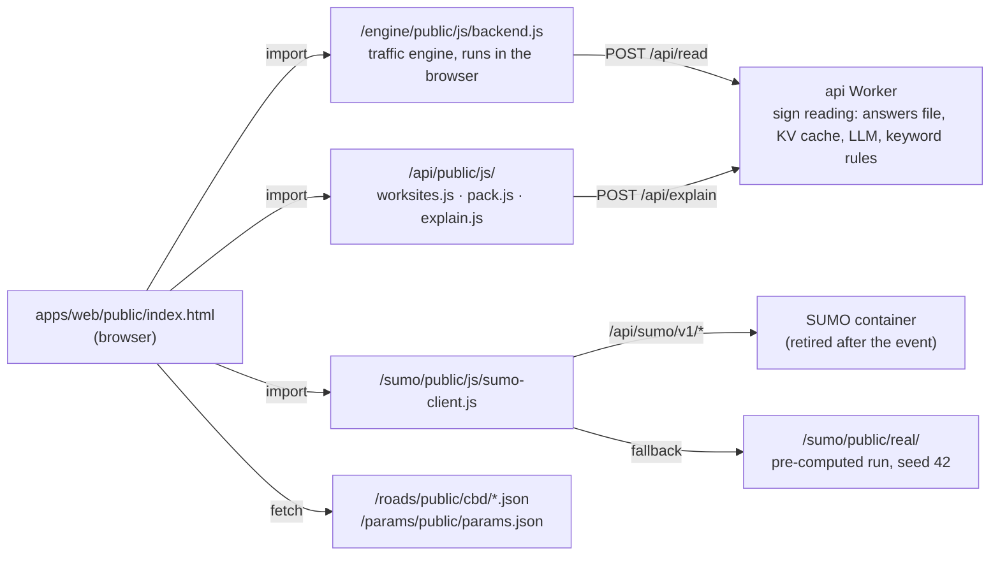

# web: the RippleTwin planning workbench

Owner: @unicornnnnnny

A zero-build, single-page web app for planning temporary traffic management in the Melbourne CBD. A planner closes a lane on a real street, writes the variable message sign (VMS) and static sign text, and works through six steps. The traffic engine scores the plan in the browser. Step 02 shows a micro-simulation: the in-browser GridSim, or a replay of an Eclipse SUMO run on the real CBD network. The last steps compare equipment kits and export a one-page execution pack.

- Live: https://hackathon-site.zemmmeng.workers.dev/web/public/ (served by `apps/site`; see [Status after the hackathon](#status-after-the-hackathon)).
- English by default, with a 中文 toggle. The Chinese copy is a deliberate feature, not leftover text.
- The page talks only to its own origin. Traffic numbers come from the engine (`apps/engine`), data from `apps/roads` and `apps/params`, sign reading, hire quotes and explanations from `apps/api`, and SUMO replays from `apps/sumo`.

Wider context: [frontend architecture](../../docs/architecture/frontend.md), [traffic simulation](../../docs/architecture/traffic-simulation.md), [module interfaces](../../docs/reference/interfaces.md).

## The six-step workflow

| Step | What the planner does | Where the numbers come from |
|---|---|---|
| 00 Overview | Pick one of two demo plans (Lonsdale St at 08:00 or La Trobe St at 17:00, one lane closed) and see the data under the map | — |
| 01 Configure | **Site**: click a street (the side you click picks the direction, keep-left), close one or all lanes, choose the hour (07, 08, 12 or 17) and the footpath treatment. **Signs**: two VMS frames, the VMS distance, static sign S-1, live rule checks, and the VMS lab, which ranks alternative wordings and positions. **Checks**: budget, must-keep conditions and a pre-simulation checklist | Engine `check()` and `run()`, re-run 350 ms after the last edit. Invalid sign text is never scored |
| 02 Simulate | Watch the works in a micro-simulation | GridSim, in the browser, when the works lie within the 2×2 of junctions at Little Lonsdale / Lonsdale St × Swanston / Russell St (all 16 SCATS junctions are computed; only that 2×2 is counted). On the Lonsdale demo link with one lane closed, a replay of a SUMO run from 08:00 to 09:00 on the real network. Otherwise a scripted La Trobe × Swanston scene |
| 03 Impact | Three tabs. **Traffic**: queue, delay, detours, per-persona effects, trams and buses, pedestrians, and the AI road-users panel. **Nearby works**: the clash check, with a stagger option. **Evidence**: which inputs are real data and which are assumed | The engine. On the SUMO plan every traffic number is SUMO's |
| 04 Compare | Read the advisor's suggestions, then compare three RPM-inventory kits side by side with hire costs and badges (lowest, cheapest, same result as another kit) | Engine `options()`. On the SUMO plan the traffic rows come from a SUMO run of each kit |
| 05 Export | Choose a plan, record who decided and why, then print a one-page execution pack or copy the playbook | `apps/api` `pack.js` |

The advisor is rule-based. The language model is used only to read sign text (through `apps/api`) and to write the optional plain-language explanation of the options in 04. Neither produces a traffic number.

**The SUMO plan.** On the Lonsdale demo works with one lane closed (`SUMO_LINK` in `4c-sumo.js`), SUMO is the primary source. Steps 02 to 05 and the map show SUMO's numbers only, and the engine stays behind the scenes. It still reads the signs and turns each wording into the share of drivers who detour, which is SUMO's input. What SUMO does not model (trams, buses, pedestrians, overlapping works) is labelled "not covered by SUMO". Every other street uses the engine and is labelled as an engine estimate. See `6e-sumo3.js` and decision D-1001-0045 in [docs/decisions.md](../../docs/decisions.md).

## How it is built

There is no bundler, framework or package install. Hand-written HTML, CSS and JavaScript in `src/` are concatenated into one committed file:

```
src/head.html + src/styles.css + src/body.html + src/js/*.js (sorted by file name)
        │
        └── python3 apps/web/build.py
              ├── public/index.html       full page (~573 KB), committed and served as is
              └── out/web-artifact.html   body-only variant for a Claude Artifact (gitignored)
```

- The JS files share one global script scope. The numeric prefixes set the load order (`0-i18n.js` first, `9-ai.js` last).
- After any change under `src/`, run `python3 apps/web/build.py` and commit `public/index.html` with it. `tests/test_web.py` fails if the committed bundle differs byte for byte from `build.bundle()`, and caps the bundle at 2 MB.
- Python 3.9 (the macOS system Python) is enough for the build.

### Source map

| File | Role |
|---|---|
| `src/head.html` | Title and Google Fonts (Inter, JetBrains Mono, Space Grotesk, Noto Sans SC) |
| `src/body.html` | App shell: top bar with the six-step stepper, layer rail, map canvas and HUD, analysis panel, timeline. Chinese copy sits in `data-zh*` attributes |
| `src/styles.css` | Light and dark colour tokens, layout, floating glass layout, compact panel, compare table, printable A4 execution pack |
| `src/js/0-i18n.js` | `L(en, zh)` and `applyLangDom()` for the `data-zh*` attributes |
| `src/js/1-world.js` | World model in page metres: seeded RNG, procedural fallback city `buildWorld()`, real footprints `buildWorldReal()` with street clipping, 2 m land-cover, shadow and wind-wake rasters |
| `src/js/2-basemap.js` | Procedural orthophoto (RGB and near-infrared) and vector basemaps, roof shading, extruded shadows, street and building labels |
| `src/js/3-weather.js` | Six illustrative weather scenarios (clear baseline, storm radar, flood depth, fog visibility, land-surface temperature, wind): rasters, contours, particles, probe readouts |
| `src/js/4-sim.js` | Scripted La Trobe × Swanston scene: IDM car-following, signals, pedestrians, TTC conflicts, the scripted C-17 / D-42 / Bus 250 event |
| `src/js/4b-grid.js` | GridSim: a 4×4 grid of real SCATS junctions with IDM car-following, flows calibrated to SCATS counts, green-wave offsets, zipper merge and left turns. Only the 2×2 around the works is counted |
| `src/js/4c-sumo.js` | SumoReplay: plays SUMO replays (format v2, see docs/reference/interfaces.md) through the same interface as GridSim, streaming chunks within a 48 MB memory budget |
| `src/js/5-app.js` | Main app logic: view and fly-to, render loop, step logic and panels, SUMO run orchestration (one cloud job at a time), histogram, legend, theme and language, data credits, boot |
| `src/js/6-engine.js` | Engine wiring: geo-to-page affine fit, link picking, plan building, debounced `run()` / `check()`, the 01 / 03 / 04 panels, advisor, map drawing of queue, detours and ripple, playbook text |
| `src/js/6c-city.js` | Whole-CBD layer: OSM vector basemap, every building footprint and the engine road network, pre-rendered once per theme to an offscreen canvas |
| `src/js/6d-vmslab.js` | VMS lab (01 › Signs): candidate wordings built from the engine's own routes, each scored by `run()`, with a recommended wording and distance |
| `src/js/6e-sumo3.js` | SUMO-primary panels for the SUMO plan (03, 04 advisor, 05 text, 01 checks, map queue) |
| `src/js/7-glass.js` | Liquid-glass UI: SVG displacement refraction on Chromium, CSS blur elsewhere, compact / detail panel folding |
| `src/js/8-clash.js` | 03 › Nearby works: overlapping registered works, clash cost D(A+B) − D(A) − D(B), one-click stagger |
| `src/js/8-compare.js` | 04 Compare and 05 Export: `options()` kits, comparison table and badges, SUMO rows on the SUMO plan, AI explanation, execution pack |
| `src/js/9-ai.js` | 03 AI road-users panel: each persona's sign reading with its source, and the AI call log with a JSON download |
| `build.py` | The bundler described above; `bundle()` is also imported by the tests |
| `test.sh` | Runs every `tests/test_*.py` and prints the `N passed, M failed` summary line |
| `wrangler.jsonc` | Legacy standalone static-assets config (not used in production) |
| `tools/sumo/` | SUMO job API and replay generators; see [tools/sumo/README.md](tools/sumo/README.md) |

### Rendering and simulation

- **Render loop.** A cached base canvas (whole-CBD layer, then the fine window around La Trobe × Swanston, then labels) is redrawn only when the view or theme changes. Each frame then draws weather, the works and queue overlays, simulated vehicles and pedestrians, tags, graticule and scale bar.
- **One simulation interface.** GridSim and SumoReplay expose the same surface (`all`, `agents`, `events`, `stats`, `minute`, `signalHeads()`, `works()`, `step()`), so the renderer, panels and histogram have no SUMO-specific branch.
- **Plan data flow.** Form state → `planFrom()` → engine `check` / `run` / `advise` / `options` / `clash` → panels and map. Sequence tokens drop stale responses when the plan changes mid-request.
- **Boot.** The page draws a procedural city at once, then swaps in the real footprints from `buildings.json` (waiting at most 1.2 s for the first frame) and the vector basemap, split across several tasks to avoid a visible freeze.

## Interfaces used

Every request is same-origin. `tests/test_web.py` checks that each `import()` and `fetch()` is a literal path under `/engine/`, `/roads/`, `/params/`, `/api/` or `/sumo/`.



| Module file | What the page uses |
|---|---|
| `/engine/public/js/backend.js` | `connect()` → `status`, `demo()`, `check()`, `run()`, `advise()`, `compare()`, `options()`, `clash()`, `stagger()`, `readingsOf()`, `aiLog()`, `onAiLog()`, `engine.net` / `engine.flows`. The backend loads the road network, flows and parameters itself, and the sign reader from `/api/public/js/reader.js` |
| `/engine/public/js/index.js` | `affected()` and `capFactors()`, to draw the detour paths that `run()` scores |
| `/api/public/js/worksites.js` | `listWorksites()`, `overlapping()`, `toEngineWorksite()` for the clash check |
| `/api/public/js/pack.js` | `loadInventory()`, `quote()`, `buildPack()`, `packText()`, `packDoc()` for hire costs and the execution pack |
| `/api/public/js/explain.js` | `optionFromRun()`, `explainOptions()` for the 04 explanation (rule-based text when `/api/explain` is unavailable) |
| `/sumo/public/js/sumo-client.js` | `loadReal()`, `runReal()`, `realManifest()`, `realChunk()` (SHA-256 checked), `runOptions()`, `reasonLabel()` |
| `/roads/public/cbd/buildings.json`, `vectormap.json`, `walk.json` | Building footprints, OSM vector basemap, pedestrian network |
| `/params/public/params.json` | Road-user mix ranges and confidence, shown next to assumed values |

Formats are specified in [docs/reference/interfaces.md](../../docs/reference/interfaces.md). The page contacts no other host apart from Google Fonts (CSS fonts, with system fallbacks) and the outbound links in the data credits.

## Bilingual UI

- In JavaScript, every user-facing string is written as `L('English', '中文')`. `L()` returns the half for the current language.
- In static HTML, the English text is the element content, and the Chinese sits in `data-zh`, `data-zh-aria-label`, `data-zh-data-tip` or `data-zh-title`. `applyLangDom()` swaps them and sets `<html lang>`.
- The page starts in English unless the viewer chose 中文 with the toggle; the choice is kept in `localStorage` (`rt-lang`). The theme and panel mode use `rt-theme`, `rt-panel` and `rt-pmin`. Every storage access is wrapped in `try`/`catch`.
- Tests require both halves of every pair to be non-empty.

## Running locally

| Goal | Command | Open |
|---|---|---|
| Full demo on one origin, as deployed | `cd apps/site && npm ci && npm run dev` (for `/api/*`, also run `npm run dev` in `apps/api` first) | http://localhost:8790/web/public/ |
| Static server, no API Worker: engine, real city and the pre-computed SUMO run still load; new sign wording is read by keyword rules | `python3 -m http.server 8000 -d apps` | http://localhost:8000/web/public/ |
| UI only: no engine, procedural city | `python3 -m http.server 4175 -d apps/web/public` or `cd apps/web && npm run dev` | http://localhost:4175/ |

The real buildings, basemap and engine load only when the server root is `apps/`, because the page fetches `/roads/…`, `/engine/…` and so on. With the UI-only server the page shows the procedural city and the "Engine offline — no numbers to show" card. That is expected, not a bug.

## Testing

```bash
bash apps/web/test.sh                 # all suites; last line "N passed, M failed"
python3 apps/web/tests/test_web.py    # one suite
```

Requirements: Python ≥ 3.9 and Node ≥ 18, with no packages to install. The suites read the sibling modules (`apps/roads`, `apps/engine`, `apps/api`, `apps/params`, `apps/sumo`), and `test_grid_wire.py` needs git with an `origin/main` ref.

There is no browser or DOM test framework. Instead:

- **Static checks** read the source and the bundle: bundle freshness, same-origin policy, escaping, step and copy rules, deploy config.
- **Pure blocks** run in Node. Functions free of DOM access are fenced with markers such as `/* pure:begin */ … /* pure:end */`, `/* grid:begin */`, `/* sumo:begin */`, `/* sumo3-pure:begin */` and `/* vlab-pure:begin */`. The `.mjs` glue scripts extract them by regex and run them in `node:vm` against the real road network, the real engine and the real `pack.js`.
- **unittest suites** cover the SUMO tools in `tools/sumo`.

| Area | Suites |
|---|---|
| Bundle, security, i18n, deploy config | `test_web.py` |
| Liquid glass and accessibility | `test_glass.py` |
| Engine wiring | `test_engine.py` → `engine_glue.mjs` |
| Real buildings | `test_world.py` → `world_real.mjs` |
| GridSim | `test_grid.py` → `grid_glue.mjs`, `test_grid_wire.py` |
| SUMO replay and SUMO-primary panels | `test_sumo_wire.py` → `sumo_glue.mjs`, `test_sumo_primary.py` → `sumo3_glue.mjs` |
| SUMO tools and the pre-computed run | `test_sumo_backend.py`, `test_sumo_real.py` |
| Compare, hire and execution pack | `test_compare.py` → `compare_glue.mjs` |
| AI road-users panel | `test_ai.py` → `ai_glue.mjs` |
| VMS lab | `test_vlab.py` → `vlab_glue.mjs` |
| Data attribution | `test_credits.py` |
| Copy, scene and whole-CBD rules | `test_t20.py`, `test_t26.py`, `test_t27.py` → `t27_glue.mjs` |

Couplings to know about:

- `test_sumo_real.py` checks that the `generator_sha256` stamped into `apps/sumo/public/real/index.json` matches `tools/sumo/build_real.py`. Any byte change to that script needs a re-bake of the pre-computed run.
- `test_grid_wire.py` requires `src/js/4-sim.js` to match `origin/main`.
- `test_sumo_real.py` can re-run SUMO to check reproducibility when `SUMO_PY` points to a Python with `eclipse-sumo` installed; otherwise that part is skipped.

## Security and privacy

- Same-origin only, enforced by the static tests. No `XMLHttpRequest`, `WebSocket` or `sendBeacon`, and no secrets in the client.
- Every engine, register or model string passes through `esc()` before it goes into HTML, and the model's free text (why, summary, pros, cons) is set with `textContent` only. `test_web.py` scans for unescaped interpolation, and includes a probe that proves the scanner catches a missing `esc()`.
- The AI call log is downloaded from the browser with whitelisted fields and is never uploaded. `localStorage` holds viewer preferences only.

## Deployment

- **Production.** `apps/site` copies every module's `public/` to one origin and serves this page at `/web/public/`. The DEPLOYER runs `bash scripts/deploy.sh all`; see [apps/site/README.md](../site/README.md) and [docs/architecture/deployment.md](../../docs/architecture/deployment.md).
- **Legacy standalone copy.** `wrangler.jsonc` publishes only `public/` as static assets, with no engine or data behind it. Check it without logging in: `cd apps/web && npm ci && npx wrangler deploy --dry-run`.

## Status after the hackathon

After the event the owner deleted the SUMO Cloudflare Container, the `hackathon-sumo` Worker and the LLM API key. The page and everything it loads are still served by `hackathon-site`.

- Everything engine-based works as before, because the engine runs in the browser: checks, impact, advisor, kits, clash check, hire quotes, the execution pack, GridSim and the La Trobe scene.
- `/api/sumo/*` returns 502 (`sumo_down`). Step 02 replays the pre-computed SUMO run in `apps/sumo/public/real/` (seed 42) and step 03 shows its numbers, labelled "SUMO · pre-computed (cloud unavailable)" with the reason "Cloud SUMO is unreachable". A pre-computed replay is never labelled live.
- Step 04's per-kit SUMO cells show "—" with the reason, because options runs have no pre-computed fallback. The rest of the table (hire, footpath, stagger suggestion) still works.
- Sign reading uses the shipped pre-computed readings for the demo plans, then the KV cache, then keyword rules for any new wording. The 04 explanation falls back to rule-based text. Each pill says which source was used.

Pre-computed SUMO results (seed 42, Lonsdale St, one lane closed, queue at 09:00):

| Scenario | Queue, engine method | Physical queue in SUMO |
|---|---|---|
| No works | 15 m | 23 m |
| Original sign (ROADWORK AHEAD) | 973 m | 246 m |
| AI sign (USE RUSSELL) | 305 m | 260 m |

SUMO is a cross-check with assumed signal timing and turn shares, not a validation of the engine's numbers.

## Known issues and limitations

- Some copy still assumes a live cloud run: the step 02 spinner "SUMO simulating 08:00–09:00 in the cloud", the seed box on 01 and "▶ Run SUMO (~1 min)". With the container gone, any seed falls back to the pre-computed seed-42 run, which is labelled honestly.
- Weather is illustrative only and is not fed into the engine; the legend says so.
- The page draws the real network on an idealised Hoddle Grid. Between Queen St and Exhibition St, Bourke St and La Trobe St the fit error is at most 1.4 m. North of La Trobe St the blocks are stretched piecewise, so buildings there are stretched too.
- Signal timing and turn shares in GridSim and SUMO are assumptions. SUMO models cars only.
- Hire day rates and stock levels are assumptions, labelled on the page.
- Conflicts and harsh braking are simulation outputs, not measurements. SumoReplay does not compute conflicts at all (shown as "—").
- All figures are model estimates and have not been validated in the field.

## SUMO tools

`tools/sumo/` holds the SUMO job API (`serve.py`, which ran in the Cloudflare Container), the real-network replay generator (`build_real.py`, which produced `apps/sumo/public/real/`), the synthetic 2×2 prototype (`build_demo.py`) and an end-to-end smoke test (`smoke.py`). See [tools/sumo/README.md](tools/sumo/README.md).

## Data sources and credits

The page credits its data in the credits bar on the map:

- OpenStreetMap contributors (ODbL): road and walking network, building outlines.
- OpenMapTiles / OpenFreeMap (CC BY 4.0): vector basemap layers.
- State of Victoria, Department of Transport and Planning, via DataVic (CC BY 4.0): SCATS traffic signal volumes, PTV GTFS timetables.
- City of Melbourne open data (CC BY): pedestrian counts, 2018 building footprints, CLUE building information.

The glass refraction technique is adapted from liquid-glass.js by Deepika Rao (MIT), credited in `src/js/7-glass.js`.
