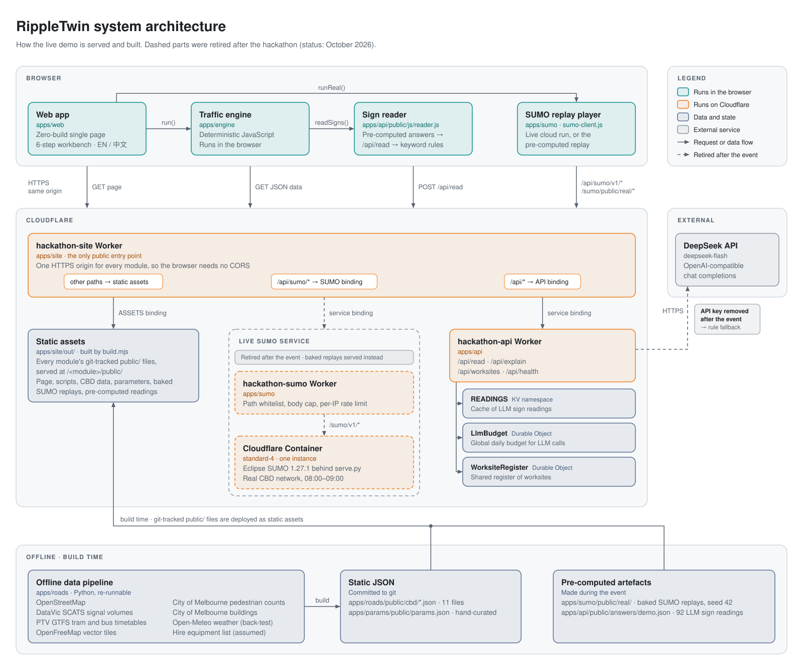
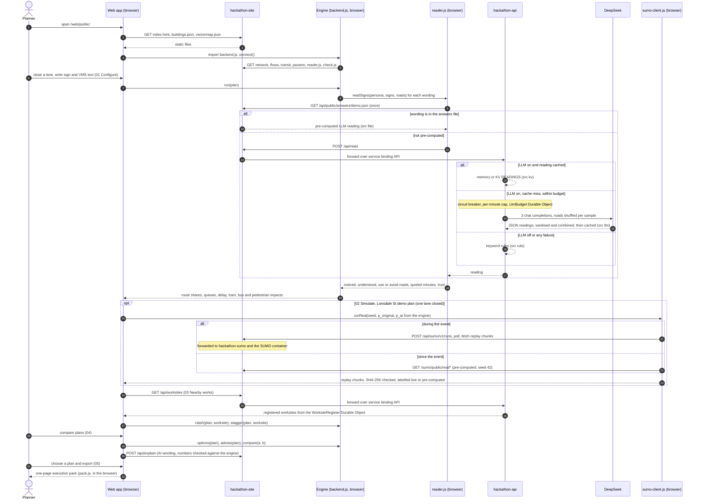

# Architecture overview

RippleTwin is a web workbench for testing a temporary traffic-management plan on the Melbourne CBD before it is deployed. A planner closes a lane or a road, places signs and writes variable message sign (VMS) text. The workbench then shows the effect on queues, delay, detours, trams and buses, and pedestrians, compares alternative equipment plans and exports a one-page execution pack. Everything is served from one Cloudflare Worker origin. The traffic engine runs in the visitor's browser over static open data that was downloaded and processed ahead of time. A large language model (DeepSeek, called only from a server-side Worker) reads the sign text from the point of view of four road-user personas. The deterministic engine turns those readings into route shares, queues and delay. During the event, Eclipse SUMO ran in a Cloudflare Container and replayed the Lonsdale St demo plan on the real street network as a cross-check. Since the event, the page replays a pre-computed SUMO run.

<picture>
  <source media="(prefers-color-scheme: dark)" srcset="../images/architecture-dark.svg">
  
</picture>

## Building blocks

The repository has eight modules under [`apps/`](../../apps/README.md). Each owns one directory, has its own `test.sh`, and talks to the others only through the interfaces in [module interfaces](../reference/interfaces.md).

| Module | Purpose | Technology | Runs where | Owner | README |
|---|---|---|---|---|---|
| `roads` | Builds the CBD road network, SCATS traffic flows, signal sites, tram and bus routes, footpath network, pedestrian counts, building footprints, vector basemap and equipment inventory as static JSON | Python (OSMnx, networkx, geopandas, shapely) | Offline on a developer machine; the JSON is served as static files | @louisxie316-dotcom | [README](../../apps/roads/README.md) |
| `params` | Behaviour and valuation parameters for the choice model, each with a source, a range and a confidence rating | JSON with a shell validator | Static file | @Unzzip | [README](../../apps/params/README.md) |
| `engine` | Deterministic traffic-impact engine: detours, persona route choice, assignment with queues, tram, bus and pedestrian impacts, clash cost of overlapping works, equipment options and a rule-based advisor. `backend.js` wires data, parameters and the sign reader together | Plain JavaScript, no dependencies | Browser (and Node for tests and tools) | @Zemmeng | [README](../../apps/engine/README.md) |
| `api` | Sign reading (LLM with keyword-rule fallback), AI explanation of a plan comparison, worksite register, hire quotes and execution pack | Cloudflare Worker, Durable Objects, KV; ES modules shared by the Worker and the browser | Cloudflare (`hackathon-api`) and browser | @jinmingq | [README](../../apps/api/README.md) |
| `web` | The 6-step planning workbench: canvas map of the CBD, plan editor, simulation view, impact, comparison and export | Hand-written HTML, CSS and JavaScript bundled by a 42-line Python script | Browser | @unicornnnnnny | [README](../../apps/web/README.md) |
| `site` | The single public origin: mounts every module's `public/` at `/<module>/public/` and routes `/api/*` to the other Workers | Cloudflare Worker with Static Assets and service bindings | Cloudflare (`hackathon-site`) | @Zemmeng (code), @unicornnnnnny (deploy) | [README](../../apps/site/README.md) |
| `sumo` | Cloud SUMO service: Worker proxy, container image running the SUMO job server, browser client and pre-computed replays | Cloudflare Worker and Container; Docker, Python, Eclipse SUMO 1.27.1 | Cloudflare (`hackathon-sumo`, retired); replays served as static files | @Zemmeng | [README](../../apps/sumo/README.md) |
| `sim` | The team's first standalone demo: a seeded micro-simulation of the Swanston St × La Trobe St junction on real counts | Plain JavaScript | Browser, at `/sim/public/` | @Zemmeng | [README](../../apps/sim/README.md) |

The SUMO job server (`serve.py`) and the real-network replay generator (`build_real.py`) live in [`apps/web/tools/sumo/`](../../apps/web/tools/sumo/README.md); the `sumo` module packages them into the container.

## Evaluating a plan, end to end

The sequence below follows one plan from page load to export. Loading the page and connecting the engine (steps 1–5) happen once per visit; after that the engine re-runs 350 ms after the planner stops editing.

Which component produces which number:

| Shown on screen | Lonsdale St demo plan, one lane closed | Any other plan |
|---|---|---|
| Queue, delay, detour volumes | SUMO replay ([D-1001-0045](../decisions.md)) | Engine estimate |
| Share of drivers who detour | Engine, from the AI sign reading (it is also SUMO's input) | Engine, from the AI sign reading |
| Tram, bus and pedestrian impacts; combined impact of overlapping works | No numbers; marked as not covered by SUMO | Engine estimate |
| Hire cost of equipment kits | Equipment inventory with assumed day rates | Same |
| Weather layer | Illustrative only, not fed into any model | Same |

Details: [traffic engine](engine.md), [sign reading](sign-reading.md), [traffic simulation](traffic-simulation.md).

## Design principles

| Principle | What it means in practice | Where to look |
|---|---|---|
| **AI interprets, the engine calculates** | The LLM returns a structured reading of a sign and nothing else: noticed, understood, which roads to use or avoid, quoted minutes, trust and a one-line reason. Route shares come from an explicit persona choice model with two-point calibration. Explanation sentences that contain a number the engine did not produce are dropped. | [`chooseShares()` in apps/engine/public/js/choice.js](../../apps/engine/public/js/choice.js) |
| **Deterministic engine** | The same plan gives a byte-identical result: adjacency lists are sorted, heap ties break in insertion order, and no random number or clock enters the numerics. Readings are fetched once per canonical request in `prepare()`, so `evaluate()` is synchronous and cheap enough to re-run for the advisor, the VMS lab and the options. | [apps/engine/tests/engine.test.mjs](../../apps/engine/tests/engine.test.mjs) asserts identical output for repeated runs |
| **Same origin, no CORS** | One Worker serves the page, the engine, the data and the API. Static files never run Worker code (`run_worker_first` covers only `/api/*`), the other Workers have no public URL, and no response carries CORS headers. | [apps/site/src/worker.js](../../apps/site/src/worker.js) |
| **Zero-build front end** | No bundler, framework or CDN JavaScript. `build.py` concatenates `src/` into one committed `public/index.html`, and a test fails if the committed file differs from a fresh build. | [apps/web/build.py](../../apps/web/build.py) |
| **Static open data, no runtime data APIs** | OpenStreetMap, SCATS, GTFS, City of Melbourne and basemap data are downloaded and processed by offline scripts into JSON. The page fetches only same-origin files; a test rejects any other host apart from Google Fonts and the data attribution links. | [apps/roads/tools/](../../apps/roads/tools/) |
| **Honest provenance labels** | Every sign reading carries `src` (`file`, `kv`, `llm` or `rule`) and every SUMO result carries `source` (`live`, `baked` or `none`) plus a reason. The UI shows these labels, and a pre-computed replay is never labelled live, even if the file says so. | [apps/sumo/public/js/sumo-client.js](../../apps/sumo/public/js/sumo-client.js) |
| **Graceful degradation** | Each dependency has a fallback that keeps the page usable and says what happened: answers file, then the API, then keyword rules for sign reading; live SUMO, then the pre-computed replay, then the in-browser GridSim; if the engine cannot load, a card says there are no numbers rather than showing preset ones. | [apps/api/public/js/reader.js](../../apps/api/public/js/reader.js) |
| **Cost safety** | The LLM is called only when `MOCK` is `"0"` and a key is set. Calls pass a cache, a circuit breaker, a per-minute guard and a global daily budget held in a Durable Object; an explanation is charged as five calls. The SUMO proxy rejects unknown paths before the container wakes and adds a body cap, a per-IP rate limit, a busy gate and a single instance. | [apps/api/src/llm.js](../../apps/api/src/llm.js) and [apps/api/src/budget.js](../../apps/api/src/budget.js) |

## Key design decisions

The full log, including superseded entries, is in [decisions.md](../decisions.md).

| Topic | Decision | Why | Entry |
|---|---|---|---|
| Where computation runs | Pages and data on Cloudflare; impacts computed in the visitor's browser; the LLM reached only through a Worker, with demo answers pre-computed | The demo had to run in the cloud, not on a team laptop. Rejected: a Python or Streamlit backend (must stay up through judging), live LLM calls for everything (slow, costly, risky on stage), computing on Workers (10 ms CPU limit on the free plan) | D-0929-1310 |
| Default stack | Zero-build HTML, CSS and ES modules; Cloudflare Workers and Durable Objects; system Python | Nobody on the team had to learn a new toolchain during a 50-hour event | D-03 |
| Role of the LLM | The LLM only reads signs; the engine's calibrated choice model sets route shares and re-iterates as queues grow without re-asking the LLM | Replaces asking the LLM for route shares directly (D-0929-1333): persona prompts barely change model behaviour, models are more risk-averse than people, and uncalibrated shares were far off | D-0929-1435 |
| LLM interface | OpenAI-compatible `/chat/completions` behind `hackathon-api`; keyword rules whenever `MOCK` is not `"0"` or no key is set; deleting the secret is the kill switch | Provider-agnostic and safe by default | D-0929-1830 |
| Ship a real LLM feature | LLM switched on for sign reading and the plan explanation; numbers still come only from the engine | Replaces the earlier plan to demo keyword rules and present the LLM as future work (D-0929-1718) | D-0929-2307 |
| Low-confidence parameters | Labelled "assumed" on screen, with a range | There is no CBD survey of road-user mix; the page has to answer "where does this number come from?" | D-0929-1536 |
| Whole-CBD map | Keep the detailed fine window and add a city layer pre-rendered once per theme | The data covered the CBD but the window showed about 8% of it; enlarging the window was estimated at 14–22 hours | D-0929-2354 |
| SUMO in the cloud | Pre-computed SUMO results as the default, plus one Cloudflare Container; the page must never depend on the container | Running SUMO on a laptop on stage contradicted D-0929-1310; the free plan cannot run containers | D-0930-1700 |
| Step 02 traffic | SUMO on the real CBD network with SCATS demand calibrated by routeSampler; GridSim only as a fallback; presented as a cross-check, not proof | The cloud SUMO at that point ran only on a synthetic 2×2 grid | D-0930-2200 |
| Numbers on the SUMO plan | Only SUMO's traffic numbers on screen for the Lonsdale demo plan; the engine stays behind the scenes and turns sign readings into SUMO's detour share | Deleting the engine would have broken the impact view, plan comparison, VMS lab and every other street | D-1001-0045 |

## Post-event status

The hackathon ended on 1 October 2026. Afterwards the owner deleted the SUMO container, the `hackathon-sumo` Worker and the `LLM_API_KEY` secret to stop costs. The live demo at <https://hackathon-site.zemmmeng.workers.dev/web/public/> still runs the build deployed at the end of the event.

| Part | State now |
|---|---|
| `hackathon-site` (page, engine, data, replays) | Online |
| `hackathon-api` (sign reading, explanation, worksite register) | Online; `/api/health` reports `llm.mode: "rules"` |
| Sign reading | The 92 pre-computed DeepSeek readings in `apps/api/public/answers/demo.json` still cover the demo wordings; any new wording is read by keyword rules and labelled "Rules · fallback" |
| AI explanation (`/api/explain`) | Rule-based text |
| `hackathon-sumo` and its container | Deleted; `/api/sumo/*` returns `502 sumo_down` |
| Steps 02 and 03 on the Lonsdale demo plan | Replay the pre-computed real-network run (seed 42), labelled "SUMO · pre-computed (cloud unavailable)" |
| Step 04 per-plan SUMO comparison | Shows "—" with the reason; there is no pre-computed fallback for this mode |
| Everything computed by the engine | Unchanged, because the engine runs in the browser |

Redeploying the site first needs the dangling `SUMO` service binding removed; see [deployment](deployment.md#post-event-status).

## More architecture pages

- [Traffic engine](engine.md): the deterministic pipeline and its calibration.
- [Sign reading](sign-reading.md): the LLM's role, guards, caching and budget.
- [Traffic simulation](traffic-simulation.md): SUMO on the real network, pre-computed replays and GridSim.
- [Front end](frontend.md): the zero-build web app.
- [Deployment](deployment.md): Cloudflare topology, deploy procedure and costs.
