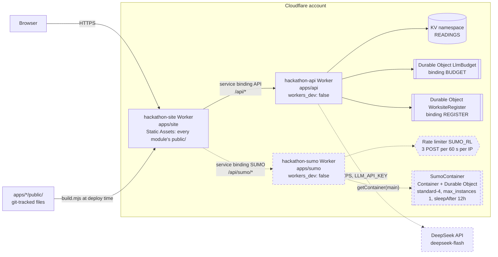

# Deployment

RippleTwin runs entirely on Cloudflare. One public Worker, `hackathon-site`, serves every module's static files from a single origin and forwards API calls over service bindings to two private Workers: `hackathon-api` for sign reading, explanations and the worksite register, and `hackathon-sumo` for live SUMO runs in a Cloudflare Container. The traffic engine itself runs in the browser, so no Worker does heavy computation.

After the event the SUMO Worker, its container and the LLM key were deleted. See [post-event status](#post-event-status) before redeploying anything.

## Topology



Dashed: deleted after the event (`hackathon-sumo`, its container and rate limiter) or no longer called (DeepSeek, since the key was removed).

Request routing in the site Worker ([`apps/site/src/worker.js`](../../apps/site/src/worker.js)):

| Path | Handled by | If the target is missing |
|---|---|---|
| `/api/sumo`, `/api/sumo/*` | service binding `SUMO` → `hackathon-sumo`, forwarded unchanged | no binding: `503 sumo_off`; binding throws: `502 sumo_down` |
| other `/api`, `/api/*` (not `/api/public/*`) | service binding `API` → `hackathon-api`, forwarded unchanged | no binding: `/api/health` reports `api: false`, other paths `503 api_not_deployed`; binding throws: `502 api_unreachable` |
| everything else, including `/api/public/*` | Static Assets (`ASSETS`), without running Worker code | `404` with an empty body |

`run_worker_first: ["/api/*", "!/api/public/*"]` in [`apps/site/wrangler.jsonc`](../../apps/site/wrangler.jsonc) keeps static requests out of Worker code. The order matters: `/api/sumo` is matched before `/api/*`, and `/api/public/*` stays static in both the config and `worker.js`. Errors use the `{ok:false, error, msg}` envelope with `cache-control: no-store` and never include internal error text. No response carries CORS headers, because nothing is cross-origin.

## Workers

| Worker | Source | `workers_dev` | Bindings and settings | Routes |
|---|---|---|---|---|
| `hackathon-site` | [`apps/site`](../../apps/site/README.md) | `true`, `preview_urls: false` | `ASSETS` (directory `out/`, built by `build.mjs`); service bindings `API` → `hackathon-api` and `SUMO` → `hackathon-sumo`; observability on | `hackathon-site.zemmmeng.workers.dev` only; no custom domain or routes |
| `hackathon-api` | [`apps/api`](../../apps/api/README.md) | `false`, `preview_urls: false` | `ASSETS` (its own `public/`); Durable Objects `BUDGET` (`LlmBudget`) and `REGISTER` (`WorksiteRegister`), SQLite-backed, migrations `v1` and `v2`; KV `READINGS`; vars `MOCK="0"`, `LLM_BASE_URL`, `LLM_MODEL`, `LLM_MAX_CALLS_PER_MIN="600"`, `LLM_MAX_CALLS_PER_DAY="50000"`; secret `LLM_API_KEY` | none; reachable only through the site's `API` binding |
| `hackathon-sumo` (deleted) | [`apps/sumo`](../../apps/sumo/README.md) | `false`, `preview_urls: false` | Container `SumoContainer` (image `apps/sumo/Dockerfile`, build context `apps/`, `instance_type: standard-4`, `max_instances: 1`; `sleepAfter = '12h'` in `src/worker.js`); Durable Object binding `SUMO_CONTAINER`, migration `v1`; rate limit `SUMO_RL` (3 `POST /runs` per IP per 60 s) | none; reachable only through the site's `SUMO` binding |

[`apps/web/wrangler.jsonc`](../../apps/web/wrangler.jsonc) also defines `rippletwin`, a legacy assets-only Worker from the first day that served a standalone copy of the page without the engine. It is not in `DEPLOY_MODULES` and is not maintained; production serves the page through `hackathon-site` at `/web/public/`.

What each Worker stores:

- **KV `READINGS`** caches sign readings and explanations for 30 days, keyed on the canonical request, the prompt version and the model. On `*.workers.dev` the Workers Cache API does nothing, so without KV only a per-instance memory cache is left.
- **`LlmBudget`** is one global counter of LLM calls per UTC day. A call is made only after a reservation succeeds; if the Durable Object is missing or fails, no call is made.
- **`WorksiteRegister`** holds the shared worksite register behind `/api/worksites`: three read-only seed worksites, at most 200 entries and 500 writes a day. An edit token is returned once, and only its SHA-256 is stored.
- **`SumoContainer`** kept SUMO job state in memory and on the container's ephemeral disk, which is why the Worker always addresses one named instance (`getContainer(env.SUMO_CONTAINER, 'main')`).

## Secrets and configuration

The only application secret is **`LLM_API_KEY`**, on `hackathon-api`:

```bash
cd apps/api
npx wrangler secret put LLM_API_KEY      # turn the LLM on (MOCK is already "0" in wrangler.jsonc)
npx wrangler secret delete LLM_API_KEY   # kill switch: sign reading and explanations fall back to keyword rules
```

The Worker calls the LLM only when `MOCK` is `"0"`, the key is set and `LLM_BASE_URL` is `https`. For local development the key goes in `apps/api/.dev.vars` (gitignored; copy [`.dev.vars.example`](../../apps/api/.dev.vars.example)). It is never written to `wrangler.jsonc`, `.env` or any tracked file; `scripts/check.sh` scans every change for key-like strings. The KV namespace id in `apps/api/wrangler.jsonc` is an identifier, not a secret.

Configuration lives in files, one per concern:

| File | What it sets |
|---|---|
| `apps/<module>/wrangler.jsonc` | Worker name, entry point, assets, bindings, vars, migrations. The `service` in each of the site's bindings must equal the target Worker's `name`, which `apps/site/tests/config.test.mjs` and `apps/sumo/tests/config.test.mjs` check |
| [`hackathon.conf`](../../hackathon.conf) | `DEMO_URL`, `DEPLOY_MODULES="api site"` (order matters: a bound Worker must exist before the Worker that binds it), `DEPLOYER` and `BACKUP_LEAD`, the event deadline and freeze windows in `Australia/Melbourne` time |
| `apps/<module>/package.json` | `npm run deploy` for each Worker; `wrangler` is a pinned devDependency (4.143.0, locked in `package-lock.json`) |

`sumo` is deliberately not in `DEPLOY_MODULES`: its image needs Docker, so `deploy.sh all` would fail on a machine without it.

## Deploying

All routine deploys go through [`scripts/deploy.sh`](../../scripts/deploy.sh):

```bash
bash scripts/deploy.sh all            # = every module in DEPLOY_MODULES, in order: api, then site
bash scripts/deploy.sh all --hotfix   # needed for a deploy from main after the deadline (see gate 4)
```

It refuses to deploy unless every preflight gate passes:

| Gate | Check |
|---|---|
| 1. Identity | `git config hack.me` equals `DEPLOYER`, or `BACKUP_LEAD` (a backup deploy, marked as such in the log) |
| 2. Clean tree | No uncommitted or untracked files: a deploy is always an exact commit |
| 3. In sync | `HEAD` is `main` and equals `origin/main`, or sits on a tag that exists on `origin` |
| 4. Freeze | During the code freeze and after the deadline, only a `demo-*` tag can be deployed, unless `--hotfix` is given |
| 5. Full check | A full `bash scripts/check.sh` run (all nine checks, every module's tests) reports no ❌ |
| 6. Deploy | For each module: `npm ci` if dependencies are missing, then `npm run deploy` (for `apps/site`: `node build.mjs && wrangler deploy`) |

After a successful deploy it runs the live smoke test `bash scripts/check.sh --e2e` against `DEMO_URL` (the landing page returns 200 and contains `data-smoke`, `/api/health` contains `"ok":true`, no `localhost` in the page, every request within 3 s), appends one line per module to `logs/deploy.log`, and on any failure prints a rollback command that redeploys the previous `demo-*` tag.

`build.mjs` copies only files listed by `git ls-files` from each `apps/<module>/public/`, so gitignored keys or raw data on the deployer's machine can never be published. It also enforces Cloudflare's limits (25 MiB per file, 20,000 files) and stamps the landing page with the commit and build time.

**Backup channel.** [`.github/workflows/deploy.yml`](../../.github/workflows/deploy.yml) deploys from the GitHub web UI (Actions → deploy → Run workflow) after its own gates: the secrets exist, the actor is `DEPLOYER`, the freeze rule, and a full `check.sh`. It runs the same `npm run deploy` per module, then the smoke test. It needs the repository secrets `CLOUDFLARE_API_TOKEN` and `CLOUDFLARE_ACCOUNT_ID` under Settings → Secrets and variables → Actions. These were never set during the event, so every real deploy went through `deploy.sh` locally.

**Logs.** `npx wrangler tail <worker>` streams live logs; observability is enabled on all three Workers, so logs also appear under Workers Logs in the Cloudflare dashboard.

### Deploying the SUMO container

`hackathon-sumo` was deployed by hand from a machine with Docker, before the site (the site's `SUMO` binding cannot resolve otherwise):

```bash
cd apps/sumo && npm ci
npx wrangler deploy             # builds the linux/amd64 image, pushes it to Cloudflare's registry, deploys the Worker
npx wrangler containers list    # container application status
bash scripts/deploy.sh all      # then api and site as usual
```

Containers need the Workers Paid plan. The image build runs its own checks (shared libraries, SUMO version, a short end-to-end simulation, real-network cache) so a broken image fails before it is deployed. Prerequisites, Apple-silicon setup and the full procedure are in [apps/sumo/README.md](../../apps/sumo/README.md#redeploying).

## Costs

| Item | Cost | Controls |
|---|---|---|
| Cloudflare Workers Paid | US$5 per month, from 30 September 2026, needed only for Containers | Cancelling the plan is left to the account owner |
| SUMO container time | Billed while awake; estimated at US$1.5–3 to the end of judging on `standard-4`. The team set a total budget of US$20 | One instance, `sleepAfter = '12h'`; path allowlist before the container wakes, 2 KB body cap, 3 POST per minute per IP, busy gate at 2 jobs |
| DeepSeek (`deepseek-flash`) | Prepaid credit, about ¥100 at the end of the event; one sign-reading call costs about ¥0.002, and pre-computing the 92 demo readings cost about ¥0.54 | Global cap of 50,000 calls a day and 600 per minute per instance as deployed (the code defaults are 600 and 60); KV cache; circuit breaker; an explanation counts as 5 calls; when the credit runs out the provider errors and the page falls back to rules |
| Workers, KV and Durable Objects for `site` and `api` | No separate charge recorded | Static files do not run Worker code; KV is written once per new reading |

Budgets and caps are recorded in the decision log: [D-0930-1700](../decisions.md) (container and Workers Paid), [D-1001-0045](../decisions.md) (`standard-4`, US$20 budget) and [D-1001-0125](../decisions.md) (LLM caps raised from 600 to 50,000 a day).

## Post-event status

Checked on 11 October 2026:

| Component | State |
|---|---|
| `hackathon-site` | Live at <https://hackathon-site.zemmmeng.workers.dev> (UI at `/web/public/`). It serves the build deployed at the end of the event (landing page stamp `68f549e`) |
| `hackathon-api` | Live behind the site. `/api/health` returns `mock: false` with `llm.mode: "rules"` and `key: false`; the worksite register works |
| `LLM_API_KEY` | Deleted. `/api/read` and `/api/explain` answer with keyword rules; the browser still serves the 92 pre-computed readings for the demo wordings |
| `hackathon-sumo` and `SumoContainer` | Deleted. `/api/sumo/v1/*` returns `502 sumo_down` from the site Worker's catch branch; the page replays the pre-computed run in `/sumo/public/real/` |
| Error messages on the live site | Still the original Chinese text from the event build; English messages in this repository reach production only after a redeploy |

Because the live Workers run the event build, code changes in this repository (including the English translation of comments and messages) are not live until the site and API are redeployed.

Before redeploying the site:

1. **Remove the dangling `SUMO` binding** from `services` in `apps/site/wrangler.jsonc`, or redeploy `hackathon-sumo` first. With the binding pointing at a deleted Worker, `wrangler deploy` is expected to fail with "Could not resolve service binding". In the same commit, relax `apps/site/tests/config.test.mjs` (it requires exactly the `API` and `SUMO` bindings) and `apps/sumo/tests/config.test.mjs` (it checks the binding name). Without the binding the site answers `503 sumo_off`, which the browser client treats like `sumo_down`.
2. **Pass the deploy gates.** The deadline has passed, so a deploy from `main` needs `--hotfix` (the alternative is to deploy a pushed `demo-*` tag), and `git config hack.me` must match `DEPLOYER` or `BACKUP_LEAD` in `hackathon.conf`.
3. **To turn the LLM back on**, restore sensible caps in `apps/api/wrangler.jsonc` first (they are still 50,000 a day and 600 a minute), then `npx wrangler secret put LLM_API_KEY`. No redeploy is needed for the key alone.

Without Containers, `site` and `api` use only Static Assets, service bindings, SQLite-backed Durable Objects and one KV namespace, all of which are available on the Workers Free plan. Rules mode makes no KV writes, so the Free plan's daily KV write limit should not be reached. This has not been tested since the plan change.

## Running locally

| What | Command | URL |
|---|---|---|
| Whole site on one origin (page, engine, data, pre-computed answers and replays) | `cd apps/site && npm ci && npm run dev` | <http://localhost:8790/web/public/> |
| API Worker | `cd apps/api && cp .dev.vars.example .dev.vars && npm ci && npm run dev` (`MOCK=1` by default: rules only) | <http://localhost:8788/api/health> |
| SUMO Worker and container (needs Docker) | `cd apps/sumo && npm ci && npm run dev` | <http://localhost:8791/api/sumo/v1/health> |
| Static files only, no Workers | `python3 -m http.server 8000 -d apps` | <http://localhost:8000/web/public/> |

`npm run dev` in `apps/site` rebuilds `out/` first; restart it after changing another module's `public/`, and `git add` new files, because only tracked files are copied. To serve a live `/api/*` locally, start `apps/api` before `apps/site`; Wrangler's local dev registry should connect the service binding, but this two-Worker setup was not tested during the event. Without it, sign reading falls back to the answers file and keyword rules.

The static-only server reproduces the post-event behaviour closely: no API (the answers file, then rules) and no live SUMO (the pre-computed replay).

## Related

- [Architecture overview](README.md)
- [apps/site/README.md](../../apps/site/README.md), [apps/api/README.md](../../apps/api/README.md), [apps/sumo/README.md](../../apps/sumo/README.md)
- [scripts/README.md](../../scripts/README.md): `check.sh`, `deploy.sh`, hooks and CI
- [Cloudflare notes from the event](../hackathon/deploy-cloudflare-notes.md) (archived)
