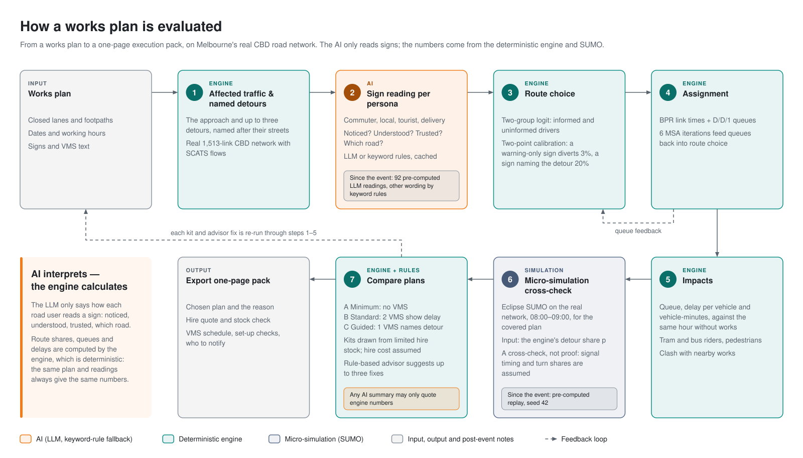
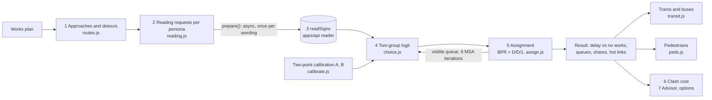

# Traffic engine

The traffic engine ([`apps/engine`](../../apps/engine/README.md)) turns a works plan into traffic impacts on the real Melbourne CBD road network. It finds the vehicles the works affect and the detours open to them. From each road-user persona's reading of the signs it works out how many take each route, then assigns the diverted flow and computes queues and delay. Tram, bus and pedestrian impacts, the extra cost of overlapping works, equipment options limited by hire stock and a rule-based advisor are built on the same core.

The engine is plain JavaScript with no dependencies. The same ES modules run in the visitor's browser (served as static files at `/engine/public/js/`) and in Node for tests and tools. It is deterministic: the same plan and the same sign readings always give byte-identical output.

The engine follows the project's central rule, *the LLM interprets, the engine calculates* ([D-0929-1435](../decisions.md)). A language model only reports how a persona reads a set of signs: noticed, understood, which roads to use or avoid, minutes quoted, trust. It never returns route shares and never does arithmetic. Every share, minute, metre and rider-minute comes from the explicit model described here. How readings are produced is covered in [sign reading](sign-reading.md).

> **What the page shows today.** On every plan except one, the numbers on screen are the engine's. The exception is the Lonsdale St demo plan (westbound link `l595594354_9756035316`, one lane closed). Since [D-1001-0045](../decisions.md) that plan shows only Eclipse SUMO's traffic numbers, and the engine works behind the scenes: it turns the persona readings of each plan's signs into the detour share `p` that SUMO is given as input. See [relationship to SUMO](#relationship-to-sumo) and [traffic simulation](traffic-simulation.md).

## At a glance

| | |
|---|---|
| Code | 18 ES modules in [`apps/engine/public/js/`](../../apps/engine/public/js/), about 2,800 lines, no dependencies, no build step |
| Network | 1,513 directed links and 805 nodes ([`network.json`](../data/sources.md), from OpenStreetMap) |
| Demand | Hourly link flows for weekdays and weekends from SCATS detector counts: 386 links measured, 1,127 estimated (`flows.json`) |
| Personas | `commuter`, `local`, `tourist`, `delivery`, mixed 50 / 25 / 10 / 15 % (assumed, low confidence) |
| Speed | One `evaluate()` on the Lonsdale demo: about 1 ms median, about 4.7 ms for the first call (Apple M5 development machine); CI gate < 100 ms |
| Tests | 11 test files, no framework, no install: `bash apps/engine/test.sh` |

## Inputs and outputs

### Works plan

A plan is an hour and a list of worksites. The full format is in [module interfaces](../reference/interfaces.md); the essentials are:

```js
{
  when: { date: '2026-10-06', hour: 8 },              // day type (weekday / weekend) comes from the date unless `day` is given
  worksites: [{
    id: 'B-12',
    links: ['l595594354_9756035316'],                  // closed links, in driving direction
    closes: { lanes: 1, footpath: 'left' },            // lanes closed per link; footpath: left | right | both (optional)
    time: { from: '2026-10-05', to: '2026-10-09', hours: [7, 19] },   // active dates and hours [start, end)
    equipment: [                                       // at_m = metres upstream of the works start (negative = downstream)
      { id: 'VMS-1', type: 'vms', at_m: 300, frames: [['ROADWORK', 'AHEAD'], ['USE', 'RUSSELL ST']] },
      { id: 'S-1', type: 'sign', at_m: 100, text: 'RIGHT LANE CLOSED' },
      { id: 'A-1', type: 'arrow', at_m: 60 },
      { id: 'B-1', type: 'barrier', at_m: 0 },
    ],
  }],
}
```

Capacity on a works link is `cap × (open lanes ÷ lanes) × 0.9`: the 0.9 is a work-zone friction factor applied to the remaining lanes. With every lane closed the factor is 0 and the link is impassable ([`worksite.js`](../../apps/engine/public/js/worksite.js)).

### Data and injected services

| Input | Source | Used for |
|---|---|---|
| `network.json` | [apps/roads](../../apps/roads/README.md) (OSM) | Links with length, lanes, speed, capacity, free-flow time, OSM road class, truck and tram flags |
| `flows.json` | apps/roads (SCATS, 8 weeks) | Background flow per link, per day type and hour (veh/h) |
| `params.json` | [apps/params](../../apps/params/README.md) | Persona mix, calibration targets and persona fields, each with a source and confidence; validated item by item, with fallback to defaults |
| `transit.json` | apps/roads (PTV GTFS) | 47 tram and bus routes (22 tram, 25 bus) matched to links, hourly trips |
| `walk.json`, `peds.json` | apps/roads (OSM, City of Melbourne counts) | Footpath graph (6,802 links) and pedestrians per footpath per hour |
| `equipment.json` | apps/roads | RPM Hire inventory: 16 items with stock and day rates (both assumed) |
| `readSigns(request)` | injected; in the app, [`apps/api/public/js/reader.js`](../../apps/api/public/js/reader.js) | Persona readings of sign text ([sign reading](sign-reading.md)) |

### Outputs

`engine.evaluate(plan)` returns, for one hour:

- `delay_min`: network delay in vehicle-minutes against the same hour with no works, and `by_type` per persona;
- `approaches[]`: per affected approach, the queue, the share on each route (`stay` and up to three named detours), usual and current travel times, and each persona's reading;
- `links[]`: flow, capacity, delay against free flow, queue and `extra_min` (extra vehicle-minutes against no works) for every link, and `hot`, the five links with the largest `extra_min`;
- `blocked_vph` (vehicles stuck at a full closure with no detour), the calibration in use, and `missing` (readings that were not available).

The wiring layer, [`backend.js`](#wiring-layer-backendjs), turns this into a display-ready summary and adds the tram, bus and pedestrian impacts.

## Pipeline

<picture>
  <source media="(prefers-color-scheme: dark)" srcset="../images/evaluation-flow-dark.svg">
  
</picture>



`createEngine({ network, flows, readSigns, params })` in [`pipeline.js`](../../apps/engine/public/js/pipeline.js) splits the work into two calls:

- **`await engine.prepare(plan)`** collects every reading the plan needs (plus the eight calibration readings), asks the injected `readSigns()` once for each one not yet cached, and recalibrates. This is the only asynchronous step and the only one that can touch the network.
- **`engine.evaluate(plan)`** is synchronous and pure. It reads only the plan, the data and the cached readings, so it can be re-run hundreds of times for the advisor, multi-day windows and clash checks without asking anyone again. A missing reading counts as "nobody persuaded" and is reported in `missing`; it is never filled with a guess.

This split works because a reading request holds only sign text, persona, speed and candidate road names. It never holds travel times, queues or positions, so the same wording is read once per persona whatever the traffic does.

### 1. Affected approaches and detours

[`routes.js`](../../apps/engine/public/js/routes.js) chains consecutive works links in driving direction into an *approach*, following links with the same street name whose headings agree (cosine > 0.7). OSM splits streets at every node, so links are often only a few metres long. The engine therefore walks by distance rather than link count: about **400 m upstream** (`UP_M`), where drivers enter and signs stand, and about **300 m downstream** (`DOWN_M`). Works on both carriageways give two approaches.

- The **stay route** is the path from the upstream origin through the works to the downstream end.
- **Detours**: at every junction before the works, try each turn-off and run Dijkstra ([`net.js`](../../apps/engine/public/js/net.js), free-flow times) to the downstream end. The search avoids the works links, fully closed links, U-turns back onto the approach and the road classes in `NO_DETOUR` (living streets, pedestrian ways, service roads, tracks, footways, cycleways, paths). CBD laneways can carry traffic on the stay route, but a sign never names one as a detour.
- Each detour is named after the street it turns into ("Russell Street"); only the fastest per name is kept, at most **three** (`MAX_ALTS`), and any detour more than **3×** slower than staying (`MAX_RATIO`) is dropped. Each records `diverge_m`, how far before the works it turns off.

The number of affected vehicles `F` is the smallest hourly flow along the stay route, an approximation of the through traffic that has to pass the works. For a full closure it is the largest flow on the closed links instead, because nobody can stay on them.

### 2. Reading requests per persona

[`reading.js`](../../apps/engine/public/js/reading.js) lists the signs on each approach: VMS boards, static signs and arrow boards facing that direction, at or upstream of the works start. It keeps the six nearest the works (the engine's own limit per request; the API accepts up to eight). A sign's readable time is legible distance ÷ speed ([`cards.js`](../../apps/engine/public/js/cards.js), after the WA VMS guideline): about 200 m for 320 mm VMS characters and 100 m for 200 mm static-sign characters, so 18 s and 9 s at 40 km/h.

For each persona the engine builds two kinds of request:

- a **full** request with every sign in driving order, which sets the persuaded share and any advice about the stay route;
- a **prefix** request per detour with only the signs a driver passes *before* that detour's turn. A sign can only send a driver down a road if it stands before the turn into that road.

```js
{ persona: 'tourist', kmh: 40,
  signs: [{ kind: 'vms', frames: [['ROADWORK', 'AHEAD'], ['USE', 'RUSSELL ST']], read_s: 18 },
          { kind: 'sign', text: 'RIGHT LANE CLOSED', read_s: 9 }, { kind: 'arrow', read_s: 9 }],
  roads: ['Lonsdale Street', 'Russell Street', 'Exhibition Street', 'Spring Street'] }
```

Requests are cached under a canonical key: JSON with sorted object keys ([`canon.js`](../../apps/engine/public/js/canon.js)). The reader in `apps/api` hashes its own canonical form of the same request to look up pre-computed readings. Any change to the bytes the engine sends (sign text, road-name cleaning, the calibration scene) therefore bypasses the 92 shipped readings, which can no longer be regenerated now that the LLM key has been deleted.

### 3. Sign reading

The injected `readSigns()` returns, per request, `notice`, `understand`, `trust` (0–1), `advice` (`{ road: 'use' | 'avoid' }`, roads from the request only), `saving_min` and `delay_min` (minutes the signs quote, or null), a one-line `why` and its `src`. In the app this is the `apps/api` reader: pre-computed DeepSeek readings, then the API, then keyword rules. The engine also has its own keyword reader, `mockReadSigns`, used in tests and as a last-resort fallback. See [sign reading](sign-reading.md).

### 4. Route choice: two-group logit

[`choice.js`](../../apps/engine/public/js/choice.js) splits each persona into the share *persuaded* by the signs and the rest. Both groups choose by multinomial logit, but only the persuaded group sees what the signs say.

```text
Persuaded share     I = notice × understand × clamp01(trust × persona.trust)

Unpersuaded group   U(stay)    = −β·h·(t_stay + 0.004 min/m × qa × Q)
                    U(detour r) = −β·h·t_r − A + ln(max(0.02, familiar))

Persuaded group     as above, except:
                    detour the signs say to use:  −β·h·t_r − A + B + β·h·saving_min   (replaces ln(familiar))
                    road the signs say to avoid:  − B
                    delay quoted on the stay route: U(stay) − β·h·delay_min

Share of route r    s_r = I · softmax(U_persuaded)_r + (1 − I) · softmax(U_unpersuaded)_r
Overall share       Σ over personas of mix × s_r
```

`t` is a route's usual travel time in minutes, `Q` the queue drivers can see on the stay route (metres), `β` = 0.4 per minute, `h` the persona's hurry and `qa` its queue aversion. `A` is detour inertia and `B` the pull of a named route; both come from calibration. A delivery driver (`truck_only`) does not consider detours over links closed to trucks. `saving_min` is used only when a prefix reading actually names a detour.

| Persona | hurry | familiar | trust in signs | queue_averse | truck_only |
|---|---|---|---|---|---|
| commuter | 1.0 | 0.8 | 1.0 | 1.0 | no |
| local | 0.8 | 0.7 | 0.6 | 1.2 | no |
| tourist | 0.5 | 0.25 | 1.1 | 0.5 | no |
| delivery | 0.9 | 0.75 | 0.8 | 0.8 | yes |

`familiar` (would think of the detour unprompted) comes from [`params.json`](../../apps/params/public/params.json); the other columns are the engine's engineering assumptions in `choice.js`. Every value [`params.js`](../../apps/engine/public/js/params.js) accepts is range-checked; anything out of range falls back to the default and is reported in `status().params_used` and `errors`. Persona descriptions that would affect how a sign is *read* go into the prompt instead (see [sign reading](sign-reading.md#prompts)); behaviour parameters stay out of the prompt so they are not counted twice.

### Two-point calibration

The two global parameters cannot be guessed, so [`calibrate.js`](../../apps/engine/public/js/calibrate.js) fixes them on a reference scene: La Trobe St westbound at 40 km/h, staying 6 min, Russell St 8 min, Elizabeth St 9 min (closed to trucks), both detours turning off at the works start. Each persona reads two standard signs, each shown with `RIGHT LANE CLOSED`:

| Standard sign | Target share of all vehicles that divert | Source |
|---|---|---|
| `ROADWORK / AHEAD` (no road named) | 3 % | Working assumption, confidence low (`anchors.generic_warning_divert`) |
| `USE / RUSSELL ST` (named route) | 20 % | Erke, Sagberg & Hagman (2007), *Transportation Research Part F* 10(6), confidence high (`anchors.named_route_divert`) |

The warning-only sign names no road, so its diversion depends only on `A`. Bisection (60 steps over A ∈ [−10, 20]) solves `A` first, then `B` over [0, 40] with `A` fixed. If `B` = 40 still misses the high target, `B` stays at 40 and `ok` is false; `ok` also requires both targets to be met within 5 % relative error. With the shipped pre-computed DeepSeek readings the result is `A` = 2.87, `B` = 3.02, both targets met. Calibration is recomputed in every `prepare()` from the anchor readings of the reader in use, so keyword-rule readings and LLM readings are each calibrated on their own terms; the result records which source and model the anchor readings came from. If any calibration reading is missing, the defaults `A` = 4, `B` = 3 are used and flagged.

All other wordings, queues and persona differences then follow from the choice model; there is no separate conversion from readings to shares.

### 5. Assignment, queues and queue feedback

[`assign.js`](../../apps/engine/public/js/assign.js) starts from this hour's background flow on every link (which already includes the affected vehicles). It subtracts the diverted share of `F` from the stay route's links and adds each detour's share to that detour's links; on shared upstream links the two cancel. Negative flows, possible after a full closure, are clipped to zero only after all approaches are applied.

Link travel time ([`net.js`](../../apps/engine/public/js/net.js)) is the BPR function below capacity plus deterministic D/D/1 queueing above it, over a one-hour period `T` = 3,600 s:

```text
t(v, c)    = t0 × (1 + 0.15 × min(v/c, 1)^4) + d(v, c)
d(v, c)    = (v − c) × T / (2c)  if v > c, else 0          mean wait of vehicles arriving this hour
queue_m    = (v − c) × T/3600 × 7 m ÷ lanes                 end-of-hour queue, using the street's original lane count
```

Route choice sees the queue, and the queue depends on route choice, so [`pipeline.js`](../../apps/engine/public/js/pipeline.js) iterates with the **method of successive averages**: six iterations (`MSA_ITERS`). At iteration *k* the shares are averaged, `s̄ₖ = s̄ₖ₋₁ + (sₖ − s̄ₖ₋₁)/k`, and drivers see half the end-of-hour queue on the works chain (the average over the hour). The LLM is not asked again; the readings depend only on text and persona.

### Outputs and delay accounting

- **Network delay** is total travel time under the plan minus total travel time in the same hour with no works (cached per day type and hour), in vehicle-minutes. Background traffic slowed by diverted vehicles is included and also reported separately as `others_min`.
- **No false time savings.** `flows.json` holds counts, not an equilibrium, so a detour can be faster than the stay route even with no works (a 40 km/h parallel street against a 20 km/h side street). Drivers who normally stay have reasons the model does not see, so a route's extra time is measured from the faster of "stay, usually" and "this detour, usually". The corresponding gain is added back to network delay as a `credit`. Without it a full closure of Little Bourke St alone produced −65 vehicle-minutes; `tests/conflict.test.mjs` checks that no single closure of a lane or little street gives negative delay.
- **Per-link impact** `extra_min = (v·t − v₀·t₀) ÷ 60` is measured against the same hour with no works, not against free flow, so streets that are congested at peak anyway (Flinders St, King St) do not light up. The map draws the ripple from this field.
- `engine.window(worksites, whens)` sums delay over sampled hours: the peak hours 8 and 17 that fall inside the works hours (or the middle hour if neither does), for every day of the works, capped at 31 days.

### Worked example

The Lonsdale St demo plan closes one of two westbound lanes on a 43 m link at 08:00 on a weekday. Capacity falls from 1,800 to 1,800 × ½ × 0.9 = 810 veh/h against a counted 1,144 veh/h. The table shows the engine's results for three VMS wordings. They were computed with the shipped answers file and keyword rules, as the live site does after the event.

| VMS text | Readings | Detour share | Queue | Network delay | Tram and bus rider-minutes |
|---|---|---|---|---|---|
| `ROADWORK / AHEAD` | pre-computed LLM | 14.0 % | 918 m | 10,493 veh-min | 18,693 |
| `ROADWORK AHEAD ▸ USE RUSSELL ST` | pre-computed LLM | 35.2 % | 538 m | 5,629 veh-min | 10,991 |
| `USE RUSSELL ▸ SAVE 9 MIN` | keyword rules | 60.7 % | 79 m | 937 veh-min | 1,651 |

The first queue can be checked by hand: (1,144 − 0.14 × 513 − 810) veh/h × 1 h × 7 m ÷ 2 lanes ≈ 918 m, where 513 veh/h is `F`, the through traffic on the stay route. The 0.14 detour share is the `p_original` that the SUMO scenarios use.

## Beyond the core

### Trams and buses

[`transit.js`](../../apps/engine/public/js/transit.js) scores every GTFS route that passes the works (`summary.transit`). Every item below is an assumption and is listed in the output's `assumed` field.

- **Buses** run with traffic on fixed routes. Extra seconds per trip = sum over the route's links of (link time under the plan − link time in the same hour with no works), both from the engine's `linkTime`.
- A **fully closed** link on a bus route forces a detour: turn off within 400 m before the closure and rejoin within 400 m after it, choosing the fastest option over the whole trip. Main roads are tried first, then side streets, never `NO_DETOUR` laneways; if nothing nearby works the whole route is searched, and failing that the route is `blocked`. A detour that skips a loop can come out faster; the extra time is floored at 0, and the loss is reported as `stops_skipped`.
- If a full closure sits within 400 m of where a route enters or leaves the network (or of its terminus) and no detour exists inside the network, the bus reroutes outside the data. It is flagged `edge`, its minutes are left null and it is not counted as cancelled.
- **Trams** run in their own lanes in the CBD: partial closures and slower traffic do not delay them, and a full closure of a tram link blocks the route (trams cannot detour). The lost trips and riders are reported, and minutes are left null rather than invented.
- **Riders per trip** are assumed, because PTV publishes no per-route hourly loads: weekdays 07:00–10:00 and 16:00–19:00 tram 60 and bus 25, otherwise tram 30 and bus 12, with ranges shown on the page. Rider-minutes = trips × riders × extra seconds ÷ 60.
- Matched route geometry has small gaps inside junctions. They are filled with the shortest path within 60 m (trams only along tram links).

### Pedestrians

[`peds.js`](../../apps/engine/public/js/peds.js) handles `closes.footpath` (`left`, `right` or `both`, relative to driving direction; with keep-left traffic, left is the kerb next to the closed lane).

- Closed footpaths are those attached to the works links on that side. On dual carriageways the right-hand footpath belongs to the opposite carriageway's way, which is found by name, direction and parallel overlap.
- The detour is the shortest path on the undirected OSM walk graph avoiding every closed footpath. Extra minutes = pedestrians per hour × extra metres ÷ (1.3 m/s × 60), using the busiest closed footpath's count, which makes it an upper bound. Waiting at signals is not included.
- No way round counts as `blocked`. A closed footpath that is a dead end gives no detour. A side with no footpath in the data is flagged `unmatched` instead of being scored as no impact. Step-free access cannot be assessed (`step_free: null`), and the number of crossings on the detour is counted.
- `walk.json` and `peds.json` (3.6 MB) load in the background; `run()` waits for them (up to 8 s) only when a footpath is actually closed at that hour.

### Overlapping works: clash cost and staggering

Two worksites active at the same time can cost more together than apart. `engine.conflict(a, b)` returns

```text
clash cost = D(A+B) − D(A) − D(B)
```

where D is network delay summed over the sampled hours of the days the two overlap; if they never overlap it is exactly 0. `backend.clash()` clamps the displayed values at 0 and separates two kinds of "about zero":

- `negative_delay`: one of the three runs has negative delay, which happens on links whose baseline flow already exceeds capacity. The result is marked unreliable.
- `substitutes`: two worksites on one corridor that substitute for each other, so overlapping adds nothing. The result stays reliable.

`backend.stagger(a, b)` shifts B by one day at a time (up to 7 by default, optionally also earlier) and stops at the first shift that removes the overlap, or gives a reliable clash cost of zero.

### Equipment options A, B and C

`backend.options()` builds three traffic-management kits for one worksite from the RPM Hire inventory ([`options.js`](../../apps/engine/public/js/options.js)), runs each through the engine for the same hour, and prices it. Step 04 of the UI shows them as plans A, B and C.

| Tier | Equipment beyond the base kit | VMS text |
|---|---|---|
| A · Minimum (`o1`) | none (base kit: barriers, `ROADWORK AHEAD`, lane-closed sign, `END ROADWORK`) | none |
| B · Standard (`o2`) | arrow board + **two** VMS (the most expensive tier) | `EXPECT / DELAYS ▸ N MIN`, where N is the extra minutes the engine finds on the stay route under kit A |
| C · Guided (`o3`) | arrow board + **one** VMS | `USE / <detour> ▸ SAVE / N MIN`, naming the detour the advisor finds fastest under kit A, placed before its turn |

- Barrier count is ⌈closed length ÷ unit length⌉. Items needed by fewer alternatives are allocated first, so lane barriers do not use up the water-filled barriers that are the only ones allowed on footpaths.
- Quantities never exceed stock (net of what time-overlapping worksites in the same plan already hold); any shortfall is reported in `stock.short`.
- Hire = quantity × day rate × days, always marked as assumed, because RPM Hire publishes no prices.
- Kit text must pass the same VMS rules as the sign reader (2 frames × 4 lines × 10 characters, 8 words). The output flags a VMS pushed out of the engine's six-sign window instead of quietly scoring it as if it were read.

For the Lonsdale demo week (5 days), with the post-event readers, kit A costs A$515 (22 water-filled barriers and three signs), B A$2,515 and C A$1,765. They give detour shares of 0.14, 0.49 and 0.61 and engine queues of 918 m, 286 m and 79 m. On the Lonsdale plan, each kit's detour share is what step 04 sends to SUMO's options mode.

### Rule-based advisor

The advisor proposes and the engine computes ([`advisor.js`](../../apps/engine/public/js/advisor.js)). No LLM advisor was built: `askAdvisor` is injectable, but the shipped one is `mockAdvise`, three deterministic rules applied to the approach with the most delay.

1. **Reword**: if a detour is currently at least 1 minute faster than staying (rounded), name it: `USE / <short name> ▸ SAVE / N MIN`. A new VMS is placed 100 m upstream of the turn, rounded to 50 m.
2. **Move**: if the VMS stands after the recommended detour's turn, move it to 100 m upstream of the turn.
3. **Stagger**: if two worksites overlap with a positive clash cost, start the second the day after the first ends (at most 60 days).

`advise()` validates each suggestion, applies it to a copy of the plan and re-runs both versions over the same window of days and hours, so a date shift is judged including the days it moves into. Every suggestion is returned with its change in delay; ones that make things worse are kept and marked `better: false`.

## Wiring layer: `backend.js`

[`backend.js`](../../apps/engine/public/js/backend.js) is the page's single entry point. `connect()` loads the network, flows, transit data and parameters from the same origin, imports the `apps/api` reader and sign checker by URL, builds the engine and returns these methods:

| Method | Returns |
|---|---|
| `run(plan)` | Validates the plan (throws `bad_plan`), runs `prepare` + `evaluate`, and returns a summary: network and affected delay, mean delay per affected vehicle, main approach (queue, detour share, routes, one `why` per persona), tram and bus impact, pedestrian impact, and `flags` (`ok`, missing or failed readings, calibration, reading source, sign-text errors and warnings, blocked vehicles) |
| `compare(before, after)` | Two runs and their differences, with queue and detour share both measured on the before-plan's main approach |
| `advise(plan)` | Up to three advisor suggestions, each re-evaluated |
| `options(worksite)` | Kits A, B and C with plan, hire, stock check, result and flags |
| `clash(a, b)`, `stagger(a, b)` | Clash cost over the overlap, and the first stagger that clears it |
| `check(plan)`, `validate(plan)` | Sign-text rule check (the `apps/api` `checkSigns`), plan validation |
| `status()` | Which source each input came from, calibration, parameter provenance, load errors |
| `aiLog()`, `onAiLog(fn)`, `readingsOf(summary)` | Every `readSigns` call this session (a ring buffer of 200), with source, model, timing and reading. Used by the page's "AI road users" and "AI call log" panels |
| `demo(name)`, `demos` | The `lonsdale` and `latrobe` demo plans |

Nothing it loads makes `connect()` throw except the road network. Without parameters the engine uses its assumed values. If the reader cannot be imported it uses the engine's keyword rules, and without the checker sign text goes unchecked. Without transit or pedestrian data those impacts report `src: null`. If the reader throws without an error code (for example, no WebCrypto on a plain-HTTP page), that call falls back to the engine's rules and the log records the fallback. Every source is logged truthfully: a rule reading is never presented as an LLM reading.

## Determinism

Determinism is built in rather than tested for after the fact:

- adjacency lists are sorted by link id, and the Dijkstra heap breaks cost ties by insertion order;
- every sort that can tie has a secondary key (route name, link id);
- cache keys use canonical JSON;
- there is no `Math.random` and no clock in any numeric path (wall time appears only in AI-log metadata);
- readings are cached for the session, so a re-run never sees a different reading.

Tests assert byte-identical JSON for repeated runs of `evaluate`, `options`, `clash`/`stagger`, the transit model and the pedestrian model.

## Performance

Measured for the Lonsdale demo on the 1,513-link network on the development machine (Apple M5): the first `evaluate()` on a fresh engine takes about 4.7 ms, because it builds the no-works baseline and the route structure. Repeat calls have a median of about 1 ms (0.8–1.2 ms across runs). A full `run()` with transit and sign checks is a few milliseconds, and `options()` for three kits about 10 ms. The only automated gate is `tests/e2e.test.mjs`, which requires a single evaluate under 100 ms.

The costs stay low because route structure is memoised per worksite and closure set, the no-works baseline per day type and hour, and the transit, walk and lane indexes per data object (in `WeakMap`s). This is what lets the page re-run the engine 350 ms after every edit, and lets the advisor and clash checks evaluate dozens of plan-hours.

## Relationship to SUMO

The engine is a one-hour macroscopic model with point queues. [SUMO](traffic-simulation.md) is a microscopic simulator on the same network and demand. During the final hours of the event the team made SUMO the source of every traffic number on the Lonsdale demo plan ([D-1001-0045](../decisions.md)), and the division of work became:

- **The engine** reads each plan's signs through the personas and the choice model, and reports the detour share `p` = 1 − (share staying). For step 02 the page sends `p_original` = 0.14 (`ROADWORK AHEAD`) and `p_ai`, the engine's share for the advisor's wording (0.53 when no comparison is available). In step 04 each kit's `p` is sent to SUMO's options mode.
- **SUMO** applies `p` as a fixed diversion share and simulates the hour. On that plan the page hides the engine's queue, delay and detour drawings (`engSumFor()` returns null), and labels what SUMO does not model rather than filling it with engine numbers.
- **Every other street and closure** still shows the engine's numbers, and the engine still provides the impact view, the VMS lab, the advisor and clash checks everywhere.

The two models were built to be comparable. SUMO's "engine-method" queue counts vehicles bound through the works as 7 m each over two lanes. For the same `p` = 0.14 it reports 973 m at 09:00, against the engine's 918 m. Both use the same assumed works capacity of 810 veh/h, so the agreement is partly by construction. It is a consistency check between two models, not a validation against measured queues.

## Tests

Run `bash apps/engine/test.sh` (Node 18 or later, nothing to install). Each `tests/*.test.mjs` file runs with a 90 s limit and prints its own count; the runner prints `N passed, M failed` for [`scripts/check.sh`](../../scripts/README.md). Tests read the real data in `apps/roads`, `apps/params` and the `apps/api` reader. Many are reverse assertions: they check that a failure is reported, not hidden.

| File | Covers |
|---|---|
| `engine.test.mjs` | Toy-grid unit tests: Dijkstra ties, BPR and D/D/1, time windows, capacity factors, detours, reading requests, the choice model, calibration, determinism, missing and failing readings, full closure with no detour, conflict and window |
| `e2e.test.mjs` | The three demo acts, sign before or after the turn, the advisor re-run; on the real network: loading, one evaluate < 100 ms, direction of act 1 |
| `backend.test.mjs` | `connect()` fallbacks, the real `apps/api` reader and checker, summary semantics, surfaced reading failures, demo plans, review regressions |
| `params.test.mjs` | Per-item fallback, `sign_trust` conversion, prototype-pollution guard, the engine following `params.json` |
| `transit.test.mjs` | Lonsdale buses, La Trobe tram stoppage, bus detours, gap filling, off-peak and weekend, no negative delay, network-edge closures; closes every bus link in turn on the real data |
| `peds.test.mjs` | Footpath closures left, right and both, opposite carriageway, crossings, sensors, unmatched sides, dead ends, background loading |
| `options.test.mjs` | Tier shapes, hire = quantity × rate × days, never over stock, footpath barrier allocation, shared stock, VMS text passes `checkSigns`, byte-identical output, cost and detour ordering of the tiers |
| `clash.test.mjs` | `clash`/`stagger` against `engine.conflict`, negative-delay versus substitute flags, determinism |
| `conflict.test.mjs` | No negative delay for any single closure of the CBD's little streets and lanes |
| `extra.test.mjs` | `links[].extra_min` is measured against the same hour with no works |
| `ailog.test.mjs` | One log entry per reader call, truthful sources, no extra requests, ring-buffer limit, unsubscribe |

For a quick look without the page:

```bash
node apps/engine/tools/demo.mjs                                              # three demo acts + advisor on a toy grid
node apps/engine/tools/demo.mjs --real --params apps/params/public/params.json   # act 1 on the real CBD network, with timings
```

## Limitations

- **Static, one-hour model.** Queues are point queues per link (D/D/1); a long queue is reported in metres but does not block upstream junctions, and there is no spill-back between links. SUMO models spill-back and is used as a cross-check on the demo plan.
- **Fixed route set.** Detours are free-flow shortest paths from junctions before the works, at most three. Only through traffic on the stay route is rerouted (all traffic on the closed links for a full closure); background traffic does not re-route in response to the diverted flow.
- **Assumed behaviour.** The persona mix, hurry, trust and queue aversion are assumed, and only `familiar` and the mix come from `params.json`, at low confidence. The 3 % warning-only target is a working assumption; only the 20 % named-route target has a strong source. See [assumptions and validation](../data/assumptions-and-validation.md).
- **Interpolated demand.** About 74 % of link flows (1,127 of 1,513) are estimated rather than measured, and some baseline flows exceed capacity, which can produce negative deltas (flagged).
- **Signals are not modelled explicitly.** Link capacity is saturation flow (1,800 veh/h per lane) × an average green ratio (0.5 at signals, 0.9 elsewhere).
- **Vehicles, not people.** Car occupancy is 1. Tram and bus riders per trip are assumed. Trucks are restricted only where the data marks a link as closed to them.
- **Advisor.** The advisor is three rules, not a model; it does not search the space of plans.
- **Not validated against a real closure.** No comparison with observed queues during an actual Lonsdale St closure has been made.
