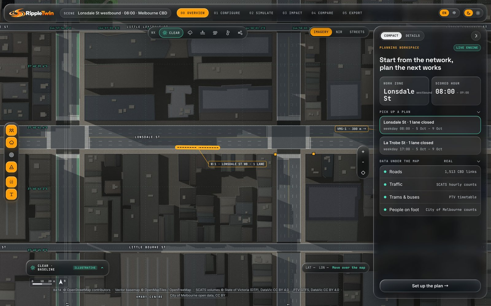
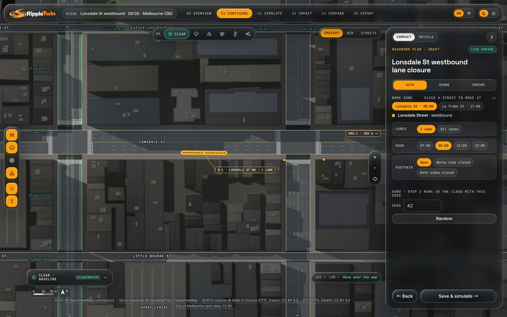
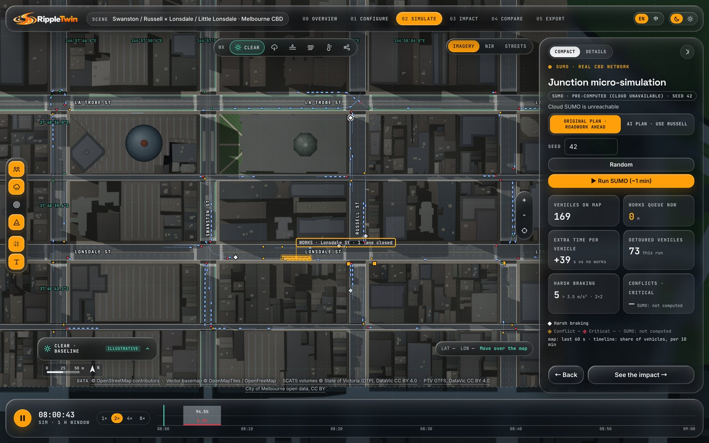
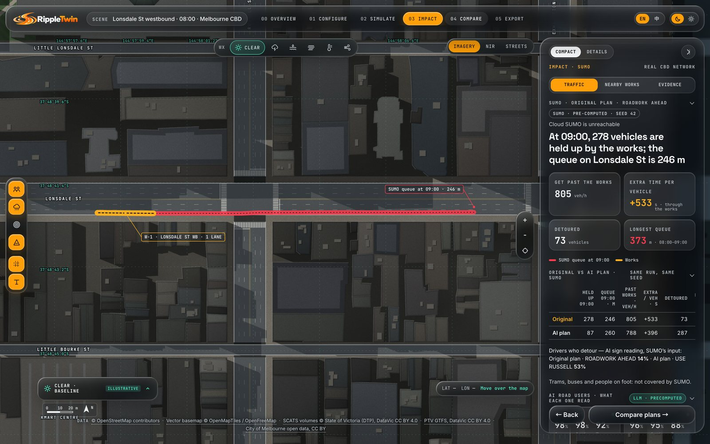
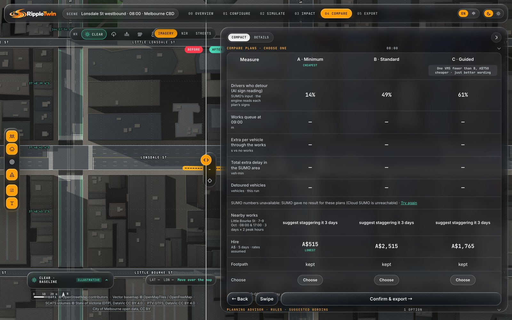
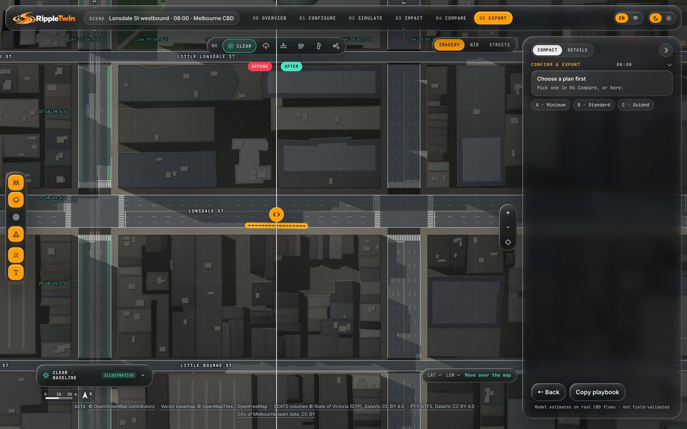

# Front end

The RippleTwin workbench ([`apps/web`](../../apps/web/README.md), owner @unicornnnnnny) is a single-page web app with no bundler, framework or package dependencies. Hand-written HTML, CSS and JavaScript are concatenated into one HTML file, which the site Worker serves at `/web/public/`. The page draws a canvas map of the Melbourne CBD, runs the traffic engine in the browser, replays SUMO runs and shows every result in English or Chinese.



## Build: `src/` → `build.py` → `public/index.html`

```bash
python3 apps/web/build.py    # writes public/index.html and prints its size
```

[`build.py`](../../apps/web/build.py) is 42 lines of Python with no dependencies. It reads `src/head.html`, `src/styles.css`, `src/body.html` and every `src/js/*.js` sorted by file name, drops the duplicate `'use strict'` lines, and writes:

- `public/index.html`: the whole page, about 570 KB. It is **committed**, because the site Worker serves module files exactly as they are in git.
- `out/web-artifact.html`: the body only, for previews. It is gitignored.

There is no bundler, transpiler, framework or CDN JavaScript; the only external resource is the Google Fonts stylesheet. Because the JavaScript files are concatenated into one `<script>`, they share one global scope, and the numeric file-name prefixes set the load order.

Two tests guard the build ([`tests/test_web.py`](../../apps/web/tests/test_web.py)):

- **Freshness.** The committed `public/index.html` must equal a fresh `build.bundle()`, byte for byte. Editing `src/` without rebuilding fails CI.
- **Size.** The bundle must stay under 2 MB.

## Source layout

| File | Responsibility |
|---|---|
| [`src/head.html`](../../apps/web/src/head.html), [`src/body.html`](../../apps/web/src/body.html) | Page title and fonts; the app shell: top bar with the 6-step stepper, layer rail, map canvas and controls, analysis panel, timeline. Chinese copy sits in `data-zh*` attributes |
| [`src/styles.css`](../../apps/web/src/styles.css) | Light and dark colour tokens, grid and floating layouts, compact panel, comparison table, printable A4 execution pack |
| [`0-i18n.js`](../../apps/web/src/js/0-i18n.js) | `LANG`, `L(en, zh)` and `applyLangDom()` for the `data-zh*` attributes |
| [`1-world.js`](../../apps/web/src/js/1-world.js) | World model in page metres (`WORLD` fine window, `CITY` whole grid), seeded random numbers and noise, synthetic fallback city, real building footprints with street clipping, 2 m land-cover, shadow and wind rasters |
| [`2-basemap.js`](../../apps/web/src/js/2-basemap.js) | Procedural orthophoto-style basemaps (RGB and near-infrared false colour) and the vector street basemap; roof shading, shadows, labels |
| [`3-weather.js`](../../apps/web/src/js/3-weather.js) | Six weather scenarios (clear, storm, flood, fog, heat, wind) drawn as rasters, contours and particle flows, all labelled illustrative and not fed into any model |
| [`4-sim.js`](../../apps/web/src/js/4-sim.js) | Scripted La Trobe St × Swanston St multi-agent scene, used when the works are outside the micro-simulation area |
| [`4b-grid.js`](../../apps/web/src/js/4b-grid.js) | GridSim: in-browser micro-simulation of 16 real signalised junctions (see [GridSim](#gridsim-fallback)) |
| [`4c-sumo.js`](../../apps/web/src/js/4c-sumo.js) | `SumoReplay`: streams and plays SUMO replays (see [SUMO replay streaming](#sumo-replay-streaming)) |
| [`5-app.js`](../../apps/web/src/js/5-app.js) | Main app: view and fly-to, render pipeline, step logic (`goStep`, `goUi`), `renderPanel` for all six steps, SUMO orchestration, histogram, legend, theme and language, data credits, input, main loop, `boot()` |
| [`6-engine.js`](../../apps/web/src/js/6-engine.js) | Engine wiring: geo-referencing, link picking, plan building, the `backend.js` connection, debounced runs and checks, panels for steps 01, 03 and 04, map drawing of queues, detours, transit and pedestrian impacts |
| [`6c-city.js`](../../apps/web/src/js/6c-city.js) | Whole-CBD layer: OSM vector basemap, every building footprint and the engine's road network, pre-rendered once per theme |
| [`6d-vmslab.js`](../../apps/web/src/js/6d-vmslab.js) | VMS lab in step 01: builds candidate sign wordings from the engine's routes, scores each with `run()` and recommends wording and distance |
| [`6e-sumo3.js`](../../apps/web/src/js/6e-sumo3.js) | SUMO-primary mode: on the Lonsdale demo plan, steps 01–05 and the map show SUMO's traffic numbers only ([D-1001-0045](../decisions.md)) |
| [`7-glass.js`](../../apps/web/src/js/7-glass.js) | Liquid-glass refraction, floating-layout insets, compact and detailed panel modes |
| [`8-clash.js`](../../apps/web/src/js/8-clash.js) | Nearby works in step 03: overlapping registered worksites, clash cost and a one-click stagger suggestion |
| [`8-compare.js`](../../apps/web/src/js/8-compare.js) | Steps 04 and 05: three equipment kits side by side with hire costs, SUMO rows per plan, the AI explanation, the execution pack |
| [`9-ai.js`](../../apps/web/src/js/9-ai.js) | AI road-users panel in step 03: each persona's reading of the signs with its source label, and the AI call log with a JSON download |

The page also imports same-origin modules from other modules at run time: [`backend.js`](../../apps/engine/public/js/backend.js) and `index.js` from the engine, `worksites.js`, `pack.js` and `explain.js` from the API module, and [`sumo-client.js`](../../apps/sumo/public/js/sumo-client.js) from the SUMO module.

## The six-step workbench

The stepper shows six steps; internally they map onto four modes (`UI_STEP = [1,1,2,3,4,4]` in `5-app.js`).

| Step | What the planner does | What runs |
|---|---|---|
| **00 Overview** | Picks one of two preset plans (Lonsdale St at 08:00, La Trobe St at 17:00) | The map with real buildings and road network; data credits |
| **01 Configure** | *Site*: clicks a street, chooses one lane or all lanes, the hour and any footpath closure. *Signs*: writes two VMS frames and a static sign and sets the VMS distance. *Checks*: budget and must-keep conditions | Sign-rule checks on every change; the engine re-runs 350 ms after the last change, and invalid sign text is never scored. The VMS lab ranks alternative wordings and positions |
| **02 Simulate** | Watches traffic around the works; on the SUMO plan can choose a seed | Lonsdale St demo plan (one lane closed): a SUMO replay of 08:00–09:00 on the real network. Other plans inside the micro-simulation area: GridSim. Elsewhere: the scripted La Trobe St scene |
| **03 Impact** | Reads the *Traffic*, *Nearby works* and *Evidence* tabs | Engine queue, delay, detours, per-persona effects, tram, bus and pedestrian impacts (on the SUMO plan: SUMO's traffic numbers, and no tram, bus or pedestrian figures); AI road-user readings and call log; clash check against the worksite register; real versus assumed inputs |
| **04 Compare** | Compares the advisor's suggestions and three equipment kits | `options()`, `advise()` and `compare()` from the engine; per-plan SUMO runs on the SUMO plan; an AI explanation whose numbers are checked against the engine's (hidden on the SUMO plan, because it would quote engine numbers) |
| **05 Export** | Chooses a plan, records who decided and why | A printable one-page execution pack (`pack.js`) or a copied plain-text playbook |

| | | |
|---|---|---|
|  |  |  |
| 01 Configure | 02 Simulate | 03 Impact |
|  |  | |
| 04 Compare | 05 Export | |

## Rendering

The map is drawn with the Canvas 2D API on two canvases.

**Base canvas, cached.** `renderBase()` redraws only when the view, the theme, the basemap or the loaded data change (tracked by a view version and a cache key). It draws, in order:

1. The **whole-CBD layer** ([`6c-city.js`](../../apps/web/src/js/6c-city.js)): the OSM vector basemap (water, parks, land use, rail), every building footprint and the engine's road network for the Hoddle Grid plus about 150 m. It is pre-rendered once per theme to an off-screen canvas: a full redraw takes about 46 ms and pasting the cache about 2 ms, which matters because the base map is redrawn on every frame of a drag.
2. The **fine window** (`WORLD`, 800 × 680 page units, roughly Elizabeth St to Exhibition St and from north of La Trobe St to Little Bourke St), clipped on top. It shows either a procedurally generated orthophoto-style rendering (*Imagery*, or *NIR* false colour) built from the real building footprints, with roof shading and sun shadows, or the vector *Streets* style. It was extended east and south so that step 02's 4×4 junction grid sits entirely inside it.
3. Road emphasis over buildings, labels, and a dashed seam around the fine window.

**Overlay canvas, every frame.** The main loop (`requestAnimationFrame`) pastes the base and draws the weather ground layer, the conflict-risk raster, the engine's queue, detours and ripple, the works, the simulated vehicles and pedestrians, signal heads, weather effects, tags, the graticule and the scale bar. Steps 04 and 05 draw "before" and "after" on either side of a swipe divider.

Layer toggles: road users, weather, conflict-risk raster, roadworks plan, graticule and labels.

**Geo-referencing.** Data arrive in latitude and longitude; the page works in metres along the Hoddle Grid. A least-squares affine fit on 24 main-grid intersections maps one to the other with a maximum error of 1.4 m (`geoToWorld()` in `6-engine.js`). North of La Trobe St the page draws its blocks taller than they are, a deliberate distortion noted in the code.

**Start-up.** `boot()` draws a procedural fallback city straight away, waits up to 1.2 s for the real footprints (`buildings.json`) so the first frame is usually the real city, and otherwise swaps them in later, split across several tasks to avoid a 0.4 s freeze. The vector basemap loads in parallel.

## State and async correctness

App state lives in a few plain objects: `S` (step, simulation, view, layers), `BE` (the backend connection), `EP` (the current plan and engine results), `SU` (SUMO), `CP` (comparison), `VL` (VMS lab) and `CL` (clash check).

Every asynchronous consumer uses a **sequence token**, so a slow response for an old plan can never overwrite the result for the current one:

```js
// pattern used by EP.seq, SU.tok, CP.seq, VL.seq and CL.seq (simplified from 6-engine.js)
const seq = ++EP.seq;
const s = await BE.api.run(plan);
if (seq !== EP.seq) return; // a newer edit has started another run
```

Two more rules keep the cloud SUMO service from being overloaded:

- `sumoLane()` in `5-app.js` is a promise queue: the page never has more than one cloud SUMO job in flight, so the step 02 run and the step 04 background prefetch wait for each other.
- Step 04 caches per-plan SUMO results by seed and detour share, so revisiting the step does not start a new job.

Viewer preferences (language, theme, panel mode) are kept in `localStorage` under `rt-*` keys, with every access wrapped in `try`/`catch` so the page works when storage is blocked.

## SUMO replay streaming

On the Lonsdale St demo plan, step 02 plays an hour of SUMO trajectories from the real CBD network ([traffic simulation](traffic-simulation.md)). [`sumo-client.js`](../../apps/sumo/public/js/sumo-client.js) fetches them from the live service when it is available and otherwise from the pre-computed copy in `/sumo/public/real/`. Each replay is a manifest (vehicle table, signal heads, chunk list, metrics) plus frame chunks with a sample per vehicle every 1–2 s (2 s in the pre-computed copy).

`SumoReplay` in [`4c-sumo.js`](../../apps/web/src/js/4c-sumo.js) streams them:

- **Prefetch.** `want()` names the chunk under the playhead and the two after it, then the rest in time order. Playback starts as soon as the playhead's chunk has arrived. Playing into a chunk that has not arrived holds on the last sample instead of jumping.
- **Typed arrays.** `addChunk()` decodes each chunk into `Int32Array` and `Float32Array` columns (ids, positions, headings, speeds). Positions are interpolated between samples.
- **Memory budget.** `_trim()` keeps at most 48 MB of decoded samples (`SUMO_MEM`). Beyond that it drops the chunks farthest from the playhead, which `want()` requests again when the playhead nears them. An hour of 1 s samples on the extended network would exceed 100 MB.
- **Integrity.** The client checks each chunk's SHA-256 against the manifest with WebCrypto before it is used (the check is skipped where WebCrypto is unavailable, such as plain-HTTP pages).
- **Provenance.** The panel label reads "Cloud SUMO · computed live" or "SUMO · pre-computed (cloud unavailable)" with the reason, taken from the client's `source` field.

`SumoReplay` exposes the same surface as GridSim (`isGrid`, `t`, `step()`, `all`, `agents`, `signalHeads()`, `works()`, `stats`, `minute`), so the renderer, panels and timeline need no SUMO-specific branch. SUMO samples carry no lane, so conflicts and time-to-collision are not computed for a replay (the panel shows "—"). Harsh-braking marks are derived from speed drops in the simulated trajectories; they are model output, not measurements.

## GridSim fallback

[`4b-grid.js`](../../apps/web/src/js/4b-grid.js) is a car-following (IDM) micro-simulation that runs in the browser. It computes a 4×4 grid of real SCATS signalised junctions (La Trobe St to Little Bourke St × Elizabeth St to Exhibition St) and shows and counts only the 2×2 around the works; the outer ring lets vehicles arrive in signal platoons and lets a queue spill back.

- **Calibrated inflow.** `gridFeeds()` solves the outer feed rates by fixed-point iteration, so the expected flow entering the 2×2 equals the SCATS count for that hour.
- **Assumptions**, shown on screen: a 90 s two-phase cycle at every junction with offsets for a westbound green wave, 15% of cars turning left where possible, no right turns.
- **Deterministic.** A seeded random number generator gives the same run every time; tests assert this and that no vehicle runs a red light.

GridSim starts immediately when a plan's works lie inside the grid. On the SUMO plan the SUMO replay replaces it once loaded, and GridSim stays as the fallback if SUMO data cannot be loaded at all.

## Bilingual UI

The UI is in English by default, with a 中文 toggle in the top bar.

- **In JavaScript**, every user-facing string is written as `L('English', '中文')`; `L` returns the half for the current language.
- **In static markup**, the English text is the element content and the Chinese is in `data-zh`, `data-zh-aria-label`, `data-zh-data-tip` or `data-zh-title`. `applyLangDom()` swaps them and caches the English in `data-en*`.
- **Data from other modules** carries its own labels: the SUMO replay index has `label.en` and `label.zh`, and `sumo-client.js` returns reason labels for a given language. Sign-rule messages from `apps/api/public/js/check.js` are in Chinese; in English mode `6-engine.js` replaces them by code (`CHECK_EN`) and keeps the quoted sign line.
- The choice is stored in `localStorage` and never taken from the browser language. Switching to Chinese sets `<html lang="zh-CN">` and forces the Noto Sans SC font to load before the map labels are redrawn.

Tests require both halves of every `L()` call to be non-empty.

## Liquid-glass effect

The top bar and the analysis panel float over the map with a refraction effect ([`7-glass.js`](../../apps/web/src/js/7-glass.js)). A canvas displacement map feeds three staggered SVG `feDisplacementMap` passes through `backdrop-filter: url()`. This works in Chromium only; Safari, Firefox, phones and users who prefer reduced transparency get a CSS frosted blur, so nothing depends on it. The technique is adapted from [liquid-glass.js](https://github.com/sven1577/liquid-glass) by Deepika Rao (MIT licence), credited in the file header.

The same file handles the floating layout (on screens at least 821 px wide, CSS insets tell the map how much of it the glass covers) and the compact panel mode, which folds secondary sections behind their headings.

## Security policy

The page renders untrusted text from three sources (the LLM, the public worksite register and the planner's own input), so the rules are enforced by tests rather than by convention ([`tests/test_web.py`](../../apps/web/tests/test_web.py)):

- **Same origin only.** Every `import()` and `fetch()` must use a literal path under `/engine/`, `/roads/`, `/params/`, `/api/` or `/sumo/`. `XMLHttpRequest`, `WebSocket` and `sendBeacon` are banned. The only external hosts allowed in the page are Google Fonts and the data attribution links, which may appear only as `href`s in the credits and open with `rel="noopener noreferrer"`.
- **Escaping.** Every string from the engine, the sign reader, the register or the planner goes through `esc()` in HTML templates, and the LLM's free-text reason is only ever set with `textContent`. A static scanner in the test finds `${…}` interpolations of risky fields without `esc()`, including ones nested inside `L()`. A built-in probe checks that the scanner catches a deliberately missing `esc()`, so the test cannot pass vacuously.
- **No secrets and no uploads.** The page holds no keys. The AI call log is downloaded as a JSON file generated in the browser from a whitelist of fields; nothing is sent anywhere.

## Testing without a DOM

`bash apps/web/test.sh` runs every `tests/test_*.py` (878 assertions). There is no browser or DOM test framework. Instead:

- **Static checks in Python** read the source and the bundle: build freshness, the security rules above, bilingual pairs, the six steps, the deploy configuration and the wiring of each feature.
- **Pure blocks in `node:vm`.** Logic that does not touch the DOM is fenced with markers such as `/* pure:begin */ … /* pure:end */` (in `6-engine.js`, `8-compare.js` and `9-ai.js`), `/* grid:begin */` (`4b-grid.js`), `/* sumo:begin */` (`4c-sumo.js`), `/* sumo3-pure:begin */` and `/* vlab-pure:begin */`. Node glue scripts extract each block with a regular expression and run it in `node:vm` against the real `network.json` and `flows.json`, the real engine `backend.js` and the real `pack.js`. They check, among other things, the coordinate fit, link picking and plan building, GridSim determinism, the replay chunk and memory logic, the SHA-256 of the pre-computed replay, the absence of hard-coded demo numbers, and the escaping of rendered HTML.
- **unittest suites** cover the SUMO job server and the real-network generator in `tools/sumo/`, including a check that the pre-computed replay was produced by the current `build_real.py` (`generator_sha256`).

Each test file prints `✅`/`❌` lines and a final `N passed, M failed` line, which `test.sh` and `scripts/check.sh` read.

## Running locally

| What | Command | URL |
|---|---|---|
| Full demo on one origin | `cd apps/site && npm ci && npm run dev` | <http://localhost:8790/web/public/> |
| Static files only (engine, data and pre-computed SUMO; no API, so sign reading uses the answers file and rules) | `python3 -m http.server 8000 -d apps` | <http://localhost:8000/web/public/> |
| The page alone (no engine: shows the offline card over a synthetic city) | `python3 -m http.server 4175 -d apps/web/public` | <http://localhost:4175/> |

After any change under `src/`, run `python3 apps/web/build.py` and commit `public/index.html` with it.

## Related

- [apps/web/README.md](../../apps/web/README.md): module details, file map and test suites
- [Architecture overview](README.md), [traffic engine](engine.md), [traffic simulation](traffic-simulation.md), [deployment](deployment.md)
- [Module interfaces](../reference/interfaces.md): the plan format, the engine API and the SUMO replay format
