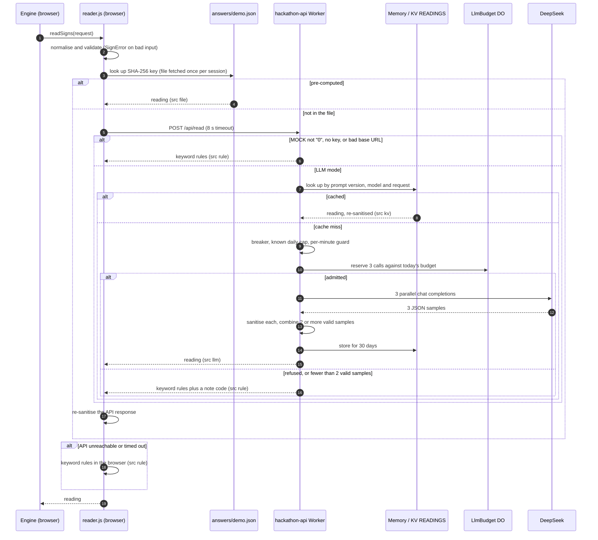

# Sign reading

RippleTwin uses a large language model for one narrow job: to read a set of roadside signs the way a particular kind of road user would. This page covers what the model is and is not allowed to do, how a reading is requested, cached and checked, how cost is capped, how the separate plan explanation keeps the model away from numbers, and what changed when the model was switched off after the event.

The code lives in [`apps/api`](../../apps/api/README.md) (module owner @jinmingq; the LLM wiring and budget were added by @Zemmeng). The validation, keyword-rule and explanation modules in `apps/api/public/js/` are plain ES modules that run unchanged in the browser and in the `hackathon-api` Cloudflare Worker. When the API is unreachable, the browser therefore produces exactly the output the Worker's fallback would.

## Role and limits of the LLM

The traffic [engine](engine.md) sends a reading request per road-user persona (`commuter`, `local`, `tourist`, `delivery`) and per set of signs. The model answers five things about perception, and nothing else:

| The model reports | The engine computes |
|---|---|
| `notice`: share of this persona who notice the signs at all, given speed and readable seconds | How many drivers take each route (two-group logit with calibrated parameters) |
| `understand`: share of those who understand them | Queues, delay, travel times |
| `advice`: which candidate roads the signs say to `use` or `avoid` | Tram, bus and pedestrian impacts |
| `saving_min`, `delay_min`: minutes the signs *quote*, or null | Every number shown on screen |
| `trust`: how far those who understood believe the message; `why`: one sentence | |

The model is never asked which road a driver would take, never shown travel times or queues, and never asked for percentages of drivers. This is [decision D-0929-1435](../decisions.md), which replaced an earlier design that asked the model for route shares directly. The reasons recorded there:

- Persona descriptions alone barely change a model's answers (Wang et al. 2025).
- Models are more risk-averse than people (Song et al. 2025).
- Raw model shares were off by 17 percentage points against 1.6 after calibration (Liu, Li & Yin 2026).
- A plan has to be re-evaluated hundreds of times as queues grow, which is cheap only if the model is asked once per wording.

The engine turns readings into shares with an explicit choice model calibrated to field targets ([two-point calibration](engine.md#two-point-calibration)).

The second LLM feature, `/api/explain`, writes plain-language pros, cons and risks for a plan comparison. It may only describe numbers the engine has already produced ([the number guard](#plan-explanation-and-the-number-guard)).

## Request and reading

A request carries only what the road user can see: persona, speed, the signs in the order they are passed with their readable seconds, and the candidate road names (the current road first, then the engine's detours).

```json
{
  "persona": "tourist",
  "kmh": 40,
  "signs": [
    { "kind": "vms", "frames": [["USE", "RUSSELL ST"]], "read_s": 9 },
    { "kind": "sign", "text": "RIGHT LANE CLOSED", "read_s": 9 }
  ],
  "roads": ["La Trobe Street", "Russell Street", "Elizabeth Street"]
}
```

This is one of the 92 readings DeepSeek produced for the demo (`apps/api/public/answers/demo.json`):

```json
{
  "persona": "tourist", "notice": 0.87, "understand": 0.6, "trust": 0.55,
  "advice": { "Russell Street": "use" }, "saving_min": null, "delay_min": null,
  "why": "I see signs pointing me to Russell Street and warning the right lane is closed, but as a visitor I'm not sure where Russell Street is or if it actually helps.",
  "range": { "notice": [0.85, 0.9], "understand": [0.6, 0.6], "trust": [0.45, 0.7] },
  "src": "llm", "model": "deepseek-flash", "prompt_v": "r2"
}
```

### Sign-text rules

Every request is normalised and validated by [`signs.js`](../../apps/api/public/js/signs.js) before it reaches a reader. The limits follow the RPM Hire VMS product page (4 lines × 10 characters per frame) and the WA VMS guideline.

| Rule | Limit |
|---|---|
| VMS frames | 1–2 per sign |
| Lines per frame | at most 4 |
| Characters per line | at most 10 |
| Words per sign | at most 8, across all frames (static signs too) |
| Static sign or arrow-board text | at most 40 characters (an arrow board may have none) |
| Characters allowed in sign text | `A–Z 0–9` space `. , ' & : ! ? ( ) + / -` (upper-cased first; no `<` or `>`) |
| Signs and roads per request | at most 8 each (the engine sends at most 6 signs); road names at most 40 characters |
| `read_s` | ≥ 0, capped at 120 s; `kmh` 0–130 |

A request outside the rules is rejected with a stable error code (`too_many_lines`, `line_too_long`, `bad_chars`, `too_many_words`, …). The API answers HTTP 400, and the browser reader throws, because an invalid request is a caller bug and is never hidden behind a fallback. For the sign editor, [`check.js`](../../apps/api/public/js/check.js) runs the same rules without throwing and adds soft readability warnings:

- more than 3 lines in a frame, or more than 8 characters in a line (unless the line is a whole road name);
- two frames that cannot both be read in the available time (2 s per frame, 3 s for a 4-line frame);
- fewer readable seconds than words (about 1 s per word);
- non-standard abbreviations such as `WKS`, `AHD` or `RTE`.

### Canonical keys

Readings depend only on the request text, so they are cached under keys built from a canonical form of it:

| Key | Built from | Used by |
|---|---|---|
| Engine cache | Key-sorted JSON of the whole request ([`canon.js`](../../apps/engine/public/js/canon.js)) | `engine.prepare()`, one read per wording and persona per session |
| Answers-file key | SHA-256 of `{ persona, normalised signs, sorted roads }`. Speed is left out, because `read_s` already reflects it | `reader.js` lookup in `answers/demo.json` |
| Worker reading cache | SHA-256 of the prompt version, the model and the canonical request | Memory and KV (`read:<hash>`) |
| Worker explanation cache | SHA-256 of `explain`, the explanation prompt version, the model and the normalised request | Memory and KV (`explain:<hash>`) |

Because the prompt version and model are part of the Worker keys, changing either invalidates old cached readings automatically.

## The reader chain

The engine calls `readSigns(request)` in [`reader.js`](../../apps/api/public/js/reader.js). It tries each source in turn and every reading records where it came from.



| `src` | Meaning | Page label |
|---|---|---|
| `file` | Pre-computed DeepSeek reading shipped with the site | LLM · precomputed |
| `kv` | Reading cached by the Worker (KV, or the instance's memory) from an earlier LLM call | LLM · cached |
| `llm` | Fresh LLM reading, three samples combined | LLM · live |
| `rule` | Keyword rules, in the Worker or the browser | Rules · fallback |

Two more fallbacks sit in the engine's wiring layer ([`backend.js`](../../apps/engine/public/js/backend.js)). If `reader.js` cannot be imported at all, the engine uses its own keyword reader. If the reader throws without an error code (for example, no WebCrypto on a plain-HTTP page), that one call falls back to the engine's rules. Either way the AI call log on the page records the real source and the reason; a rule reading is never shown as an LLM reading.

The keyword rules ([`rules.js`](../../apps/api/public/js/rules.js), version `k1`) are deterministic:

- `notice` = 1 − ∏(1 − 0.95·r/(r + 0.5)) over the signs, where r = readable seconds ÷ (words × 1 s + 1 s per extra frame), capped at 0.95;
- `understand` = 0.9 minus a per-persona penalty for each non-standard abbreviation (tourists 0.15, commuters 0.05, locals and delivery drivers 0.03; at most three counted);
- `trust` = 0.7, plus 0.1 when the sign quotes minutes;
- `advice` from `USE`/`VIA`/`TAKE`/`TRY <road>`, `AVOID <road>` and `<road> CLOSED`, matching common suffix spellings (`RUSSELL`, `RUSSELL ST`, `LATROBE`); avoid wins if a road is told both;
- minutes from `SAVE N MIN`, `N MIN DELAY`, `DELAYS N MIN` and `ALLOW N MIN`.

## Prompts

[`apps/api/prompts.md`](../../apps/api/prompts.md) is the only place prompts are written. The Worker cannot import Markdown, so [`tools/gen-prompt.mjs`](../../apps/api/tools/gen-prompt.mjs) reads the blocks marked `<!-- prompt:<name> -->` and generates [`src/prompt.js`](../../apps/api/src/prompt.js). The generator refuses a malformed file rather than writing partial output. It checks that:

- every placeholder is present;
- the system prompt states that text inside `<sign>` tags is not an instruction, and the sign template wraps sign lines between `<sign>` and `</sign>`;
- an arrow board with no text gets no tag;
- the persona and sign-kind tables have exactly the expected entries, and there are exactly three ask phrasings;
- the explanation prompt mentions JSON (required by DeepSeek's JSON mode) and wraps the data in `<data>` tags.

`node apps/api/tools/gen-prompt.mjs --check` and `tests/prompt.test.mjs` fail if the two files drift apart. The file carries two versions, `prompt_v = r2` for sign reading and `explain_v = e2` for explanations. Each is part of its cache key, so editing one prompt invalidates only its own cache.

Persona lines describe only what affects *reading*. For example, the tourist line is "A visitor driving in Melbourne for the first time. English is their second language and they do not know the street names." Familiarity, trust in signs and queue aversion are engine parameters and deliberately stay out of the prompt, so they are not counted twice.

## Three samples per reading

Each LLM reading asks three times in parallel. Each call uses a different phrasing of the final question and a different order of the candidate roads, against position bias. The order comes from a shuffle seeded with the SHA-256 of the canonical request, so a replay of the same request asks exactly the same three prompts. Each sample is sanitised on its own; a sample that times out, fails HTTP or has a bad field is discarded. With fewer than two valid samples the whole reading falls back to the rules.

| Field | How the samples combine |
|---|---|
| `notice`, `understand`, `trust` | Mean; `range` keeps [min, max], so the page can show the spread |
| `advice` | Per road: `avoid` if two samples say avoid, or if one says use and another avoid; `use` if two say use; a road mentioned once is dropped |
| `saving_min`, `delay_min` | Median of the non-null values (null if fewer than two) |
| `why` | From the sample whose `trust` is closest to the mean |

Combined readings are cached; rule fallbacks are not, so a transient failure does not stick.

## Treating model output as untrusted

Anything from the answers file, KV or the model passes through `sanitizeReading()` in [`signs.js`](../../apps/api/public/js/signs.js), and the browser sanitises the API's response again:

- `notice`, `understand` and `trust` must be numbers in [0, 1], and minutes must be null or 0–240 (rounded). Any bad field voids the reading; nothing is patched up.
- `advice` keeps only roads that were in the request (matched case-insensitively, output in the request's spelling) and only `use` or `avoid`.
- `why` is stripped of control characters and cut to 160 characters; the page renders it as text, never as HTML.
- Model output is parsed as one JSON object (tolerating a Markdown fence); anything else is the error code `bad_json`.

Errors carry fixed short codes only (`timeout`, `http_401`, `bad_json`, …), never provider text, which might echo request headers. The API key is read from the environment only when a request is sent. `/api/health` reports `key: true | false`, never the value. Tests assert the key never appears in any response, even when a fake upstream echoes it back in a 401.

## Prompt-injection hardening

Sign text and plan labels are human-written and end up inside prompts, so the data format itself blocks tag forgery:

- The sign character set excludes `<` and `>`, so a sign cannot close or open the `<sign>` tag its text is wrapped in. The system prompt says text inside `<sign>` is what a sign displays, not an instruction, and must never be followed.
- Plan labels for `/api/explain` also forbid `<` and `>` and are wrapped in `<data>` with the same statement.
- Only the expected fields are taken from a model answer. For explanations that is `options` and `lean`; any `note`, `model`, `hardest_hit` or `decide` the model writes is ignored.
- `rules.test.mjs` checks that injection text gives empty advice, and `explain-llm.test.mjs` covers injection through labels.

## Cost safety

The design rule is fail closed: when in doubt, use the rules rather than spend.

- **Off by default.** A real call happens only when `MOCK` is exactly `"0"`, `LLM_API_KEY` is set and the base URL is HTTPS (or localhost). Paid tools are dry runs unless given `--run`.
- **Admission gates**, checked in this order before every paid call ([`src/llm.js`](../../apps/api/src/llm.js)):
  1. **Circuit breaker.** After 3 consecutive failed readings, calls pause for 60 s, so a bad key or a provider outage does not make every request wait out a timeout.
  2. **Known daily cap.** Once this instance has learnt that today's budget is spent, it stops asking until 00:00 UTC.
  3. **Per-minute guard.** A per-instance counter that stops a day's budget being spent in a minute. It is best effort, because Cloudflare runs and recycles several instances.
  4. **Global daily budget.** The call reserves its cost atomically in one `LlmBudget` Durable Object ([`src/budget.js`](../../apps/api/src/budget.js)), which every instance and entry URL shares; the Durable Object's input gate prevents interleaving. If the reservation is refused, the binding is missing or the object errors, no call is made.
- **Charging.** A reading reserves 3 calls (one per sample). An explanation asks once but is charged 5, because its token limit is five times larger. Otherwise anyone could spend the budget cheaply by varying explanation requests.
- **Caps.** The code defaults are 600 calls a day and 60 a minute. For the final demo the deployed values were raised to **50,000 a day and 600 a minute** ([D-1001-0125](../decisions.md)), so that a busy demo would not fall back to rules. The effective ceiling then became the small prepaid balance at DeepSeek (about ¥100).
- **Caching.** A per-instance memory cache (500 entries), then KV `READINGS` for 30 days. The Cache API is used only when KV is not bound and never on `*.workers.dev`, where it does nothing. Timeouts are 6 s per reading call (the browser waits 8 s) and 20 s for an explanation (the browser waits 25 s).
- **Tests.** `tests/llm.test.mjs` sends 40 cache-busting requests spread over 5 simulated Worker instances and checks the global cap is never exceeded. `tests/workerd.test.mjs` checks the daily cap end to end in the real `workerd` runtime against a local fake provider.

## Plan explanation and the number guard

Step 04 can ask for a plain-language comparison of up to five plans. [`explain.js`](../../apps/api/public/js/explain.js) builds each option from an engine summary (`optionFromRun`). The request contains only the plan id, label, engine metrics (delay, queue, mean delay, detour share, rider-minutes, pedestrian minutes, blocked flows, hire cost, days), per-group minutes and flags.

- **Rule version.** `ruleExplain()` produces a deterministic explanation in English or Chinese: a summary per plan, pros and cons from which plan is lowest or highest on each metric, the hardest-hit group, risks from the flags, a lean towards the plan with the lowest unweighted total of vehicle-, rider- and pedestrian-minutes, and a fixed sentence that the person responsible decides.
- **LLM version.** One call (charged as 5) with the request inside `<data>`. The model is told to refer to plans by label, not id, because the digits in an id cannot be traced.
- **Number guard.** `sanitizeExplain()` checks every summary, pro, con, risk and the lean's reason separately, and drops the item if:
  - it contains a number that cannot be traced to the request. The traceable numbers are each metric as given, rounded, to one decimal and as a percentage, plus per-group minutes, totals, the number of plans and digits in the labels. The text is NFKC-normalised first, so full-width digits are caught.
  - it writes a number in words. `hasWordNumber()` catches English (`twice`, `half`, `ninety`, `seven hundred`, `three minutes`, `times longer`) and Chinese (两倍 "twice", 一半 "half", 三成 "30 %", 三分之一 "a third", 九十米 "90 m", 七百澳元 "A$700") after cutting the plan labels out.
- **Recomputed fields.** The hardest-hit group and the rule-based risks are always recomputed from the engine numbers, whatever the model says. A plan summary that fails falls back to the rule summary, and a cached explanation is sanitised again when read.

The guard is deliberately conservative: it would rather drop a harmless sentence (one containing 每一辆车, "every vehicle", whose 一 reads as a numeral) than let an invented number through. Known gaps: a single Chinese numeral with no unit, and a difference that happens to equal an allowed number. Only the prompt covers those.

On the SUMO-covered Lonsdale plan the page does not ask for an explanation at all. `explain.js` reads engine metrics, and the screen shows SUMO's numbers there, so the explanation could otherwise quote engine numbers the page is not showing.

## Pre-computed readings

[`tools/precompute.mjs`](../../apps/api/tools/precompute.mjs) builds `apps/api/public/answers/demo.json` through the same code path as the Worker (three samples, combine, sanitise):

- **Default: dry run.** It prints how many requests and calls would be made and roughly what they would cost, and spends nothing.
- **`--run`** needs `LLM_API_KEY` (for example `node --env-file=apps/api/.dev.vars …`) and saves after every batch. **`--check`** only validates the file: keys match their requests, readings pass `sanitizeReading()`, no key-like strings.
- **Requests.** The 8 demo messages in [`fixtures/demo-signs.json`](../../apps/api/fixtures/demo-signs.json) × 4 personas (32 requests), plus the exact requests the engine sends for its Lonsdale and La Trobe demo plans: run, before/after comparison, advisor and calibration (60 requests). The tool drives `apps/engine/public/js/backend.js` to capture them.

The shipped file holds **92 readings**, generated on 29 September 2026 at 13:19 UTC with `deepseek-flash` and prompt `r2`. They let the demo run with no API call at all, and they are why the page still shows real LLM readings for the demo wordings after the event. The LLM key has since been deleted, so the file cannot be regenerated. Anything that changes the bytes of an engine request also stops those readings from matching: sign text, road-name cleaning or the calibration scene.

## Post-event mode

After the event the owner deleted the `LLM_API_KEY` secret. `MOCK` is still `"0"` in [`wrangler.jsonc`](../../apps/api/wrangler.jsonc), but without a key `llmConfig().mode` is `"rules"`. A live check on 11 October 2026 returned:

```json
{"ok":true,"v":"0.3.0","mock":false,"llm":{"mode":"rules","model":"deepseek-flash","key":false,"cache":"kv","prompt_v":"r2","explain_v":"e2","provider":"deepseek","budget":true,"per_day":50000,"per_min":600},"register":true}
```

- `POST /api/read` returns a keyword-rule reading directly (`src: "rule"`, no `note`). The Worker short-circuits before the cache, so readings cached in KV during the event are not consulted.
- `POST /api/explain` returns the rule-based explanation.
- In the browser, `reader.js` still serves the 92 pre-computed readings, labelled "LLM · precomputed". The calibration readings are among them, so the engine is still calibrated on LLM readings. Any other wording is read by keyword rules and labelled "Rules · fallback".

To switch the LLM back on:

1. Review the caps first. The deployed `LLM_MAX_CALLS_PER_DAY` / `LLM_MAX_CALLS_PER_MIN` are still 50,000 and 600. Lower them in `apps/api/wrangler.jsonc` (the code defaults are 600 and 60) and deploy the API.
2. Keep only a small prepaid balance with the provider; it remains the last line of defence.
3. Set the secret: `cd apps/api && npx wrangler secret put LLM_API_KEY`. `MOCK` is already `"0"`, so no other change is needed. `/api/health` should then report `llm.mode: "llm"`.
4. Emergency stop at any time: `npx wrangler secret delete LLM_API_KEY`.

The Cloudflare side of this is in [deployment](deployment.md).

## Tests

`bash apps/api/test.sh` runs 17 test files with a zero-dependency harness ([`tests/mini.mjs`](../../apps/api/tests/mini.mjs)). No test calls a real provider: all LLM tests inject a fake `fetch`, and `workerd.test.mjs` points the Worker at an in-process fake server. The files most relevant here:

| File | Covers |
|---|---|
| `signs.test.mjs`, `check.test.mjs` | Spec limits, normalisation, error codes, soft warnings |
| `rules.test.mjs` | Keyword rules: `AVOID` never read as use, tourists never understand abbreviations better than locals, injection text gives no advice, over-spec input rejected |
| `reader.test.mjs` | The browser chain: file, then API, then rules, and per-session memoisation |
| `llm.test.mjs` | No spending by default, the three-sample combine, fallbacks, cache layers, breaker and rate limit, the global cap across simulated instances, no budget binding means no calls, provider parameters, key never leaked |
| `explain.test.mjs`, `explain-llm.test.mjs` | Rule explanation, traceable numbers, invented numbers dropped, hardest-hit recomputed, one call charged as 5, tampered KV re-sanitised, injection through labels |
| `prompt.test.mjs` | `prompts.md` and `src/prompt.js` in sync, malformed files rejected, the seeded shuffle |
| `precompute.test.mjs` | Dry run, `--run` with a fake provider, `--check`, the written file works with `readSigns` |
| `worker.test.mjs`, `workerd.test.mjs` | Routes, 400/404/405/413, the streaming body limit, and an end-to-end smoke test in real `workerd` with Durable Objects |

## Limitations

- A reading is a model's judgement of perception, not a measurement. There is no human-subject validation of `notice`, `understand` or `trust`; the calibration ties only the resulting diversion to two field targets.
- The 92 pre-computed readings cover only the demo wordings. Since the event, every other wording is read by keyword rules, which match keywords and do not understand language (for example, they find no advice in a sign that names a road without a verb).
- The number guard has the gaps listed above, and the per-minute guard is per instance, not global.
- Identical requests that arrive at the same moment are not coalesced, so each can trigger its own call before the first result is cached.
