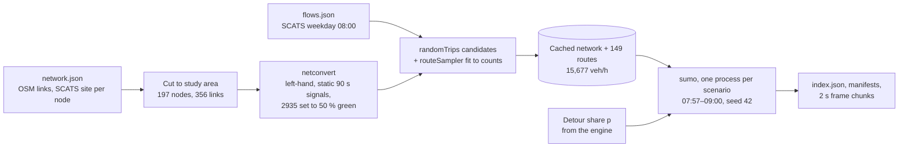

# Traffic simulation

Step 02 of the workbench shows individual vehicles moving through the CBD. For the Lonsdale St demo plan these are trajectories from **Eclipse SUMO 1.27.1** running on the real CBD street network with SCATS demand. During the event SUMO ran on demand in a Cloudflare Container; since the event the page replays a pre-computed run. Where SUMO data is not available, a smaller browser micro-simulation (GridSim) is used instead. This page describes the SUMO model and its assumptions, what it outputs, the cloud service that ran it, how the browser plays it back and how honestly each source is labelled.

SUMO here is a **cross-check, not empirical validation**. Signal timings and turn shares are assumptions, the diversion share comes from the [engine](engine.md), and no result has been compared with queues observed on the street ([D-0930-2200](../decisions.md)).

Code: the generator and job server are in [`apps/web/tools/sumo/`](../../apps/web/tools/sumo/README.md) (`build_real.py`, `serve.py`, and `build_demo.py` for the older synthetic grid). The cloud service, browser client and pre-computed replays are in [`apps/sumo/`](../../apps/sumo/README.md). The playback code is `apps/web/src/js/4c-sumo.js`. Owner: @Zemmeng; @jinmingq built the first SUMO back end (the synthetic 2×2 grid) and extended the GridSim to 4×4.

## The model on the real CBD network

[`build_real.py`](../../apps/web/tools/sumo/build_real.py) builds and runs everything from three files produced by [apps/roads](../../apps/roads/README.md): `network.json` (OpenStreetMap links), `signals.json` (SCATS signal sites, attached to network nodes) and `flows.json` (SCATS counts).



1. **Study area.** `network.json` is cut to two rectangles in a frame aligned with Lonsdale St: Elizabeth St to Spring St by Bourke St to La Trobe St; plus room for the queue east of Russell St to the edge of the data (Albert St to Gisborne St, Nicholson St, Victoria Pde), south to Collins St and about 170 m north of La Trobe St. Living streets are dropped. The result is 197 nodes and 356 links. A narrower cut along Albert St alone was tried and rejected: `routeSampler` chose different routes, right-turning traffic at Russell St × Lonsdale St locked up, and nearly 200 vehicles bound for the works could not enter the network even with no works.
2. **Network.** `netconvert` builds a left-hand-traffic SUMO network: no U-turns, junctions within 12 m joined, signal controllers only where the data has a SCATS site, every signal a static 90 s plan.
3. **Demand.** Weekday 08:00–09:00 counts from `flows.json` (the mean of 38 weekdays) are attached to all 207 network edges, 97 of them from detectors and the rest interpolated. `randomTrips` generates candidate routes and SUMO's `routeSampler` (with `--optimize full`) picks route flows that best match the counts. The result is 149 routes carrying 15,677 veh/h, with 1,143 veh/h through the works link against a count of 1,144. Cars only: no trams, buses or trucks.
4. **Cache.** The network and demand are cached under a hash of the generator, the SUMO version, the signal split and the three input files. The Docker image builds this cache at build time, so a live run only has to run `sumo`.
5. **Simulation.** Each scenario draws Poisson departures on every route from the same seed, and each vehicle's diversion draw is also seeded, so every scenario simulates the same vehicles (common random numbers) and differences come only from the treatment. The scenarios run in parallel, one `sumo` process each.

### Scenarios and the detour share

| Scenario | Works | Diversion share `p` | Meaning |
|---|---|---|---|
| `baseline` | none | 0 | The same hour with no works |
| `original` | one lane closed from 08:00 | 0.14 | The engine's share for the original sign, `ROADWORK AHEAD` |
| `ai` | one lane closed from 08:00 | 0.53 by default | The AI wording `USE RUSSELL / SAVE 9 MIN`; a live re-run used the engine's current share for the advisor's plan |
| `opt-A` … `opt-E` (options mode) | one lane closed | per plan | Step 04: one scenario per traffic-management plan, metrics only by default; plans with equal `p` run once and are copied (`reused_from`) |

SUMO does not choose routes in response to the signs. A fixed share `p` of *eligible* vehicles takes the detour. Eligible means vehicles on Lonsdale St westbound before Russell St whose route passes through the works. The detour is left into Russell St, then Little Bourke St, Swanston St and back onto Lonsdale St. The engine supplies `p`: its persona readings of each plan's signs and its choice model give the share of drivers who leave the stay route (see [engine, relationship to SUMO](engine.md#relationship-to-sumo)).

### Key assumptions

- **Works capacity.** The right (median) lane of the 42 m Lonsdale St westbound link before pedestrian signal 2935 closes at 08:00:00; the open lane runs at 30 km/h. Signal 2935 gives Lonsdale St traffic 50 % of its 90 s cycle (42 s green, 3 s amber). This split was chosen so the works link matches the engine's capacity assumption of 1,800 veh/h × ½ lane × 0.9 = **810 veh/h**. SUMO's achieved discharge is measured and reported separately (805 veh/h in the `original` scenario).
- **Signals.** SCATS publishes counts but not timings, so every other signal runs SUMO's default 90 s fixed plan. The real network is SCATS-adaptive.
- **Turns.** Turning movements are whatever routes `routeSampler` needs to reproduce the link counts; turn shares are not measured.
- **Warm-up.** The network starts empty at 07:57:00 with 08:00 demand and no works. The first 180 s are warm-up and are not shown or measured.
- **Jams are kept.** A vehicle blocking a junction for 60 s is ignored by crossing traffic, and only a vehicle that has not moved at all for 300 s is moved ahead (SUMO teleport). This prevents model deadlocks without removing the works queue, which moves up every cycle. Every teleport is counted and located in the metrics.
- **Not modelled.** Kerbside parking, clearways, living streets, pedestrians, trams and buses.

## Outputs

A run writes a v2 output directory ([module interfaces](../reference/interfaces.md)):

- **`index.json`**: the scenarios with their metrics, every parameter (seed, `p` values, hour window, warm-up, sample period, signal split, network size, demand totals), the assumptions in English and Chinese, timing, and `generator_sha256`.
- **`<scenario>/manifest.json`**: the vehicle catalogue, one signal head per approach, the works-lane geometry, per-minute counters, the metrics, and the list of frame chunks, each with its byte size and SHA-256.
- **`<scenario>/frames-NNN.json`**: 60 frames each (2 minutes), one frame every **2 s**. Each vehicle row is `[i, lon×1e6, lat×1e6, angle°, speed cm/s]`: position at the vehicle centre, angle 0 = north, clockwise. Each frame also holds every signal's state string and the works queue in metres. Only vehicles inside the page's view are written, and only `original` and `ai` have frames (`baseline` is metrics only).

The pre-computed copy in [`apps/sumo/public/real/`](../../apps/sumo/public/real/) is seed 42, baked in the `linux/amd64` Docker image: 64 files, about 30 MB, 30 chunks per played scenario. The run took about 27 s on 4 CPUs.

**Provenance.** `generator_sha256` is the SHA-256 of `build_real.py` at bake time, and `apps/web/tests/test_sumo_real.py` fails if the generator changes without a re-bake. Results also depend on platform (a macOS arm64 run differs from the `linux/amd64` bake), so `params.source` records where a run was made.

### Seed-42 results

Read from `apps/sumo/public/real/index.json`. "The cohort" is every vehicle that departs between 08:00 and 09:00, the same vehicles in every scenario.

| Metric | Definition | Baseline | Original (p = 0.14) | AI plan (p = 0.53) |
|---|---|---|---|---|
| Detoured / eligible vehicles | Cohort vehicles that took the detour, of those eligible to | 0 / 538 | 73 / 538 | 287 / 538 |
| Demand through the works | Cohort vehicles whose final route passes the works (veh in the hour) | 1,173 | 1,100 | 886 |
| Discharge past the works | Vehicles crossing the end of the works between 08:00 and 09:00 | 1,161 | 805 | 788 |
| Physical queue at 09:00 | Back of the stopped queue on the Lonsdale / Albert St westbound chain, longest over the last 90 s cycle | 23 m | 246 m | 260 m |
| Physical queue, hour maximum / mean | Same measure over the hour | 152 / 2 m | 373 / 159 m | 278 / 115 m |
| Engine-method queue at 09:00 | Vehicles bound through the works that are queued behind it (including spill-back onto side streets) or still waiting to enter the network, averaged over the last cycle, × 7 m ÷ 2 lanes | 15 m | 973 m | 305 m |
| … of which waiting to enter | Mean vehicles held at the network edge in the last cycle | 0.8 | 240.8 | 78.4 |
| Extra delay per vehicle, works traffic | Mean (time loss − baseline time loss) for cohort vehicles whose original route passes the works, including those that detour | — | 533 s | 396 s |
| Extra delay per vehicle, all traffic | Same, for the whole cohort | — | 38.6 s | 39.8 s |
| Teleports in the hour | Vehicles moved ahead after 300 s without moving | 1 | 0 | 2 |

How to read the table:

- **The physical queue saturates** at roughly the same length (about 250 m back from the works) in both works scenarios. The difference between the plans shows up in vehicles that spill back onto side streets or cannot enter the network at all. The engine-method queue counts those, and it is the measure designed to be comparable with the engine's D/D/1 queue. For the same `p` = 0.14 the engine reports 918 m against SUMO's 973 m, but both rely on the same 810 veh/h capacity assumption.
- **Diverting more drivers helps the traffic bound for the works** (533 s → 396 s of extra delay each), but the network-wide mean is essentially unchanged (38.6 s → 39.8 s), because the detour adds load to Russell, Little Bourke and Swanston streets. Diversion moves delay; it does not remove it.
- It is **one seed** with no confidence interval. The AI scenario uses `p` = 0.53, while the engine's share for that wording today (read by keyword rules since the event) is 0.61 ([worked example](engine.md#worked-example)).
- The metrics also include SUMO's collision and emergency-braking counters. They are diagnostics: a collision on a lane fails the run, and "collisions" inside merged OSM junctions are geometry artefacts that are recorded separately. They are not safety measurements, and the page does not use them as such.

## The cloud service (during the event)

From 30 September until after the finals, SUMO ran on demand in Cloudflare ([D-0930-1700](../decisions.md)). The topology, deployment and costs are in [deployment](deployment.md).

```text
browser ─ /api/sumo/v1/* ─▶ hackathon-site ─ service binding SUMO ─▶ hackathon-sumo Worker (proxy.js)
                                                                       └─▶ SumoContainer (Durable Object, 1 instance)
                                                                            └─▶ serve.py /sumo/v1/* ─▶ build_real.py ─▶ sumo
```

**Worker proxy** ([`apps/sumo/src/proxy.js`](../../apps/sumo/src/proxy.js)). It has no Cloudflare imports, so Node tests it directly.

- **Whitelist first.** Six route patterns (health, create run, run status, `index.json`, scenario manifests and frame chunks, and a synthetic-only frame endpoint). Any other path is a 404 before the container is touched, so probes cannot wake (and bill) it; tests check about 33 hostile paths, including traversal and encoded slashes. Wrong methods get 405 with `Allow`.
- **Abuse and cost controls on `POST /runs`.** A 2,048-byte body cap counted while streaming (it also catches chunked uploads with no `Content-Length`). A Workers rate limit of **3 runs per IP per minute**. A busy gate that asks the container's own health and returns 429 when 2 or more jobs are active.
- **Clean forwarding.** `Origin`, `Cookie` and `Authorization` are stripped, and query strings are dropped except on the frame endpoint.
- **Error mapping.** Errors are normalised to `{ ok: false, error, msg }`, with container start-up mapped to 503 `sumo_starting` and failures to 502 `sumo_down`, without leaking internal text.
- **Caching.** Completed outputs are cached `public, max-age=86400, immutable`, because run ids are random and outputs never change; everything else is `no-store`.

**Container** ([`apps/sumo/Dockerfile`](../../apps/sumo/Dockerfile), [`wrangler.jsonc`](../../apps/sumo/wrangler.jsonc)):

- **Image.** `python:3.12-slim` with pip-installed `eclipse-sumo` and `sumolib` 1.27.1, plus numpy and scipy for `routeSampler`.
- **Build-time verification.** The build fails on a missing shared library (`ldd`), a wrong SUMO version, missing `routeSampler` dependencies, a failing end-to-end mini simulation or a broken real-network import, rather than after deployment. It also pre-builds the real-network cache.
- **Instance.** One `standard-4` instance (4 vCPU, 12 GiB) with `max_instances: 1`. `serve.py` keeps job state in memory and on the container's ephemeral disk, so a second instance could not see runs the first created; the Worker therefore always addresses the instance named `main`. `sleepAfter` is 12 h, to stay warm through judging.
- **`serve.py`.** Runs one job at a time, queues at most 4 and keeps the newest 20 runs. A real-network job runs its scenarios as parallel subprocesses (`SUMO_REAL_JOBS=4`). On shutdown the running job finishes and queued ones are dropped; after a restart, interrupted jobs are marked failed rather than left "running".

Three request modes share the endpoint:

- the synthetic 2×2 grid (`build_demo.py`; scenarios baseline / closure / guided / footpath);
- the real network (`{ network: 'real', seed, p_original, p_ai }`);
- options mode (`{ network: 'real', options: [{ id: 'A', p }, …] }`).

## Pre-computed replays and honest labels

The page never depends on the container ([D-0930-1700](../decisions.md)). [`sumo-client.js`](../../apps/sumo/public/js/sumo-client.js) is its only entry point to SUMO. Every result it returns carries `source` and, on fallback, a `reason` code:

| Method | Live path | Fallback | `source` |
|---|---|---|---|
| `runReal()` (steps 02 and 03) | health → `POST /runs` → poll every 1 s → `index.json` | Pre-computed seed-42 replay in `/sumo/public/real/` | `live`, `baked` |
| `runOptions()` (step 04) | Same, options mode | None: the page shows "—" and the reason | `live`, `none` |
| `run()` (legacy synthetic grid) | Same, synthetic mode | Nearest of 15 baked grid points in `/sumo/public/baked/` | `live`, `baked` |

- **Reason codes** include `health_down`, `sumo_rate`, `sumo_busy`, `timeout`, `sumo_failed`, `network`, `not_found`, `cancelled` and `bad_chunk`, each with an English and a Chinese label.
- **Timeouts.** The health check waits 6 s (12 s for real-network and options runs, to give a cold container time). A whole real-network run is allowed 180 s; cloud runs of the full hour took about 40–60 s.
- **Never labelled live.** Tests reverse-assert that a pre-computed result is never labelled live, even if the file itself claims `source: 'live'` or carries a run id. Options mode deliberately has no fake fallback, because no baked run exists for arbitrary plan shares.
- **Legacy grid replays.** `public/baked/` (101 files, about 21 MB: a preset plus 15 points over diversion {0, 0.15, 0.3, 0.45, 0.6} × demand {0.8, 1.0, 1.2}) belongs to the earlier synthetic grid and is not used by the current UI.

## Browser playback

`apps/web/src/js/4c-sumo.js` plays a v2 replay through the same interface the page already draws from for the GridSim, so the map's drawing code has no SUMO branch.

- **Integrity.** `realManifest()` and `realChunk()` check each chunk's SHA-256 against the manifest with WebCrypto, and raise `bad_chunk` on a mismatch. On a plain-HTTP page without WebCrypto the check is skipped rather than breaking the page.
- **Streaming.** The page loads the chunk at the playhead and the two after it first, then the rest in time order, and starts playing as soon as the playhead's chunk has arrived. Playing into a chunk that has not arrived holds on the last sample instead of jumping. Decoded samples are capped at 48 MB; chunks far from the playhead are dropped and fetched again when needed. If chunks keep failing, the page plays what arrived.
- **Positions.** Positions are interpolated linearly between the 2 s samples, and headings are turned through the map projection.
- **No conflict counting.** The v2 samples carry no lanes, so leaders and gaps (and with them conflicts and time-to-collision) are not computed for SUMO replays; the page shows "—". The map does draw heuristic harsh-braking marks: a vehicle whose speed falls faster than 3.5 m/s² between samples. These are a visual cue derived from sampled speeds, not a measured safety statistic.

**Labels.** In step 02 the pill reads "Cloud SUMO · computed live · N s · seed N" for a live run and "SUMO · pre-computed (cloud unavailable) · seed N" for the replay, followed by the reason. Step 03 shows the same run, choosing the scenario whose `p` is closest to the engine's share for the plan on screen.

## When SUMO is not used: GridSim and the junction scene

Step 02 picks what to show from the plan:

- **Lonsdale St westbound, one lane closed**: the SUMO replay (live or pre-computed). While it loads, or if it cannot be loaded, the GridSim is shown.
- **Works inside the GridSim's 2×2 block**: the GridSim.
- **Anywhere else**: the earlier single-junction La Trobe St scene.

The **GridSim** (`apps/web/src/js/4b-grid.js`) is a pure-JavaScript micro-simulation that runs in the browser ([D-0930-1036](../decisions.md), [D-0930-1720](../decisions.md)).

- **Extent.** It *computes* a 4×4 grid of 16 real SCATS junctions (La Trobe, Little Lonsdale, Lonsdale and Little Bourke streets × Elizabeth, Swanston, Russell and Exhibition streets) and *shows and counts* only the 2×2 around the works. The outer ring exists so cars arrive in signal platoons and a queue has room to spill back.
- **Demand.** Lanes and flows come from the data, and the outer entry flows are calibrated so the 2×2 inflows still match `flows.json`.
- **Model and assumptions.** IDM car-following (desired speed 11 m/s, time headway 1.2 s, jam gap 2 m, acceleration 1.2 m/s², comfortable deceleration 2 m/s²). Every junction runs a 90 s two-phase cycle with offsets for a westbound green wave. 15 % of cars turn left wherever there is a left exit, and there are no right turns. Trams run on Swanston St every 90 s.
- **Determinism.** A fixed seed and 180 s of warm-up.

The **earlier junction simulation** ([`apps/sim`](../../apps/sim/README.md)) was the team's first prototype, built on the first day of the event. It is a seeded micro-simulation of the Swanston St × La Trobe St junction (SCATS site 2921) with cars, bikes, trams and pedestrians on real counts, and a work zone that closes a bike lane. It is still served at `/sim/public/` but is not linked from the workbench.

## Post-event status

After the event the owner deleted the `hackathon-sumo` Worker and its container. The `hackathon-site` Worker still declares the `SUMO` service binding, so `/api/sumo/v1/*` now returns **502 `sumo_down`** immediately.

- **Steps 02 and 03** fall back to the pre-computed seed-42 replay straight away, labelled "SUMO · pre-computed (cloud unavailable) · seed 42" with the reason "Cloud SUMO is unreachable". Choosing another seed still plays the seed-42 replay, and it is labelled seed 42.
- **Step 04's** per-plan SUMO cells show "—" with the reason. The engine's kits, hire costs and detour shares are unaffected.
- **Static files.** The replays and `sumo-client.js` are static files on the site and still load.
- **Tests.** `bash apps/sumo/test.sh` needs no Docker, npm install or network.

Reviving the live service needs a Workers Paid plan and Docker: `cd apps/sumo && npm ci && npx wrangler deploy`, then redeploy the site. Redeploying the site *without* SUMO first requires removing the dangling binding (see [deployment](deployment.md#post-event-status)).

## Limitations

- **A cross-check, not validation.** SUMO and the engine share the network, the demand and the works-capacity assumption, so agreement between them is partly by construction. Neither has been compared with queues or travel times observed during a real closure.
- **Assumed signals and turns.** Signal timings are SUMO defaults, except the 2935 split, which was chosen to match the engine. Turning movements are fitted to counts, not observed.
- **No route choice.** The diversion is a fixed share supplied from outside, over one fixed detour, so SUMO does not test whether drivers would actually divert.
- **Narrow scope.** Cars only, one hour, one works location, and one baked seed. Vehicles that cannot enter the bounded study area wait at its edge rather than queueing on streets outside the data.
- **Platform dependence.** Results depend on the platform, which is why the replay is baked on `linux/amd64` and carries its generator hash.
