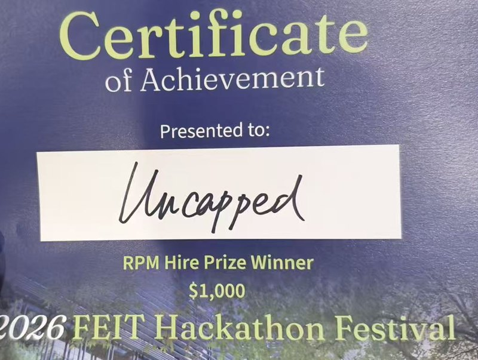

# Hackathon archive

This folder is the record of how RippleTwin was built: Team Uncapped's entry to FEIT Hackathon Festival 2026, written in about 50 hours between 29 September and 1 October 2026. Everything here was written during the event in Chinese and has been translated into English. The documents are kept as they were, including plans, numbers and claims that changed later. For the product as it stands, read the [project README](../../README.md) and the [architecture overview](../architecture/README.md).

The untranslated originals, and the repository exactly as it was at the end of the event, are at the git tag [`hackathon-final`](https://github.com/Zemmeng/rippletwin/tree/hackathon-final).

## The event

| | |
|---|---|
| Event | FEIT Hackathon Festival 2026, Faculty of Engineering and IT, University of Melbourne |
| Dates | 29 Sep 09:30 to 1 Oct 12:00 AEST (UTC+10), about 50 hours |
| Challenge | Challenge 5, sponsored by RPM Hire: *Digital Tool for Temporary Infrastructure*, theme Future Cities |
| Rounds | A 3-slide pre-screen PDF on 30 Sep selected 12–15 finalist teams; finalists gave a 7-minute presentation with 3 minutes of questions on 1 Oct |
| Team | Uncapped, five members (see [Team](#team-and-contributions)) |

The challenge asked for a digital tool that, before a road closure or work zone goes on site, uses a typical traffic equipment inventory (barriers, signage, VMS boards) to simulate its knock-on effects on surrounding traffic, pedestrians and public transport. The intended users are councils and contractors. The brief gave no dataset and no required deliverable format. The full brief, the rules and how the team read them are in [challenge-brief.md](challenge-brief.md).

## Result

Team Uncapped won the **RPM Hire Prize ($1,000)**.

## Judging criteria

The organisers' general criteria applied to both rounds; each was scored from 1 to 5. Challenge 5 had no criteria of its own.

| Criterion | Weight |
|---|---|
| Potential effectiveness | 40% |
| Technical feasibility | 30% |
| Originality | 15% |
| Viability (business and social uptake) | 10% |
| Presentation of ideas | 5% (finals only) |

The pre-screen used only the first four criteria.

## Timeline

All times are AEST (UTC+10) and are taken from the merge times of the pull requests (PRs) and from `hackathon.conf`.

| When | What happened |
|---|---|
| 26 Sep 01:29 | First commit: the team's pre-event workflow template (process docs, git hooks, `scripts/check.sh`, CI). No product code, design or data; see [submission.md §3](submission.md#3-what-existed-before-the-event-rule-3) |
| 26 Sep 02:06 | CI check and manual-only deploy workflows (#1); teammate onboarding guide (#2) |
| 29 Sep 09:30 | Event starts. Challenges unlock at 10:45 |
| 29 Sep 12:15 | Challenge 5 chosen (decision D-0929-1215) |
| 29 Sep 12:30 | First product code: a junction simulation of Swanston St / La Trobe St on real traffic volumes, `apps/sim` (#6) |
| 29 Sep 13:19 | Data contract v1, plan, task board and the first architecture diagrams (#7) |
| 29 Sep 14:24 | Real Melbourne CBD road network with 8 weeks of SCATS traffic counts, `apps/roads` (#9) |
| 29 Sep 15:02–15:31 | Equipment inventory, tram, bus and pedestrian data (#14); the rule-based sign reader and `/api/read`, `apps/api` (#22); the first web panel, `apps/web` (#19); the traffic engine on the real network, `apps/engine` (#20) |
| 29 Sep 15:42 | Behaviour parameters with sources and confidence ratings, `apps/params` (#31) |
| 29 Sep 16:02 | Same-origin Cloudflare Worker that serves every module, `apps/site` (#35) |
| 29 Sep 17:13 | The page shows engine-computed numbers instead of presets (#43); first live deploy |
| 29 Sep 19:47 | "Liquid glass" interface (#47) |
| 29 Sep 21:33–22:42 | Worksite register on a Durable Object (#53); plan explanation (#54); execution pack and hire quotes (#55); three equipment plans built from the inventory (#59); plan comparison, selection and export (#61); clashes between overlapping works shown on the page (#62) |
| 29 Sep 23:21 | DeepSeek sign reading with a KV cache and 92 pre-computed demo readings (#70); LLM-worded explanations that drop any number the engine did not produce (#71) |
| 30 Sep 01:27 | Pre-event starter templates deleted under the strictest reading of rule 3 (#65); the repository is made public at 01:30 (D-0930-0133) |
| 30 Sep 10:59–11:20 | 2×2 junction micro-simulation (#95); a local Eclipse SUMO backend (#96); back-test against real weather (#92) |
| 30 Sep 12:30 | Pre-screen deadline: 3-page PDF submitted ([pitch/](pitch/README.md)) |
| 30 Sep afternoon | The team advances to the finals (recorded in the 16:10 handoff note, #105) |
| 30 Sep 17:53 | SUMO runs in a Cloudflare Container behind `/api/sumo`, with pre-computed replays as the fallback, `apps/sumo` (#112) |
| 30 Sep 18:00 | 4×4 grid micro-simulation (#109); OpenStreetMap vector basemap (#111) |
| 30 Sep 20:25 | The 6-step workbench interface (#116) |
| 30 Sep 22:23 | Step 02 traffic comes from SUMO on the real CBD network (#118), run automatically in the cloud (#120) |
| 1 Oct 01:31 | SUMO covers the full 08:00–09:00 hour and supplies the on-screen traffic numbers for the Lonsdale demo plan; the container moves to 4 vCPU (#130) |
| 1 Oct 02:37 | Plans split into tiers A, B and C; step 04 is pre-computed in the background (#133) |
| 1 Oct 04:01 | Last code PR (#134). This build stayed live |
| 1 Oct 06:00 / 10:00 | Feature freeze / code freeze |
| 1 Oct 12:00 | Submission deadline |
| 1 Oct 13:30 | Finals presentations begin (7-minute talk and 3 minutes of questions per team) |
| 1 Oct 13:55 | README demo video replaced with the final 1:32 recording (#136, documentation only) |
| 1 Oct, awards | Team Uncapped wins the RPM Hire Prize |
| After the event | The SUMO container, the `hackathon-sumo` Worker and the LLM key were deleted. The site and API Workers remain online; the live page replays the pre-computed SUMO run and reads new sign wording with keyword rules. See [deployment](../architecture/deployment.md) |
| Oct 2026 | Repository translated into English and renamed `rippletwin`; the Chinese originals are kept at the `hackathon-final` tag |

## Team and contributions

Each module has one owner. Ownership is recorded in [`.github/CODEOWNERS`](../../.github/CODEOWNERS) and in the `Owner:` line of each module README.

| Member | Role | Main work | Notable PRs | Merged PRs |
|---|---|---|---|---|
| [@Zemmeng](https://github.com/Zemmeng) | Team lead, architect and integrator | `apps/engine` (traffic engine), `apps/sumo` (SUMO in a Cloudflare Container), `apps/site` (same-origin Worker), `apps/sim`; wiring the web page to the engine and SUMO; LLM integration in `apps/api`; scripts, CI and git hooks; the interface contract and decision log | #6, #7, #20, #35, #43, #59, #62, #70, #71, #112, #118, #130, #133 | 67 |
| [@unicornnnnnny](https://github.com/unicornnnnnny) | Front-end and UI owner; designated deployer | `apps/web`: map, liquid-glass interface, full-CBD map, the 6-step workbench, comparison table, logo | #19, #47, #85, #116, #123, #128, #134, #136 | 25 |
| [@jinmingq](https://github.com/jinmingq) | API and LLM module owner; pitch owner | `apps/api`: sign reader, Worker, worksite register, plan explanation, hire quotes and execution pack; the plan comparison and export UI; the 4×4 grid simulation; the local SUMO 2×2 backend; demo video | #22, #53, #54, #55, #61, #109, #117; authored #96 (merged by the lead) | 20 |
| [@louisxie316-dotcom](https://github.com/louisxie316-dotcom) | Data engineer | `apps/roads`: CBD road network, SCATS flows, signals, equipment inventory, GTFS transit, walking network and pedestrian counts, buildings, the weather back-test | #9, #14, #33, #92 | 8 |
| [@Unzzip](https://github.com/Unzzip) | Research | `apps/params`: behaviour parameters from the literature, each with a source and confidence rating; the OpenStreetMap vector basemap; the first English README for the judges and a repository clean-up | #31, #89, #111 | 5 |

In `git log`, commits by "Yiwen Ren" are @Zemmeng's (their local git identity) and commits by "Mina" are @jinmingq's.

## How the team worked

Five people, and the AI coding sessions each of them drove, wrote to one repository at once. The process was set up before the event to keep that from turning into merge conflicts and lost work.

- **Module ownership.** Each module under `apps/` had one owner. `scripts/check.sh` failed any branch that changed files outside its own module, unless the PR carried a `cross-module` label. The brief, plan and interface contract were edited only by the lead. Everyone edited only their own section of the task board, could only append to the decision log and pitfalls file (`check.sh` rejected deleted lines), and asked for any other shared-file change through section 2 of a handoff note.
- **One branch and one PR per task.** Tasks were numbered on the [task board](task-board.md) (T0–T51, each sized at two hours or less) and built on branches named `<handle>/<module>/T<n>-<slug>`. Changes reached `main` through PRs, almost all squash-merged; the pre-push hook refused direct pushes to `main`, and the lead's 13 direct commits were explicit overrides.
- **One quality gate everywhere.** `scripts/check.sh` runs nine checks: a secret scan, tracked secret files, branch and module boundaries, module structure, every module's tests, repository hygiene, the rules block in the README, handoff-note format and `hackathon.conf`. The pre-commit hook ran the secret scan, the pre-push hook ran the quick version, and CI ran the full version on every PR and every push to `main`. See [scripts/README.md](../../scripts/README.md).
- **Integration checkpoints.** From 17:00 on 29 Sep, every four hours, everyone pushed, the lead merged, and the live site was redeployed with `scripts/deploy.sh` by the designated deployer or, as backup, the lead. A feature freeze at 06:00 and a code freeze at 10:00 on 1 Oct protected the demo.
- **Handoff notes.** Whenever a person or an AI session stopped (to sleep, to hand over, or because a session's context was nearly full), it wrote a note in a fixed four-part format: facts and verification, changes needed in files the author did not own, decisions and risks for the lead, and the next command to run. 35 notes were written; see [handoff/](handoff/README.md).
- **Written specs.** For larger tasks the lead wrote a short spec before handing the work over; see [specs/](specs/README.md).
- **Decision log.** Every product and process decision went into [docs/decisions.md](../decisions.md) with a time-stamped ID (D-MMDD-HHMM), the reason and the alternatives rejected. The log is append-only, and the check script enforced that; it holds 54 decisions.

## AI tools

This is the disclosure the team submitted ([submission.md §2](submission.md#2-ai-tools-used)), summarised:

- **Claude Code** (Anthropic) was the main coding assistant for all five members. It wrote most of the code, tests, data scripts, documentation and HTML diagrams, working from specs the team wrote. People set the direction, made every product decision (each is in the decision log), reviewed the work and merged the PRs.
- **OpenAI Codex** was used for one editable workflow SVG (@jinmingq, PR #52) and for an early standalone prototype of the liquid-glass interface (@unicornnnnnny), of which only the accent colour was reused.
- **No image or video generation models** were used. All diagrams are HTML or SVG written as code.
- **Inside the product**, an LLM (DeepSeek, `deepseek-flash`) read sign and VMS text and worded the plan explanations during the event; every number came from the engine. The key was removed after the event, and the live site now uses the pre-computed readings and keyword rules.

## By the numbers

| | |
|---|---|
| Merged pull requests | 125 (121 inside the event window); 67 by @Zemmeng, 25 by @unicornnnnnny, 20 by @jinmingq, 8 by @louisxie316-dotcom, 5 by @Unzzip |
| Commits on `main` | 139 at the end of the event (129 inside the event window) |
| Modules | 8: `sim`, `roads`, `web`, `engine`, `api`, `params`, `site`, `sumo` |
| Decisions logged | 54 |
| Handoff notes | 35 |

## What is in this folder

| File | What it is |
|---|---|
| [challenge-brief.md](challenge-brief.md) | The facts of the challenge: Challenge 5's text, all nine challenges, venue, key times, judging criteria, deliverables, and how the team read the rules |
| [plan.md](plan.md) | The plan written at kickoff on 29 Sep: one-line pitch, users, the three demo moments, options considered and rejected, MVP scope, module table, milestones and risks |
| [task-board.md](task-board.md) | The task ledger, T0–T51: each member's tasks with status, branch, PR and start time, plus the risk list and the paid-API ledger |
| [demo-script.md](demo-script.md) | The finals script timed to the second, pre-screen notes, where each number came from, prepared answers to judges' questions, fallbacks and checklists |
| [submission.md](submission.md) | The notes submitted to the judges: third-party data and software with licences, AI tools used, what existed before the event; with a post-event update |
| [deploy-cloudflare-notes.md](deploy-cloudflare-notes.md) | The generic Cloudflare deployment guide from the team template (superseded by [deployment](../architecture/deployment.md)) |
| [specs/](specs/README.md) | Task specs the lead wrote for team members, the AI-flow description, and a simulated judge panel run by AI agents (not real judge feedback) |
| [llm-apis/](llm-apis/README.md) | Cards on the LLM APIs each member could access, used to choose DeepSeek (variable names only, no keys) |
| [pitch/](pitch/README.md) | The 3-page pre-screen deck (HTML source and PDF), its screenshots and the pitch diagrams with their generator |
| [handoff/](handoff/README.md) | The 35 handoff notes; [handoff/done/](handoff/done/README.md) holds the ones the lead had processed |

### Where the originals were

At the [`hackathon-final`](https://github.com/Zemmeng/rippletwin/tree/hackathon-final) tag, the Chinese originals are at these paths:

| Archive file | Original path |
|---|---|
| `challenge-brief.md` | `docs/1-brief.md` |
| `plan.md` | `docs/2-plan.md` |
| `task-board.md` | `docs/3-tasks.md` |
| `demo-script.md` | `docs/4-demo.md` |
| `submission.md` | `docs/submission.md` |
| `deploy-cloudflare-notes.md` | `docs/deploy-cloudflare.md` |
| `specs/` | `docs/arch/` |
| `llm-apis/` | `docs/llm-apis/` |
| `pitch/` | `docs/pitch-assets/` |
| `handoff/` | `handoff/` |
